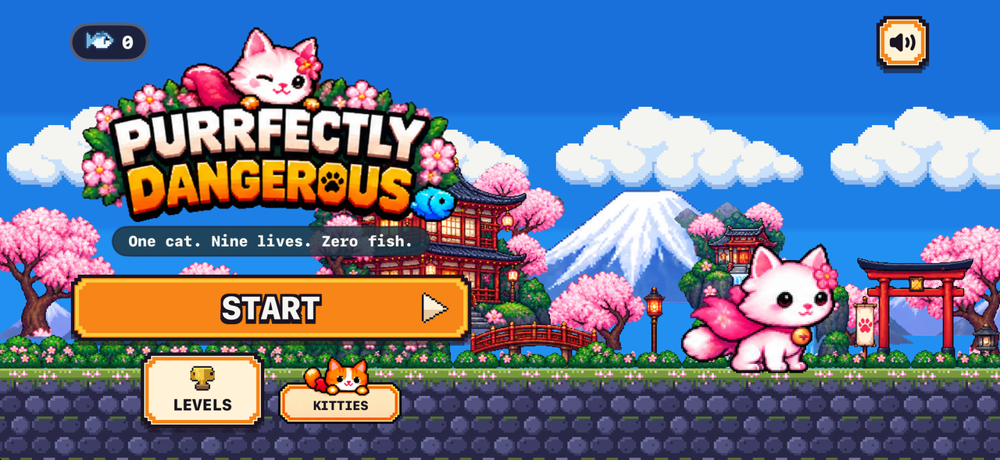
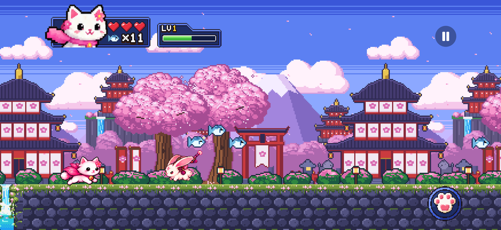
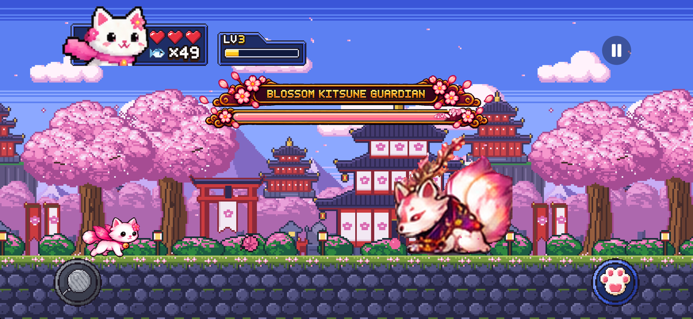
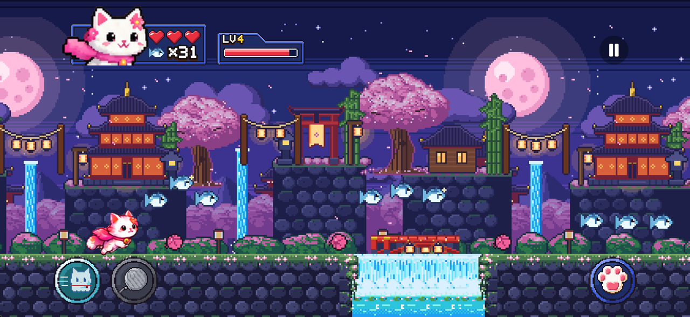
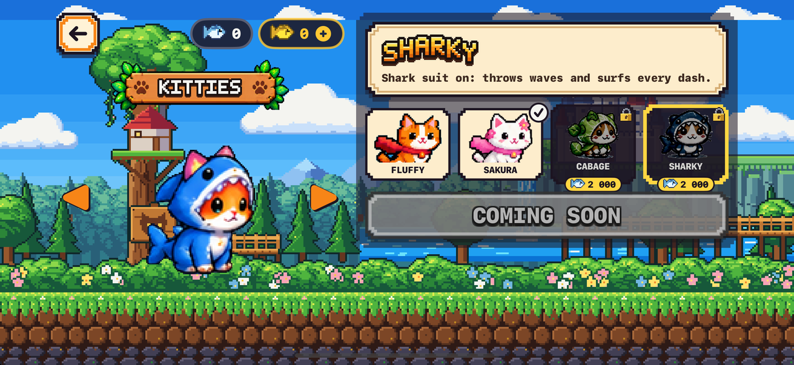
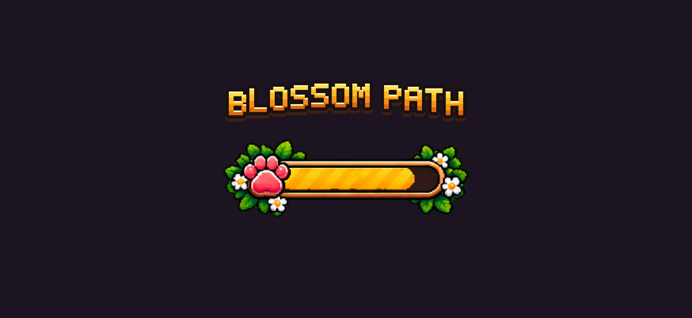
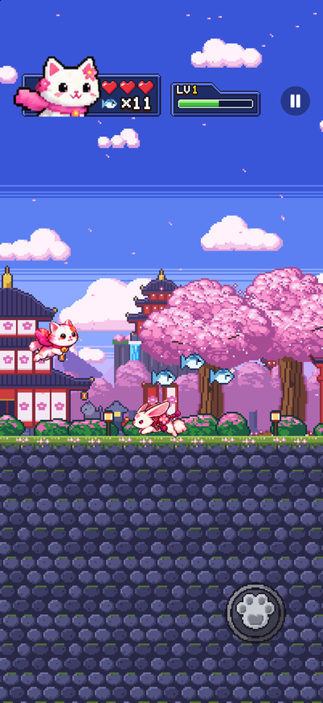

# Purrfectly Dangerous

*One cat. Nine lives. Zero fish.* A 2D pixel-art auto-runner for iPhone: a kitten crosses four
worlds — forest, frozen mountains, a haunted museum and a fiery citadel — dodging traps, unlocking
cat abilities and beating a three-phase boss at the end of each.

Swift + SpriteKit, no third-party runtime dependencies. All pixel art and sound effects are
generated by scripts in `Tools/`.

## Screenshots



| | |
| --- | --- |
|  |  |
|  |  |
|  |  |

Taken in the iPhone simulator with `CLEAN=1 Tools/run-sim.sh …` (no debug readout).

## Run it

```
brew install xcodegen
python3 -m venv Tools/.venv && Tools/.venv/bin/pip install -r Tools/requirements.txt
cp .env.example .env                                        # then set DEVELOPMENT_TEAM in it
Tools/xcodegen.sh && open PurrfectlyDangerous.xcodeproj     # then Run on an iPhone simulator
```

or from the command line: `Tools/run-sim.sh` (menu) / `Tools/run-sim.sh 1 7 28 39` (a bot plays
level 1 and screenshots are saved to `.build/screens/`).

Plays in landscape or portrait. Controls: the jump button (bottom right; hold for higher, again in
the air to Double Pounce), the yarn button (bottom left, once Yarn Shot is won) and, above it, the
paw button once Ghost Dash is won: tap to dash, hold until the ring fills and release to Super
Pounce. The HUD shows hearts, the fish counter and the kitten's level.

## Check it

`Tools/check.sh` runs the rule tests, proves every level can be finished without taking a hit,
tests the generated art and builds the app.

## Names

Every name shown in the game lives in `App/Resources/Lore.json`, keyed by neutral ids; code and
asset names never contain display names. Interface labels (START, RETRY, …) are looked up as
`ui.<key>` there too (`AppModel.ui`), with an English fallback for keys the file does not have yet.
Sound effects and the cosy menu theme are synthesised by `python3 Tools/sfx/build.py`. `Tools/release-check.sh` is the gate before any upload.

## Release

Every merge to `main` runs the checks, raises the build number and uploads the build to TestFlight
(`.github/workflows/release.yml`). Setup and the manual steps: [`docs/release.md`](docs/release.md).

More: [`docs/game-design.md`](docs/game-design.md), [`docs/level-format.md`](docs/level-format.md),
[`docs/sprite-spec.md`](docs/sprite-spec.md), [`docs/release.md`](docs/release.md), [`CLAUDE.md`](CLAUDE.md).
