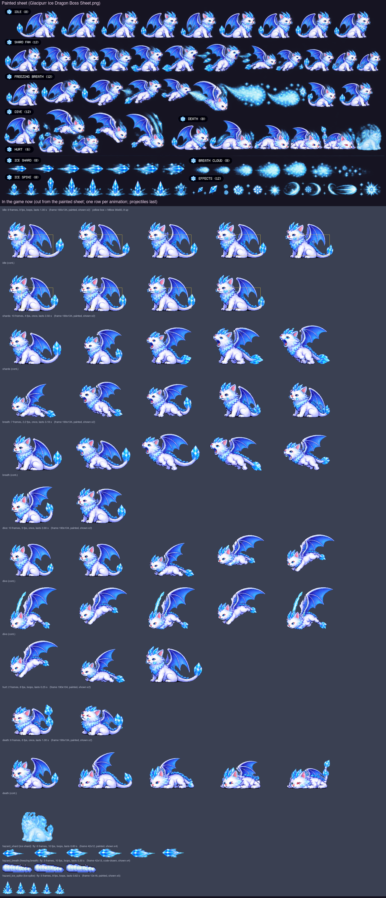

# Painting a boss sheet: Glacipurr (Fluffy's route, level 2)

What a painted sheet for `boss_icedragon` must contain so the build can cut it into the game's animations
(`Tools/sprites/sheet_boss.py`, with a new `characters/boss_icedragon_painted.py` table), the same way as the
Sakura bosses (`docs/boss-kitsune-sheet-brief.md`, `docs/boss-toad-sheet-brief.md`) and the heroes
(`docs/hero-sheet-brief.md`). Glacipurr is drawn in code today; the frame counts and speeds below replace
today's, so the cutter's table, `Sprites.json` and the counts in `Tools/sprites/tests/test_sprites.py` change
with the sheet.

The boss: a fluffy white ice dragon with a cat's face, pale blue-lilac shading, crystalline ice horns and
whiskers, big pale blue bat wings with darker membranes, a frosty mane down the neck, ice spikes along the
back and a long tail ending in crystals. Sits on its haunches like a cat.

The picture shows, on top, the painted sheet (`docs/concept/Glacipurr Ice Dragon Boss Sheet.png`). Below are the
frames the game now plays, cut from it (see "Done" at the end), one row per animation with its count and speed,
then the projectiles; the yellow box on the idle row is the hitbox. (Before the sheet, the picture showed the World 2
panel of `docs/concept/Pixel Boss Atlas_ Feline Realms.png` and the code-drawn frames.)

## Abilities (what the game does)

From `App/Resources/Bosses.json`, `Packages/GameCore/Sources/GameCore/World.swift` and `App/Scenes/GameScene.swift`.

- **Where it stands:** a fixed distance ahead of the running kitten (210 units wide screen, 140 upright); it
  never moves toward the kitten. It slides in over 1.5 s (IDLE), then attacks.
- **Toughness:** 24 HP. Hitbox 90 wide × 60 tall, its bottom **8 above the ground** (the body and neck; wings,
  head crest and tail stick out).
- **How it is hurt:** only by **Yarn Shot**, 1 HP a ball, and **only in the pause after each attack**
  (1.5–1.6 s). During a wind-up or an attack, yarn is shrugged off (a grey flash and a block sound). Stomps,
  Ghost Dash and Super Pounce never touch it. A hit flashes it white and plays HURT. **So the pause must
  read as an opening:** the end of every attack row shows it winded (see the table).
- **Phases** (checked when each attack starts; attacks cycle in order):
  1. 24–16 HP: `shard_fan` only.
  2. 15–8 HP: `freezing_breath`, `shard_fan`.
  3. 7–1 HP: `dive`, `freezing_breath`, `dive`, `shard_fan`.
- **Attacks** (hazards start at the boss's front edge and fly left toward the kitten; low = on the ground,
  jump it; high = its bottom 42 up, over a standing kitten (24 tall), stay down):

| Attack | Wind-up (warning) | Then | Pause after (it can be hit) | Hazards |
|---|---|---|---|---|
| `shard_fan` (Ice Shards) | 0.8 s | 1.0 s | 1.5 s | Three ice `shard`s 0.5 s apart: **high** 40×10 (42 up) at 0.8 s, **low** 30×10 at 1.3 s, **high** 40×10 at 1.8 s; closing at 200 |
| `freezing_breath` (Freeze Breath) | 0.9 s | 1.0 s | 1.5 s | Two **low** `breath` clouds 40×12, at 0.9 and 1.9 s; closing at 170 |
| `dive` (Dive) | 1.0 s | 1.2 s | 1.6 s | Three `ice_spike`s 12×18 with their bottom **26 up** (just over a standing kitten), at 1.0, 1.4 and 1.8 s; closing at 230 |

  Times are from the start of the wind-up. **What the player does:** dodge (stay down for high shards and
  spikes, jump the low shard and the breath), then throw yarn in the pause after each attack. The design
  (`docs/game-design.md`) says the dive also ices the floor; the code doesn't do that today, so don't paint
  ice spreading on the ground as part of the attack.

## What to deliver

- **Two sheets**, because there are about 95 frames:
  - `Glacipurr Boss Sheet A.png`: the boss's own animations (IDLE, the attacks, HURT, DEATH).
  - `Glacipurr Boss Sheet B.png`: the projectile rows and the loose-effects row.
- **PNG, about 4096 wide (larger is fine)**, with a **real transparent background**. Long rows wrap onto a
  second line directly below; label it "SHARDS (cont.)" and keep the order.
- **Boss size:** about **3× its game size: about 400 px wide sitting** (wings folded, tail included), the same
  in every frame of every row.

## Few, steady frames — but full wind-ups

Drifting frames flicker in the game: a wing whole in one frame and clipped in the next, horns that change, an
eye that winks. A boss still needs many frames, because its wind-up is the warning the player reads and each
shot must leave on the right frame. So:

- **The same dragon in every frame:** the same size, face, horns, wings and tail. Only the pose changes. The
  whole tail and both wings in every frame, never cut off by the frame edge.
- **No eye blinking.** Both eyes fully open in every frame of every row: no blinks, no winks, no half-closed
  eyes, not even in IDLE. A glare in a wind-up is fine; the eyes stay open. The winded pose keeps its eyes
  open too (tired, not sleeping). The only exceptions: "> <" in HURT, "x x" in DEATH.
- **Paint in-betweens in the wind-ups:** frost glowing brighter in the throat, the head drawing back further,
  a tremble at the peak. Never paint the same frame twice to fill time.
- **Calm between shots:** small, steady steps rather than new poses.
- **The strike or release is one clear frame** at the number given in the table, the biggest change of the row.
- **Follow-through:** wings, mane and tail lag a beat behind the body. Ease out into the winded pose.
- **Looping rows close the loop;** the dragon never grows or shrinks.

## Sheet rules

- **Export as a PNG with a real transparent background.** A checkerboard painted into the picture is not
  transparency: the cutter can't tell white fur from light squares. To check, open the PNG over a dark
  background: the squares must disappear. If the tool can't export transparency, use one flat colour that
  never appears on the dragon (pure green `#00FF00` or dark navy), never a checkerboard or gradient.
- **Fully opaque with a dark outline all round** (a dark navy line reads well on the white fur). Frost glow
  may be soft but must not touch or join two frames.
- **One row per animation**, frames left to right in playing order, the label above the row, never touching a
  frame. **The number of frames in a row must equal the count in the table.**
- Paint the dragon facing **right**; the build mirrors it so it faces the kitten.
- **Figures never touch:** at least **~30 px of empty space** between frames, measured from the wing tips and
  the tail. An attack effect (a frost cone at the mouth) stays inside its own frame.
- **Same scale in every frame of every row**, all feet on one baseline (only DIVE leaves it; paint a soft
  ground shadow under the airborne frames — the cutter removes it). The game frame is 190×134 with the ground
  3 px above the bottom; the body the kitten must hit is about 90 wide × 60 tall, starting 8 above the ground
  (haunch, chest and neck). Wings, head and tail stick out; keep the widest pose within the 190 frame width
  (about 2× the body) and leave room above the head for the DIVE rise.
- **Loose effects** (snowflakes, frost sparkles, ice chips that are not part of a strike) go in their own row
  at the bottom of sheet B.
- **Don't paint the projectiles flying away** — the shards, the breath cloud and the ice spikes are separate
  sprites. Paint only what stays on the dragon: crystals forming at the jaws, the short frost cone at the
  mouth, the burst at the wings.

## How the game plays an attack

The game plays the attack row **once**, from its first frame at the **start of the wind-up**, at 10 frames a
second, and holds the last frame until the row ends, then shows IDLE. So frame N shows at (N − 1) ÷ 10
seconds, and a hazard released at T seconds after the wind-up starts must leave on frame 10 × T + 1. Each row
here runs about 0.4–0.5 s past the end of the attack: those last frames play at the start of the pause, when
the dragon can be hit, so they show it **winded** — head low, wings drooping, panting frosty puffs.

## Animations

The table as the brief asked for it (the counts a new sheet should have). What the game plays now, cut from the
painted sheet, is in "Done" below.

| # | Row | Frames | Speed | Loops | Lasts | When the game plays it | What the frames show |
|---|---|---|---|---|---|---|---|
| 1 | IDLE | 6 | 6 fps | yes | 1 s | Sliding into the arena, and resting after an attack | Sitting tall like a cat, wings half folded: breathing in over 1–3 and out over 4–6, the tail tip curling and uncurling, frost drifting off the mane. Eyes open throughout |
| 2 | SHARDS | 24 | 10 fps | no | 2.4 s | `shard_fan` (phase 1 on) | 1–4 rearing back, wings opening; 5–8 a fan of ice crystals forming round the open jaws, growing each frame, a tremble at 8 (warning peak); **9 high shard** (0.8 s): head snapped forward and up, jaws wide; 10–13 head dipping, new crystals forming; **14 low shard** (1.3 s): head snapped down toward the ground; 15–18 head rising; **19 high shard** (1.8 s); 20–24 **winded**: head sagging low, wings drooping, frosty pants |
| 3 | BREATH | 25 | 10 fps | no | 2.5 s | `freezing_breath` (phase 2 on) | 1–5 chest swelling, frost glowing brighter in the throat; 6–9 head drawn back high (warning peak, a tremble at 9); **10 breath** (0.9 s): head down, jaws wide, a short frost cone at the mouth; 11–14 the cone fading, head lifting, chest swelling again; 15–19 second build; **20 breath** (1.9 s); 21–25 **winded** |
| 4 | DIVE | 27 | 10 fps | no | 2.7 s | `dive` (phase 3) | 1–6 crouching, wings spreading wide; 7–10 leaping up to the top of the frame, wings beating; **11 wing sweep** (1.0 s): at the peak, wings swept down, a burst of ice at the wing edge (first spike); 12–14 hovering, wings up; **15 sweep** (1.4 s); 16–18 hovering; **19 sweep** (1.8 s); 20–22 dropping back down; 23 landing heavily (2.2 s); 24–27 **winded** |
| 5 | HURT | 3 | 12 fps | yes | 0.25 s | Just after a hit (only possible in the pause) | 1 flinch, eyes squeezed "> <", wings jerked up; 2 recoil peak; 3 easing back. Keep the outline (the game flashes it white) |
| 6 | DEATH | 10 | 10 fps | no (last frame stays) | 1 s | Defeated | 1–2 big flinch, "x x" eyes; 3–4 swaying, wings sagging; 5–6 freezing over, ice creeping up the body; 7–8 frozen solid in a crystal; 9 the crystal cracking; 10 a heap of ice crystals and snow where it sat |

Optional (the game doesn't use it today): TIRED 6 frames, 6 fps, loops — the winded pose breathing, for the
whole pause (it would need a GameScene change to play in the pause instead of IDLE).

**Total: 95 boss frames** (101 with TIRED), plus 12 projectile frames.

## Projectile rows (separate sprites, sheet B)

| Row | Frames | Size in game | Loops | What it is |
|---|---|---|---|---|
| ICE SHARD | 4 | 42×12 (hits 40×10; the low one hits 30×10) | yes (10 fps) | A long, thin ice crystal flying point first, glinting, with a short frost trail on the right. One sprite serves both the high and the low shard |
| BREATH | 4 | 42×13 (hits 40×12, low) | yes (10 fps) | A rolling cloud of freezing breath along the ground, its leading edge on the left, ice glitter inside |
| ICE SPIKE | 4 | 12×18 (hits 12×18, 26 up) | yes (8 fps) | A sharp icicle flying point first to the left (it travels sideways at head height), a little frost behind |
| EFFECTS | any | — | — | Snowflakes, frost puffs and ice chips, if painted |

Projectiles fly toward the left (toward the kitten): paint them pointing **left**, the trail on the right.

## Before sending, check

- [ ] The background is transparent: the squares disappear on a dark background.
- [ ] Two sheets; the dragon about 400 px wide sitting, the same size in every frame of every row.
- [ ] **Every row has exactly the frame count in the table** — count them.
- [ ] No eye blinking: both eyes open and the same in every frame, except "> <" in HURT and "x x" in DEATH.
- [ ] Both wings and the whole tail in every frame; figures ~30 px apart, never touching.
- [ ] Each wind-up keeps moving, and the release frames are at the numbers in the table (SHARDS 9, 14, 19;
      BREATH 10, 20; DIVE 11, 15, 19); every attack row ends winded.
- [ ] IDLE closes the loop; DEATH ends on its final frame.
- [ ] Projectiles point left, each in its own row.

## For the developer cutting the sheet

Cut with `sheet_boss.py` into a new `characters/boss_icedragon_painted.py`, `faces_left=True`, keeping the
game frame 190×134 and the ground row, with the body filling the 90×60 hitbox 8 above the ground; add the
boss and its three hazards to the painted `NAMES`. The names are the ones GameScene already plays
(`shard_fan` → `shards`, `freezing_breath` → `breath`, `dive` → `dive`), so no Swift change is needed. Update
`SPEC` in `Tools/sprites/tests/test_sprites.py` and `docs/sprite-spec.md`. Today's `hazard_shard` is 62×12,
much longer than its 40×10 / 30×10 hitboxes: cut the painted shard at 42×12. Because the attack rows run past
the attack into the pause, the winded frames show while the dragon can be hit; a TIRED loop for the whole pause
would need `renderBoss` to play it during `.recover` for this boss.

## Done (2026-10-25)

The user's sheet `docs/concept/Glacipurr Ice Dragon Boss Sheet.png` (copied to
`Tools/sprites/boss_icedragon_source.png`) is cut by `Tools/sprites/characters/boss_icedragon_painted.py` with
`sheet_boss.py`; the code-drawn `boss_icedragon`, `hazard_shard` and `hazard_ice_spike` are no longer built. It is
one sheet (not two), 1774×887 with real transparency, the dragon about 170 px long sitting (not 400), and most rows
have fewer frames than the brief asks for, and than their own labels say:

| Painted row (label) | Painted | Notes |
|---|---|---|
| IDLE (8) | 9 | sitting, wings half raised; eyes open throughout |
| SHARD FAN (12) | 12 | 0-4 rearing, 5-6 roaring with shards painted at the jaws (they drop), 7 lunging low, 8 a small roar, 9 roaring up, 10-11 sitting (painted smaller) |
| FREEZING BREATH (12) | 10 | 0 sit, 1-4 open-jawed breaths (two of them hopping), 5 a swoop wrapped in a cloud, 6-7 only the cloud, 8-9 sitting |
| DIVE (12) | 4 | sit, leap, diving, diving with ice streaks off the wing |
| HURT (6) | 2 | "> <" eyes |
| DEATH (8) | 6 | sit, sinking, lying, lying with "x" eyes, then a dragon-shaped block of ice |
| ICE SHARD (8) | 7 | a crystal pointing right with a frost trail |
| ICE SPIKE (8) | 9 | a crystal pointing up out of a burst of frost |
| BREATH CLOUD (8) | 7 | a round puff, growing then scattering |
| EFFECTS (12) | 12 | loose snowflakes and swooshes (not used) |

What the game plays now (played frame N, 0-based, shows at N / fps; GameScene plays an attack once from the start
of its wind-up and holds the last frame):

| Animation | Frames | Speed | Loops | Lasts | From the sheet | Release frames |
|---|---|---|---|---|---|---|
| idle | 9 | 9 fps | yes | 1 s | IDLE 0-8 | — |
| shards | 10 | 4 fps | no | 2.5 s | SHARD FAN 0, 2, 4-11 (1 and 3, near repeats, left out) | 5 (first roar) at 0.75 s, 7 (low lunge) at 1.25 s, 9 (roar up) at 1.75 s, for the shards at 0.8 / 1.3 / 1.8 s; the two sitting frames show from 2.0 s, in the pause |
| breath | 7 | 2.2 fps | no | 3.2 s | FREEZING BREATH 0-4, 8, 9 (the swoop and the two cloud-only frames left out; the soft frost cones fall below the cut) | 2 at 0.91 s and 4 at 1.82 s, for the clouds at 0.9 / 1.9 s; sitting from 2.27 s |
| dive | 13 | 5 fps | no | 2.6 s | DIVE 0, 0, SHARD FAN 7 (crouch), DIVE 1, 2, 3, 2, 3, 2, 3, 2, SHARD FAN 7 (landing), IDLE 0 | the wing sweep, DIVE 3, at 1.0, 1.4 and 1.8 s, for the three spikes; lands at 2.2 s as the attack ends |
| hurt | 2 | 8 fps | yes | 0.25 s | HURT 0-1 | — |
| death | 6 | 6 fps | no | 1 s | DEATH 0-5 | ends frozen in a block of ice |

The frame stays 190×134 points (570×402 PNGs at 3x), ground row 130, x 90, `faces_left`; the same anchor, so GameCore
and GameScene are unchanged. 0.84 points per sheet pixel, with the rows and frames the painter drew smaller scaled up
to IDLE's size: about 106 points tall and 150 long sitting. Each grounded frame is lined up with IDLE 0 by its
chest-and-haunch band, the chest at the front of the 90×60 hitbox (where the yarn arrives) and wing and haunch over the
rest. The in-air DIVE frames sit 30 and 14 points up. Projectiles: `hazard_shard` is now 42×12 (was 62×12) from ICE
SHARD 1-6, mirrored to fly left, about 32 points long for the 40×10 / 30×10 hitboxes; `hazard_ice_spike` stays 12×18
from ICE SPIKE 3-7. `hazard_breath` stays code-drawn: the painted cloud is a round puff about as tall as it is long,
which would stand about three times taller than its low 40×12 hitbox.

Still short of the brief: the attack rows have no painted winded frames (they end sitting calmly), the breath row has
no second build-up (the second cloud leaves on the last open-jawed frame, and the low fps makes it read as a slide
show), and the dive repeats its two in-air frames to fill the three sweeps. A painted TIRED loop would still need a
GameScene change.
