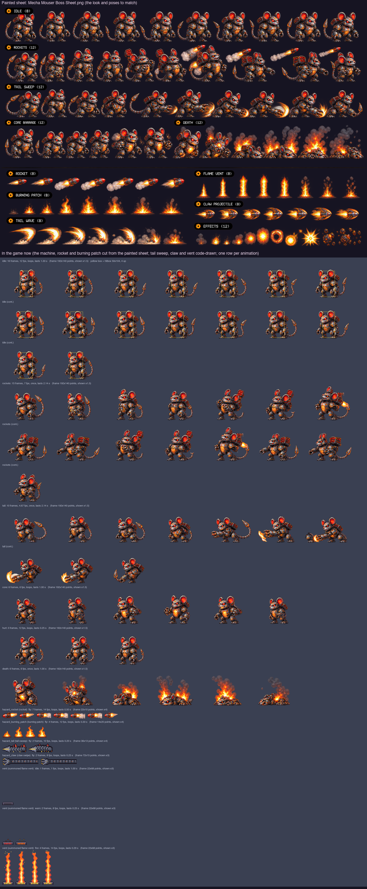

# Painting a boss sheet: The Mecha-Mouser (Fluffy's route, level 4)

What a painted sheet for `boss_mecha` must contain so the build can cut it into the game's animations
(`Tools/sprites/sheet_boss.py`, with a new `characters/boss_mecha_painted.py` table), the same way as the
Sakura bosses (`docs/boss-kitsune-sheet-brief.md`, `docs/boss-toad-sheet-brief.md`) and the heroes
(`docs/hero-sheet-brief.md`). The Mecha-Mouser is drawn in code today; the frame counts and speeds below
replace today's, so the cutter's table, `Sprites.json` and the counts in `Tools/sprites/tests/test_sprites.py`
change with the sheet.

The boss: a giant robot mouse standing upright, dark gunmetal armour plates with rivets and glowing orange
seams, big round ears with red-lit insides, red glowing eyes, a jaw of steel teeth, a shoulder rocket pod,
heavy clawed arms, piston legs, a long segmented metal tail ending in a blade, and a **furnace core** in its
chest behind armour plates that open in the last phase.

## Done: cut from `Mecha Mouser Boss Sheet.png`

The user painted one sheet (`docs/concept/Mecha Mouser Boss Sheet.png`, 1536×1024, real transparency, the machine about
131 px tall), copied to `Tools/sprites/boss_mecha_source.png` and cut by `Tools/sprites/characters/boss_mecha_painted.py`
with `sheet_boss.py`. It has fewer frames than asked for and no HURT or separate CORE row. Rows found vs labels: IDLE 10
painted (labelled 8), ROCKETS 10 (12) with one launch, TAIL SWEEP 10 (12), CORE BARRAGE 6 (12), DEATH 6 (12); ROCKET 7 (8),
BURNING PATCH 8 (8), TAIL WAVE 7 (8), FLAME VENT 8 (8), CLAW PROJECTILE 7 (8), EFFECTS 11 (12).

- **Size:** frame 192×140 points (was 168×124) with the ground on row 136 and the chest on x 96, so the raised pod and the
  fiery arcs are not cut at the frame's edge. The anchor is the same point, so the boss stands where it did; about 114
  points tall (0.87 points per sheet pixel, 3x textures). The 50×104 hitbox, 4 up, is covered by the body up to the
  head, the ears reach its top. GameCore and Swift are unchanged.
- **Rows → animations:** IDLE 1-9 and back → `idle`; ROCKETS → `rockets` (its aim and launch, 4-6, played twice);
  TAIL SWEEP → `tail`; CORE BARRAGE 2-5 and back → `core` (the rest pose from 12 HP, and what `core_barrage` plays);
  IDLE 1 knocked back → `hurt`; DEATH → `death`. The flying rocket, smoke trails and steam puffs painted on the machine
  are wiped; the launch flash and the fiery arcs at the claw stay.
- **Release timing** (played frame N shows at N / fps): rockets launch at 0.86 s and 1.57 s (needed 0.9 and 1.6); the
  tail sweep's first flame at 0.86 s (vent at 0.9), its biggest arc at 1.50 s (wave at 1.5). The barrage has no slot of its
  own, so nothing lines up with its hits (see below).
- **Projectiles:** `hazard_rocket` (ROCKET, mirrored and levelled, 7 frames) and `hazard_burning_patch` (BURNING PATCH
  2, 3, 4, 3) are cut at their old sizes. `hazard_tail`, `hazard_claw` and the citadel's `vent` stay code-drawn: TAIL WAVE
  is a tall arc and CLAW PROJECTILE a stubby arrowhead, and neither covers its low, long hitbox (30×12, 50×12) inside its
  frame; FLAME VENT has no off state for the level trap. EFFECTS are not used.
- **Still open:** a painted HURT row ("> <" eyes); a BARRAGE row with its four strikes (it would also need one line in
  `GameScene.attackAnimation`, `core_barrage` → `barrage`, not made); a second launch in ROCKETS; venting ends for ROCKETS
  and TAIL; a CORE row with the chest open in every frame (CORE BARRAGE shows it open only in 4 and 5, and its tail is
  hidden from 2 on, so the tail vanishes when the rest pose switches to `core` at 12 HP).

What the game now plays:

| Animation | Played frames (painted row) | Speed | Loops | Lasts |
|---|---|---|---|---|
| idle | 16 (IDLE 1-9, 8-2) | 12 fps | yes | 1.33 s |
| rockets | 15 (ROCKETS 0-8, 4, 5, 6, 7, 8, 9) | 7 fps | no | 2.14 s |
| tail | 10 (TAIL SWEEP 0-9) | 4.67 fps | no | 2.14 s |
| core | 6 (CORE BARRAGE 2, 3, 4, 5, 4, 3) | 6 fps | yes | 1 s |
| hurt | 3 (IDLE 1, 3, 5 and 2 points back) | 12 fps | yes | 0.25 s |
| death | 6 (DEATH 0-5) | 6 fps | no | 1 s |

The picture below now shows the painted sheet on top and the frames the game draws below. The rest of this brief is
the original request.

The picture shows, on top, the World 4 panel of `docs/concept/Pixel Boss Atlas_ Feline Realms.png` (the look
and the poses to match: rocket launch, tail sweep, flamethrower, hurt/defeat). Below are today's code-drawn
frames, one row per animation with its count and speed, then the projectiles and the flame vent it summons;
the yellow box on the idle row is the hitbox.

## Abilities (what the game does)

From `App/Resources/Bosses.json`, `Packages/GameCore/Sources/GameCore/World.swift`, `Boss.swift`, `Items.swift`
and `App/Scenes/GameScene.swift`.

- **Where it stands:** a fixed distance ahead of the running kitten (210 units wide screen, 140 upright); it
  never moves toward it. It slides in over 1.5 s (IDLE), then attacks.
- **Toughness:** 30 HP. Hitbox 50 wide × 104 tall, its bottom **4 above the ground** (the tall body column;
  the tail, ears and arms stick out).
- **How it is hurt:** only by **Yarn Shot**, 1 HP a ball. **Armoured above 40%:** while it has more than 12 HP,
  yarn only lands in the **pause after each attack** (1.6 s); during a wind-up or an attack it is shrugged off
  (grey flash, block sound). At **12 HP or less** the armour is off and it can be hit at any time. Stomps, Ghost
  Dash and Super Pounce never touch it. A hit flashes it white; HURT plays when the hit lands in the pause.
  From 12 HP on, its resting pose is **CORE** (chest open) instead of IDLE.
- **Phases** (checked when each attack starts; attacks cycle in order):
  1. 30–22 HP: `rockets` only.
  2. 21–13 HP: `tail_sweep`, `rockets`.
  3. 12–1 HP: `core_barrage` only, short pauses (0.9 s).
- **Attacks** (hazards start at its front edge and fly left toward the kitten, unless placed "ahead"; low = on
  the ground, jump it; high = its bottom 42 up, over a standing kitten (24 tall), stay down):

| Attack | Wind-up (warning) | Then | Pause after | Hazards and summons |
|---|---|---|---|---|
| `rockets` (Rocket Launch) | 0.9 s | 1.4 s | 1.6 s | Two **high** `rocket`s 20×8 (42 up), at 0.9 and 1.6 s, closing at 220; with each, a `burning_patch` 10×16 appears **on the ground 150 (then 170) ahead of the kitten**, blinking and harmless for 0.6 s, then burning where it stands until the kitten has passed it (jump it) |
| `tail_sweep` (Tail Sweep) | 0.9 s | 1.0 s | 1.6 s | At 0.9 s a **flame vent** springs up from the floor at its front (the citadel's vent trap: a flame column 12 wide × 60 tall, firing on a cycle of 0.8 s on, blinking 0.5 s before; pass while it is off, or Ghost Dash through); at 1.5 s a **low** `tail` sweep 30×12 rolls in at 190 |
| `core_barrage` (Core exposed) | 0.6 s | 1.5 s | 0.9 s | Alternating, 0.5 s apart: **low** `tail` 30×12 at 0.6 s (200), **high** `claw` 50×12 (42 up) at 1.1 s (220), **low** `tail` at 1.6 s, **high** `claw` at 2.1 s |

  Times are from the start of the wind-up. **What the player does:** while it is armoured, dodge (stay down for
  rockets and claws, jump the patches and tail sweeps, pass the vent while it is off) and throw yarn in the
  pauses; once the core is open, throw yarn all the time while switching between jumping and staying down.

## What to deliver

- **Two sheets**, because there are about 100 frames:
  - `Mecha-Mouser Boss Sheet A.png`: its own animations (IDLE, the attacks, CORE, HURT, DEATH).
  - `Mecha-Mouser Boss Sheet B.png`: the projectile rows and the loose-effects row.
- **PNG, about 4096 wide (larger is fine)**, with a **real transparent background**. Long rows wrap onto a
  second line directly below; label it "ROCKETS (cont.)" and keep the order.
- **Boss size:** about **3× its game size: about 360 px tall** (ears included), the same in every frame of
  every row.

## Few, steady frames — but full wind-ups

Drifting frames flicker in the game: a tail segment that disappears, plates that change shape, an eye light
that goes out. A boss still needs many frames, because its wind-up is the warning the player reads and each
rocket and sweep must leave on the right frame. So:

- **The same machine in every frame:** the same size, plates, rivets, ears and tail. Only the pose changes. The
  whole tail in every frame, never cut off by the frame edge.
- **No eye blinking.** Both eye lights fully lit and the same shape in every frame of every row: no flicker, no
  dimming, no shutters, not even in IDLE. The eyes may glow brighter at a wind-up peak. The only exceptions:
  "> <" eye slits in HURT, dark "x x" eyes in DEATH.
- **Paint in-betweens in the wind-ups:** the pod rising, the seams glowing hotter, a shudder at the peak.
  Never paint the same frame twice to fill time.
- **Calm between shots:** small, steady steps rather than new poses.
- **The strike or release is one clear frame** at the number given in the table, the biggest change of the row.
- **Follow-through:** the tail and ears lag a beat behind the body; steam and sparks trail off.
- **Looping rows close the loop** (IDLE, CORE); it never grows or shrinks.

## Sheet rules

- **Export as a PNG with a real transparent background.** A checkerboard painted into the picture is not
  transparency. To check, open the PNG over a dark background: the squares must disappear. If the tool can't
  export transparency, use one flat colour that never appears on the machine (pure green `#00FF00`), never a
  checkerboard or gradient.
- **Fully opaque with a dark outline all round** (the dark armour needs a lighter rim or the orange seams to
  read on the dark citadel; keep the outline dark). Glow and steam may be soft but must not touch or join two
  frames.
- **One row per animation**, frames left to right in playing order, the label above the row, never touching a
  frame. **The number of frames in a row must equal the count in the table.**
- Paint it facing **right**; the build mirrors it so it faces the kitten.
- **Figures never touch:** at least **~30 px of empty space** between frames, measured from the tail blade, the
  ears and the claws. An attack effect (a launch flash, a fiery tail arc) stays inside its own frame.
- **Same scale in every frame of every row**, both feet on one baseline. The game frame is 168×124 with the
  ground 3 px above the bottom; the body the kitten must hit is about 50 wide × 104 tall, starting 4 above the
  ground (the body column from the feet to the eyes). The tail, ears and arms stick out; keep the widest pose
  within the 168 frame width (about 3× the body) and the ears within its height.
- **Loose effects** (steam puffs, sparks, smoke that are not part of a strike) go in their own row at the bottom
  of sheet B.
- **Don't paint the projectiles flying away** — the rockets, the burning patches, the tail sweep wave and the
  claw swipe are separate sprites, and so is the flame vent. Paint only what stays on the machine: the launch
  flash at the pod, the fiery arc of the tail as it whips, the claw slash at the paw.

## How the game plays an attack

The game plays the attack row **once**, from its first frame at the **start of the wind-up**, at 10 frames a
second, and holds the last frame until the row ends, then shows IDLE (or CORE from 12 HP). So frame N shows at
(N − 1) ÷ 10 seconds, and a hazard released at T seconds after the wind-up starts must leave on frame
10 × T + 1. ROCKETS and TAIL run about 0.4 s past the end of the attack into the pause, when the armoured
machine can be hit, so they end **venting**: shoulder hatches open, steam blowing out — the opening.

## Animations

| # | Row | Frames | Speed | Loops | Lasts | When the game plays it | What the frames show |
|---|---|---|---|---|---|---|---|
| 1 | IDLE | 6 | 6 fps | yes | 1 s | Sliding into the arena; resting after an attack while armoured (above 12 HP) | Standing, chest plates shut, the furnace glowing through the seams: a slow hiss of the pistons, the body rising over 1–3 and settling over 4–6, the tail swaying one swing and back. Eye lights steady |
| 2 | ROCKETS | 27 | 10 fps | no | 2.7 s | `rockets` (phase 1 and 2) | 1–4 the shoulder pod rising and its hatch opening; 5–8 aiming: the pod tilting, the eye lights glowing hotter, sparks at the hatch; 9 a shudder (warning peak); **10 launch** (0.9 s): a flame flash from the pod, the body recoiling; 11–16 the pod re-aiming; **17 launch** (1.6 s); 18–23 the pod folding back down; 24–27 **venting** steam from the shoulder hatches |
| 3 | TAIL | 24 | 10 fps | no | 2.4 s | `tail_sweep` (phase 2) | 1–5 the tail curling up high behind, segments clanking; 6–9 the tail glowing hot red; **10 stamp** (0.9 s): one foot stamped down, sparks at the foot (the flame vent springs up ahead); 11–15 the tail cocked overhead, the body twisting; **16 sweep** (1.5 s): the tail whipped forward low along the ground through a fiery arc (the sweep wave leaves); 17–20 follow-through, the tail coiling back; 21–24 **venting** steam |
| 4 | CORE | 6 | 6 fps | yes | 1 s | Resting from 12 HP on (the armour is broken) | The chest plates swung wide open, the furnace core blazing and pulsing over the 6 frames, sparks, a dented and smoking body. This is the target: the open core must read at a glance |
| 5 | BARRAGE | 24 | 10 fps | no | 2.4 s | `core_barrage` (phase 3) | Chest open in every frame. 1–5 crouching, the core flaring, both arms and the tail coiling (a short warning); 6 peak; **7 low tail whip** (0.6 s) through a fiery arc; 8–11 rising, the clawed arm drawn back high; **12 high claw** (1.1 s): the arm thrust forward at head height, a fiery claw slash; 13–16 crouching again; **17 low tail whip** (1.6 s); 18–21 rising; **22 high claw** (2.1 s); 23–24 settling |
| 6 | HURT | 3 | 12 fps | yes | 0.25 s | Just after a hit in the pause after an attack | 1 jolt backwards, eye lights narrowed to "> <" slits, sparks off the plates; 2 recoil peak; 3 easing back. Keep the outline (the game flashes it white) |
| 7 | DEATH | 10 | 10 fps | no (last frame stays) | 1 s | Defeated | 1–2 sparks bursting from the seams, "x x" eye lights; 3–4 plates popping off; 5–6 small explosions at the core and joints; 7 a big burst; 8–9 collapsing into a heap; 10 a smoking scrap heap with the cooled core |

**Total: 100 boss frames**, plus 16 projectile frames.

## Projectile rows (separate sprites, sheet B)

| Row | Frames | Size in game | Loops | What it is |
|---|---|---|---|---|
| ROCKET | 4 | 22×10 (hits 20×8, 42 up) | yes (14 fps) | A red-and-steel rocket flying nose first to the left, its exhaust flame flickering on the right |
| BURNING PATCH | 4 | 14×20 (hits 10×16, on the ground) | yes (12 fps) | A small patch of fire burning on the ground where a rocket fell, flames licking up. It blinks in the game while harmless, so paint it solid |
| TAIL SWEEP | 4 | 36×13 (hits 30×12, low) | yes (10 fps) | A low fiery arc sliding along the ground from the tail's whip, its bright edge leading on the left |
| CLAW | 4 | 52×14 (hits 50×12, 42 up) | yes (8 fps) | A long fiery claw slash (three hot streaks) flying left at head height, the claw tips leading |
| EFFECTS | any | — | — | Steam puffs, sparks and smoke, if painted |

The flame vent is the citadel's existing `vent` trap sprite (shown in the reference for scale); it is not part of
this sheet. Projectiles fly toward the left (toward the kitten): paint them pointing **left**, the trail on the right.

## Before sending, check

- [ ] The background is transparent: the squares disappear on a dark background.
- [ ] Two sheets; the machine about 360 px tall, the same size in every frame of every row.
- [ ] **Every row has exactly the frame count in the table** — count them.
- [ ] No eye flicker: both eye lights the same in every frame, except "> <" in HURT and "x x" in DEATH.
- [ ] The whole tail in every frame; figures ~30 px apart, never touching.
- [ ] Each wind-up keeps moving, and the release frames are at the numbers in the table (ROCKETS 10, 17;
      TAIL 10, 16; BARRAGE 7, 12, 17, 22); ROCKETS and TAIL end venting.
- [ ] The chest is shut in IDLE, ROCKETS and TAIL and open in CORE and BARRAGE.
- [ ] IDLE and CORE close the loop; DEATH ends on its final frame.
- [ ] Projectiles point left, each in its own row.

## For the developer cutting the sheet

Cut with `sheet_boss.py` into a new `characters/boss_mecha_painted.py`, `faces_left=True`, keeping the game
frame 168×124 and the ground row, with the body filling the 50×104 hitbox 4 above the ground; add the boss and
its four hazards to the painted `NAMES`. `rockets` → `rockets` and `tail_sweep` → `tail` already play. **BARRAGE
is new:** today `core_barrage` plays `core`, and because CORE is also the resting pose from 12 HP it is already
playing when the barrage starts, so it doesn't restart and nothing lines up with the hits. Map `core_barrage` →
`barrage` in `GameScene.attackAnimation` (one entry); CORE stays the rest pose (`renderBoss` picks it when the
HP fraction is at or below `armoredAbove`). Update `SPEC` in `Tools/sprites/tests/test_sprites.py` and
`docs/sprite-spec.md`. Today's `hazard_claw` is 72×15 for a 50×12 hitbox: cut the painted one at 52×14.
