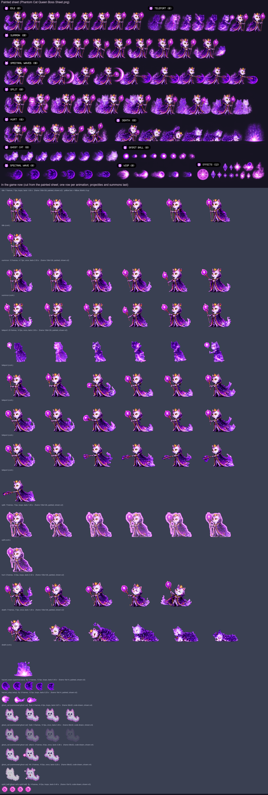

# Painting a boss sheet: The Phantom Cat Queen (Fluffy's route, level 3)

What a painted sheet for `boss_phantom` must contain so the build can cut it into the game's animations
(`Tools/sprites/sheet_boss.py`, with a new `characters/boss_phantom_painted.py` table), the same way as the
Sakura bosses (`docs/boss-kitsune-sheet-brief.md`, `docs/boss-toad-sheet-brief.md`) and the heroes
(`docs/hero-sheet-brief.md`). The Queen is drawn in code today; the frame counts and speeds below replace
today's, so the cutter's table, `Sprites.json` and the counts in `Tools/sprites/tests/test_sprites.py` change
with the sheet.

The boss: a slender, translucent-looking royal ghost cat standing upright, pale lilac-white fur, golden eyes,
a small gold crown floating just above her head, a high-collared purple cloak and a long flowing gown that
melts into purple smoke at the hem, holding a tall staff topped with a glowing magenta orb. Elegant and eerie.
She looks see-through but is **painted fully opaque** (the game can fade her).

The picture shows, on top, the user's painted sheet `docs/concept/Phantom Cat Queen Boss Sheet.png`; below, the
frames the game now plays, cut from it (see "Done" at the end), one row per animation with its count and speed,
then the projectiles and her summoned ghost cat (still code-drawn); the yellow box on the idle row is the hitbox.
(Before the sheet, the picture showed the World 3 panel of `docs/concept/Pixel Boss Atlas_ Feline Realms.png` and
the code-drawn frames.)

## Abilities (what the game does)

From `App/Resources/Bosses.json`, `Packages/GameCore/Sources/GameCore/World.swift`, `Items.swift` and
`App/Scenes/GameScene.swift`.

- **Where she stands:** floating a fixed distance ahead of the running kitten (210 units wide screen, 140
  upright); she never moves toward it. She slides in over 1.5 s (IDLE), then attacks.
- **Toughness:** 26 HP. Hitbox 30 wide × 64 tall, its bottom **6 above the ground** (a slim column: body and
  head; staff, crown, cloak and smoke stick out).
- **How she is hurt:** only by **Yarn Shot**, 1 HP a ball. She is **always vulnerable**. Stomps, Ghost Dash and
  Super Pounce never touch her. A hit flashes her white; HURT plays only when the hit lands in the pause
  after an attack. Her ghost cats don't stop yarn (it passes through them).
- **Phases** (checked when each attack starts; attacks cycle in order):
  1. 26–18 HP: `summon_ghosts` only.
  2. 17–9 HP: `spectral_waves`, `summon_ghosts`.
  3. 8–1 HP: `split`, `spectral_waves`, `split`, `summon_ghosts`, **with two look-alike copies** for the whole
     phase: three Queens stand in a line, 38 apart, toward the kitten. Only one is real: it plays **SPLIT**
     (glowing) at full strength; the copies are drawn at 70% and act out the attacks (they stand in IDLE
     during `split`). Yarn passes through the copies. Which copy is real changes with every attack, in a
     fixed order. New copies appear playing TELEPORT.
- **Attacks** (hazards start at her front edge and fly left toward the kitten; low = on the ground, jump it;
  high = its bottom 42 up, over a standing kitten (24 tall), stay down):

| Attack | Wind-up (warning) | Then | Pause after | Hazards and summons |
|---|---|---|---|---|
| `summon_ghosts` (Ghost Cats) | 0.9 s | 1.0 s | 1.0 s | Two **ghost cats** appear at her front, 42 up, at 0.9 and 1.9 s. Each drifts in, dives down to the ground as it nears, blinks in and out (visible 1.2 s of every 2 s, only hurts while visible, can't be hurt by yarn) and while visible throws a `spirit_ball` 8×8 at head height (26 up) every 2.4 s. It is the haunted level's Ghost Cat (`docs/enemy-sheet-brief-fluffy.md`) |
| `spectral_waves` (Shadow Waves; she teleports) | 0.8 s | 1.2 s | 1.0 s | Three **low** spectral `wave`s 12×12, 0.6 s apart, at 0.8, 1.4 and 2.0 s; closing at 160 |
| `split` (phase 3 only) | 0.9 s | 1.0 s | 1.0 s | A **high** `wisp` 12×12 (42 up) at 0.9 s, then a **low** `wave` 12×12 at 1.5 s; closing at 170 |

  Times are from the start of the wind-up. **What the player does:** keep throwing yarn at her; time the ghost
  cats (or Ghost Dash through them) and stay down for their spirit balls; hop the waves, stay down for the
  wisp; in phase 3, aim at the glowing Queen. (`docs/game-design.md` says her summons soak yarn; in the code
  the ghost cats let yarn through.)

## What to deliver

- **Two sheets**, because there are about 70 frames:
  - `Phantom Cat Queen Boss Sheet A.png`: her own animations (IDLE, SUMMON, TELEPORT, SPLIT, HURT, DEATH).
  - `Phantom Cat Queen Boss Sheet B.png`: the projectile rows and the loose-effects row.
- **PNG, about 4096 wide (larger is fine)**, with a **real transparent background**. Long rows wrap onto a
  second line directly below; label it "SUMMON (cont.)" and keep the order.
- **Boss size:** about **3× her game size: about 360 px tall** (crown and smoke included), the same in every
  frame of every row.

## Few, steady frames — but full wind-ups

Drifting frames flicker in the game: a crown that changes shape, a staff that comes and goes, an eye that
winks. A boss still needs many frames, because its wind-up is the warning the player reads and each wave must
leave on the right frame. So:

- **The same Queen in every frame:** the same size, face, crown, cloak, gown and staff. Only the pose changes.
  The staff and crown in every frame (except where she dissolves in TELEPORT and DEATH).
- **No eye blinking.** Both eyes fully open in every frame of every row: no blinks, no winks, no half-closed
  eyes, not even in IDLE (today's idle has a closed-eye frame: drop it). A glare in a wind-up is fine. The
  only exceptions: "> <" in HURT, "x x" in DEATH.
- **Paint in-betweens in the wind-ups:** the orb glowing brighter, the cloak flaring wider, a tremble at the peak.
  Never paint the same frame twice to fill time.
- **Calm between casts:** small, steady steps rather than new poses.
- **The strike or release is one clear frame** at the number given in the table, the biggest change of the row.
- **Follow-through:** the cloak, gown hem and smoke lag a beat behind the body.
- **Looping rows close the loop** (IDLE, SPLIT); she never grows or shrinks.

## Sheet rules

- **Export as a PNG with a real transparent background.** A checkerboard painted into the picture is not
  transparency, and her pale fur and soft smoke are exactly what the cutter would eat. To check, open the PNG
  over a dark background: the squares must disappear. If the tool can't export transparency, use one flat
  colour that never appears on her (pure green `#00FF00`), never a checkerboard or gradient.
- **Fully opaque with a dark outline all round**, smoke and gown hem included (the game makes her see-through
  where needed). Her aura may be soft but must not touch or join two frames.
- **One row per animation**, frames left to right in playing order, the label above the row, never touching a
  frame. **The number of frames in a row must equal the count in the table.**
- Paint her facing **right**; the build mirrors her so she faces the kitten.
- **Figures never touch:** at least **~30 px of empty space** between frames, measured from the staff, the
  cloak and the smoke. A cast effect (the burst at the staff's foot) stays inside its own frame.
- **Same scale in every frame of every row**, the bottom of her smoky hem on one baseline (she floats just
  above the ground). The game frame is 84×126 with the ground 3 px above the bottom; the body the kitten must
  hit is about 30 wide × 64 tall, starting 6 above the ground. Staff, crown and cloak stick out; keep the
  widest pose within the 84 frame width (about 2.5× the body).
- **Loose effects** (violet sparks, wisps of smoke that are not part of a cast) go in their own row at the
  bottom of sheet B.
- **Don't paint the projectiles or the ghost cats flying away** — the waves, the wisp and the ghost cats are
  separate sprites. Paint only what stays on her: the orb flaring, the burst at the staff's foot, the swirl as
  a ghost cat forms at her side.

## How the game plays an attack

The game plays the attack row **once**, from its first frame at the **start of the wind-up**, at 10 frames a
second, and holds the last frame until the row ends, then shows IDLE. So frame N shows at (N − 1) ÷ 10
seconds, and a hazard released at T seconds after the wind-up starts must leave on frame 10 × T + 1. In phase 3
the real Queen loops SPLIT the whole time and the copies play the attack rows, so the attack rows must also read
on a faded copy.

## Animations

The table as the brief asked for it (the counts a new sheet should have). What the game plays now, cut from the
painted sheet, is in "Done" below.

| # | Row | Frames | Speed | Loops | Lasts | When the game plays it | What the frames show |
|---|---|---|---|---|---|---|---|
| 1 | IDLE | 6 | 6 fps | yes | 1 s | Sliding into the arena, resting after an attack; the copies during `split` | Floating, bobbing up over 1–3 and down over 4–6, the gown hem and smoke swirling, the orb softly pulsing, the crown hovering. Eyes open throughout |
| 2 | SUMMON | 22 | 10 fps | no | 2.2 s | `summon_ghosts` (every phase) | 1–3 raising the staff; 4–8 the orb glowing brighter, a pale swirl gathering at her front, growing each frame; 9 swirl at its fullest, a tremble (warning peak); **10 release** (0.9 s): staff thrust forward, a flash at the swirl (the first ghost cat appears there); 11–14 swirl fading, staff drawn back; 15–19 gathering again; **20 release** (1.9 s); 21–22 settling |
| 3 | TELEPORT | 23 | 10 fps | no | 2.3 s | `spectral_waves` (phase 2 on); also when a copy appears in phase 3 | 1–2 cloak flaring; 3–5 dissolving into a pillar of violet flame (she is gone at 5); 6–7 re-forming, crouched low with the staff pointed down; 8 staff raised high (warning peak); **9 strike** (0.8 s): staff struck into the ground, a violet burst at its foot (the first wave leaves); 10–14 staff lifting again; **15 strike** (1.4 s); 16–20 lifting; **21 strike** (2.0 s); 22–23 settling. In the game she never moves: the teleport happens in place |
| 4 | SPLIT | 6 | 6 fps | yes | 1 s | The real Queen, all through phase 3 | IDLE's pose with a **strong glow**: a bright magenta-white aura hugging her outline, the crown blazing, the orb flaring; the glow pulses over the 6 frames. It must stand out clearly from the faded copies beside her |
| 5 | HURT | 3 | 12 fps | yes | 0.25 s | Just after a hit in the pause after an attack | 1 flinch, eyes squeezed "> <", the crown jolted up; 2 recoil peak; 3 easing back. Keep the outline (the game flashes her white) |
| 6 | DEATH | 10 | 10 fps | no (last frame stays) | 1 s | Defeated (the copies fade out) | 1–2 big flinch, "x x" eyes; 3–4 the staff falling, the orb going dark; 5–6 sinking, the gown dissolving into violet flame from the hem up; 7–8 only her head and the crown left in the flame; 9 the flame burning low; 10 the crown resting on a last wisp of violet flame |

**Total: 70 boss frames**, plus 8 projectile frames.

## Projectile rows (separate sprites, sheet B)

| Row | Frames | Size in game | Loops | What it is |
|---|---|---|---|---|
| SPECTRAL WAVE | 4 | 16×14 (hits 12×12, low) | yes (12 fps) | A violet crescent of ghost-fire rolling along the ground, its bright edge on the left, a few sparks behind |
| WISP | 4 | 18×14 (hits 12×12, 42 up) | yes (12 fps) | A violet ghost flame with a pale core flying left, its flame tail flickering on the right |
| EFFECTS | any | — | — | Violet sparks and smoke wisps, if painted |

The ghost cat and its spirit ball are the haunted level's enemy sprites (`ghost_cat`, `spirit_ball`), painted to
`docs/enemy-sheet-brief-fluffy.md`; they are shown in the reference picture only for scale.
Projectiles fly toward the left (toward the kitten): paint them pointing **left**, the trail on the right.

## Before sending, check

- [ ] The background is transparent: the squares disappear on a dark background.
- [ ] Two sheets; the Queen about 360 px tall, the same size in every frame of every row.
- [ ] **Every row has exactly the frame count in the table** — count them.
- [ ] No eye blinking: both eyes open and the same in every frame, except "> <" in HURT and "x x" in DEATH.
- [ ] Staff and crown in every frame; figures ~30 px apart, never touching; opaque with an outline.
- [ ] Each wind-up keeps moving, and the release frames are at the numbers in the table (SUMMON 10, 20;
      TELEPORT 9, 15, 21).
- [ ] SPLIT clearly glows compared with IDLE; IDLE and SPLIT close the loop; DEATH ends on its final frame.
- [ ] Projectiles point left, each in its own row.

## For the developer cutting the sheet

Cut with `sheet_boss.py` into a new `characters/boss_phantom_painted.py`, `faces_left=True`, keeping the game
frame 84×126 and the ground row, with the body filling the 30×64 hitbox 6 above the ground; add the boss and
`hazard_wave` / `hazard_wisp` to the painted `NAMES`. The names are the ones GameScene already plays
(`summon_ghosts` → `summon`, `spectral_waves` → `teleport`, `split` → `split`, the real copy loops `split`, new
copies start with `teleport`), so no Swift change is needed. Update `SPEC` in
`Tools/sprites/tests/test_sprites.py` and `docs/sprite-spec.md`. In the `split` attack nobody plays a timed
release (the real Queen loops SPLIT, the copies stand in IDLE), so its wisp and wave simply leave her position.

## Done (2026-10-25)

The user's sheet `docs/concept/Phantom Cat Queen Boss Sheet.png` (copied to `Tools/sprites/boss_phantom_source.png`)
is cut by `Tools/sprites/characters/boss_phantom_painted.py` with `sheet_boss.py`; the code-drawn `boss_phantom`,
`hazard_wave` and `hazard_wisp` are no longer built. It is one sheet (not two), 1536×1024, the Queen about 118 px
tall (not 360). The background is really transparent, but nothing on it is fully opaque: her fur, cloak and staff
are painted at alpha 240–254 and her smoke fades out below that. She is cut at **alpha 200** (solid, with a clean
edge; the faint haze between figures drops) and the figures are told apart at alpha 240 (225 in SPECTRAL WAVES, whose
thin staff is fainter), so she comes out fully opaque as the game expects. Her frames overlap their neighbours (the
smoke behind her reaches under the staff of the frame before), so each is grown from her head along the painting's
dark outlines (the toad's watershed). Every row has a different number of frames than its label says:

| Painted row (label) | Painted | Notes |
|---|---|---|
| IDLE (8) | 8 | standing, staff upright; eyes open throughout. 0 has a curl of smoke the others lack |
| TELEPORT (8) | 8 | 0-5 a ghost of violet flame (dissolving, gone, re-forming), 6-7 the Queen again (7 painted a little larger) |
| SUMMON (8) | 10 | 0-3 staff upright, the orb brightening; 4 the thrust; 5 staff forward; 6-8 upright; 9 a ghost cat beside her |
| SPECTRAL WAVES (8) | 10 | 0-1 orb raised; 2 thrust with a crescent; 3 staff back up; 4 thrust with a bigger crescent; 5-9 staff levelled with a dark ghost-fire ball at its tip |
| SPLIT (8) | 9 | the Queen conjuring two look-alikes beside her |
| HURT (6) | 5 | squeezed eyes; 4 flung back with the staff up |
| DEATH (8) | 7 | 0 flinch, 1-5 sinking into violet smoke, 6 a burst of violet flame |
| GHOST CAT (8) | 8 | a ghost cat floating, darkening, then pale |
| SPIRIT BALL (8) | 8 | a pulsing violet ball |
| SPECTRAL WAVE (8) | 6 | a dark violet crescent ball, pointing right; 5 smaller |
| WISP (8) | 5 | a pink-violet ghost flame, pointing right; 3-4 smaller |
| EFFECTS (12) | 12 | a rune circle, crystals, sparks, smoke (not used) |

What the game plays now (played frame N, 0-based, shows at N / fps; GameScene plays an attack once from the start
of its wind-up and holds the last frame):

| Animation | Frames | Speed | Loops | Lasts | From the sheet | Release frames |
|---|---|---|---|---|---|---|
| idle | 7 | 7 fps | yes | 1 s | IDLE 1-7 (0, with its extra curl of smoke, left out so the loop closes) | — |
| summon | 12 | 4.7 fps | no | 2.55 s | SUMMON 0-8, 4, 5, 6 (the cast played twice; SUMMON 9's painted ghost cat drops and the frame is not played) | the thrust, SUMMON 4, at frames 4 and 9: 0.85 s and 1.91 s, for the ghost cats at 0.9 / 1.9 s |
| teleport | 25 | 10 fps | no | 2.5 s | TELEPORT 0-7, then SPECTRAL WAVES 2, 3, 3, 0, 1, 1, 4, 3, 3, 0, 1, 1, 5-9 (the painted crescents and ghost-fire balls are the wave sprite itself and drop) | WAVES 2 (thrust) at 0.8 s, WAVES 4 (thrust) at 1.4 s, WAVES 5 (staff levelled) at 2.0 s, for the three waves |
| split | 7 | 7 fps | yes | 1 s | IDLE 1-7, lit toward pale pink with a pulsing two-tone glow (pale pink, magenta) drawn round her outline in code | — |
| hurt | 5 | 12 fps | yes | 0.42 s | HURT 0-4 | — |
| death | 7 | 7 fps | no | 1 s | DEATH 0-6 | ends in the burst of violet flame |

`spectral_waves` plays `teleport` (GameScene's table), so that one animation is both her teleport and the casts: she
dissolves and re-forms in place, then casts the three waves. A phase-3 copy appearing also plays `teleport`, so a new
copy goes through the casts once too (it is a look-alike acting out an attack, and no wave leaves it). The painted
SPLIT row (the Queen conjuring look-alikes) has no slot: the game draws the copies itself, so the real Queen's `split`
loop is IDLE with a glow drawn in code. Some SPECTRAL WAVES frames play twice (the staff drawn back and the orb raised
again between thrusts), as the row has no painted second and third wind-up.

The frame is now **156×126** points (468×378 PNGs at 3x; it was 84×126), ground row 122 (her lowest pixel) and
`faces_left` as before: she trails her smoke up to 92 points behind her head and the levelled staff reaches 63 ahead
of it, far wider than the brief's 84. Her head is on x 92 in every frame (the anchor), so the gown under it fills the
30×64 hitbox and GameCore and GameScene need no change. 0.93 points per sheet pixel (SUMMON ×0.93 and TELEPORT 7
×0.97, painted larger): about 99 points tall, as the code-drawn Queen. HURT 4 (staff flung up and forward) sits 13
points back, which reads as the recoil. Projectiles: `hazard_wave` (16×14 for 12×12, now 5 frames) from SPECTRAL WAVE
0-4 and `hazard_wisp` (18×14 for 12×12, now 3 frames) from WISP 0-2, mirrored to fly left; the shrinking last frames
are left out so the loops close. `hazard_wave` is also the haunted bell's sound wave. `ghost_cat` and `spirit_ball`
stay code-drawn: they are the haunted level's enemy sprites (float, fade, attack and hit), which the GHOST CAT row
does not paint.

Still short of the brief: no painted second and third wind-up in either attack (frames are replayed), summon plays at
a slow 4.7 fps, the split glow is drawn rather than painted, HURT has no "> <" eyes and DEATH no "x x" (closed,
squeezed eyes instead), and DEATH ends in a flame burst without the crown.
