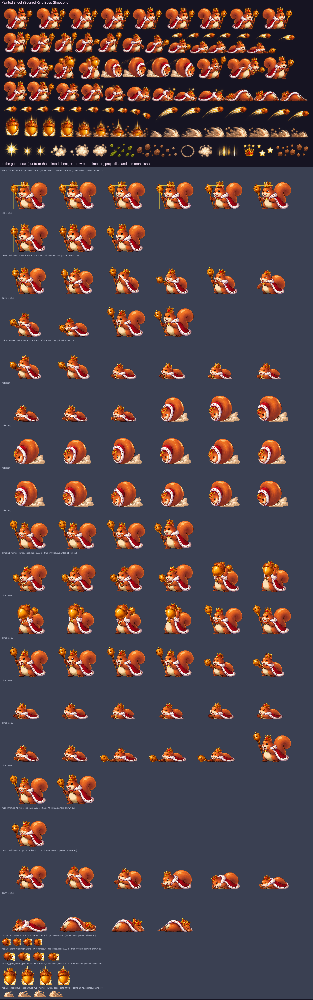

# Painting a boss sheet: The Great Squirrel King (Fluffy's route, level 1)

What a painted sheet for `boss_squirrel` must contain so the build can cut it into the game's animations
(`Tools/sprites/sheet_boss.py`, with a new `characters/boss_squirrel_painted.py` table), the same way as the
Sakura bosses (`docs/boss-kitsune-sheet-brief.md`, `docs/boss-toad-sheet-brief.md`) and the heroes
(`docs/hero-sheet-brief.md`). The squirrel is drawn in code today (`characters/` with `bosskit.py`); the
frame counts and speeds below replace today's, so the cutter's table, `Sprites.json` and the counts in
`Tools/sprites/tests/test_sprites.py` change with the sheet.

The boss: a big orange-brown squirrel king with a cream belly and muzzle, a huge curled bushy tail, a gold
crown set with red jewels, a red royal cape with a white fur trim and a gold clasp, a sceptre topped with a
big acorn, and an acorn pouch at the belt. Proud, chubby and a little pompous.

The picture shows, on top, the painted sheet (`docs/concept/Squirrel King Boss Sheet.png`). Below are the frames
the game now plays, cut from it (see "Done" at the end), one row per animation with its count and speed, then the
projectiles; the yellow box on the idle row is the hitbox. (Before the sheet, the picture showed the World 1 panel
of `docs/concept/Pixel Boss Atlas_ Feline Realms.png` and the code-drawn frames. `docs/concept/The Great Squirrel
King UI Sprite Sheet.png` only has the name banner and the health bar, no boss.)

## Abilities (what the game does)

From `App/Resources/Bosses.json`, `Packages/GameCore/Sources/GameCore/World.swift` and `App/Scenes/GameScene.swift`.

- **Where it stands:** on the ground, a fixed distance ahead of the running kitten (210 units on a wide screen,
  140 upright). It never moves toward the kitten and the kitten never reaches it; it slides in from the right
  over 1.5 s (playing IDLE), then starts attacking.
- **Toughness:** 20 HP. Hitbox 56 wide × 84 tall, standing on the ground (body and head; tail, crown and
  sceptre stick out).
- **How it is hurt:** only by **Yarn Shot**, 1 HP a ball (one ball every 0.35 s at most). It is **always
  vulnerable**: yarn lands during the wind-up, the attack and the pause after it. Stomps, Ghost Dash and
  Super Pounce never touch it. A hit flashes it white; HURT plays only when the hit lands in the pause after
  an attack (during an attack the attack row keeps playing).
- **Phases** (checked when each attack starts; attacks cycle in order):
  1. 20–14 HP: `acorn_arc` only.
  2. 13–7 HP: `acorn_roll`, `acorn_arc`.
  3. 6–1 HP: `giant_acorn`, `acorn_roll`, `giant_acorn`, `acorn_arc`.
- **Attacks** (all hazards start at the boss's front edge and fly left at the given speed toward the kitten,
  unless placed "ahead"; low = on the ground, jump it; high = its bottom 42 up, over a standing kitten
  (24 tall), stay on the ground):

| Attack | Wind-up (warning) | Then | Pause after | Hazards |
|---|---|---|---|---|
| `acorn_arc` (Acorn Throw) | 0.9 s | 1.3 s | 1.0 s | Three acorns 0.6 s apart: **low** `acorn` 10×10 at 0.9 s, **high** `acorn_high` 14×12 (42 up) at 1.5 s, **low** `acorn` at 2.1 s; closing at 150 |
| `acorn_roll` (Roll Charge) | 0.9 s | 1.4 s | 1.0 s | Three **low** `acorn`s 10×10, 0.7 s apart, at 0.9, 1.6 and 2.3 s; closing at 160 |
| `giant_acorn` (Tree Drop) | 1.0 s | 1.6 s | 1.1 s | At 1.0 s a `giant_acorn` 18×22 appears **on the ground 110 ahead of the kitten**, blinking and harmless for 0.6 s, then solid where it stands (the kitten runs into it: jump it). At 2.6 s a **low** `shockwave` 20×10 rolls from the boss at 170 |

  Times are from the start of the wind-up. **What the player does:** keep throwing yarn; hop the low acorns,
  stay down for the high one, jump the giant acorn once it stops blinking, then hop the shockwave.

## What to deliver

- **Two sheets**, because there are about 100 frames:
  - `Great Squirrel King Boss Sheet A.png`: the boss's own animations (IDLE, the attacks, HURT, DEATH).
  - `Great Squirrel King Boss Sheet B.png`: the projectile rows and the loose-effects row.
- **PNG, about 4096 wide (larger is fine)**, with a **real transparent background** (see Sheet rules). Long
  rows wrap onto a second line directly below; label it "THROW (cont.)" and keep the order.
- **Boss size:** about **3× its game size: about 320 px tall standing** (crown included), the same in every
  frame of every row.

## Few, steady frames — but full wind-ups

The heroes and enemies taught us that drifting frames flicker in the game: a tail whole in one frame and cut
off in the next, a crown that changes shape, an eye that winks. A boss still needs many frames, because its
wind-up is the warning the player reads and each throw must land on the right frame. So:

- **The same squirrel in every frame:** the same size, face, crown, cape, tail and sceptre. Only the pose
  changes. The whole tail in every frame, never cut off by the frame edge or a neighbour.
- **No eye blinking.** Both eyes fully open in every frame of every row: no blinks, no winks, no half-closed
  eyes, not even in IDLE. A glare (brows down) in a wind-up is fine; the eyes stay open. The only exceptions
  are the named expressions: "> <" in HURT, "x x" in DEATH.
- **Paint in-betweens in the wind-ups.** The wind-up builds steadily to its peak (crouching lower, the paw
  going back further, a tremble at the peak); never paint the same frame twice to fill time.
- **Calm between throws.** Between two releases the body moves little (a paw reaching for the next acorn, the
  tail settling): small, steady steps rather than new poses.
- **The strike or release is one clear frame** at the number given in the table. Put the biggest change of
  the row there.
- **Follow-through:** the tail, cape and crown tassels lag a beat behind the body. Ease out into the settle.
- **Looping rows close the loop:** the last frame of IDLE leads straight back into the first.
- **Keep the volume:** the boss must not grow or shrink. A squash on a landing returns to the same size.

## Sheet rules

- **Export as a PNG with a real transparent background.** A checkerboard painted into the picture is not
  transparency: the cutter then has to guess which light pixels are background and which are the cream belly
  or the white fur trim. To check, open the PNG over a dark background: the squares must disappear. If the
  tool can't export transparency, use one flat colour that never appears on the boss (pure green `#00FF00` or
  dark navy), never a checkerboard or gradient.
- **Fully opaque with a dark outline all round.** Glow and dust may be soft but must not touch or join two frames.
- **One row per animation**, frames left to right in playing order, the label above the row, never touching a
  frame. **The number of frames in a row must equal the count in the table.**
- Paint the squirrel facing **right**; the build mirrors it so it faces the kitten.
- **Figures never touch:** at least **~30 px of empty space** between frames, measured from the tip of the
  tail, the sceptre and the cape. An attack effect (a dust burst) stays inside its own frame.
- **Same scale in every frame of every row**, all feet on one baseline (only the CLIMB jump leaves it; paint a
  soft ground shadow under the airborne frames so the ground line is known — the cutter removes it). The game
  frame is 112×132 with the ground 3 px above the bottom; the body the kitten must hit is about 56 wide ×
  84 tall from the ground. The tail, crown and sceptre can stick out of that, but keep the widest pose no
  wider than about 2× the body, and leave room above the crown for the jump.
- **Loose effects** (leaves, sparkles, dust puffs that are not part of a strike) go in their own row at the
  bottom of sheet B, never touching the boss.
- **Don't paint the projectiles flying away** — the acorns, the giant acorn and the shockwave are separate
  sprites (sheet B). Paint only what stays on the boss: the acorn in its paw, the dust burst where it lands.

## How the game plays an attack

The game plays the attack row **once**, from its first frame at the **start of the wind-up**, at 10 frames a
second, and holds the last frame until the boss rests (then IDLE). So frame N shows at (N − 1) ÷ 10 seconds,
and a hazard released at T seconds after the wind-up starts must leave on frame 10 × T + 1. The table puts the
release frames there; paint the wind-up before them and the follow-through after.

## Animations

The table as the brief asked for it (the counts a new sheet should have). What the game plays now, cut from the
painted sheet, is in "Done" below.

| # | Row | Frames | Speed | Loops | Lasts | When the game plays it | What the frames show |
|---|---|---|---|---|---|---|---|
| 1 | IDLE | 6 | 6 fps | yes | 1 s | Sliding into the arena, and resting after an attack | Standing proud, sceptre in one paw: breathing in over 1–3 and out over 4–6, the tail swaying one slow swing and back, the cape stirring. Eyes open throughout |
| 2 | THROW | 24 | 10 fps | no | 2.4 s | `acorn_arc` (phase 1 on) | 1–3 reaching into the pouch for an acorn; 4–8 drawing the paw back low, leaning back, tail bracing; 9 coiled, a tremble (the warning peak); **10 low throw** (0.9 s): sidearm, paw swept low and forward; 11–15 reaching for the next acorn, the paw rising high over the shoulder; **16 high throw** (1.5 s): overarm, paw flung high and forward; 17–21 reaching again, drawing back low; **22 low throw** (2.1 s); 23–24 settling, cape swinging |
| 3 | ROLL | 28 | 10 fps | no | 2.8 s | `acorn_roll` (phase 2 on) | 1–4 crouching, the tail wrapping round; 5–8 curling into a tight ball, crown tucked on top; 9 the ball trembling (warning peak); 10–24 **rolling on the spot**, a quarter turn a frame (the four turn poses may repeat — it is a spin), with **an acorn bursting out of its front at 10 (0.9 s), 17 (1.6 s) and 24 (2.3 s)** — paint a small puff of dust and leaves at the front on those frames; 25–28 uncurling back to standing |
| 4 | CLIMB | 28 | 10 fps | no | 2.8 s | `giant_acorn` (phase 3) | 1–10 hefting a giant acorn overhead with both paws, knees bending lower under its weight, wobbling more each frame (the warning); **11 hurl** (1.0 s): the giant acorn flung up out of the top of the frame (the falling one is a separate sprite); 12–16 watching it, paws on hips; 17–20 crouching for a leap; 21–25 jumping up and coming down; 26 just above the ground; **27 landing stomp** (2.6 s): squashed flat, a big dust burst to both sides (the shockwave leaves); 28 bouncing back up |
| 5 | HURT | 3 | 12 fps | yes | 0.25 s | Just after a hit in the pause after an attack | 1 flinch backwards, eyes squeezed "> <", crown knocked askew; 2 recoil peak; 3 easing back. Keep the outline (the game flashes it white) |
| 6 | DEATH | 10 | 10 fps | no (last frame stays) | 1 s | Defeated | 1–2 big flinch, "x x" eyes; 3–4 staggering, the sceptre dropping; 5–6 toppling backwards, the crown flying off; 7–8 landing flat on its back; 9 a bounce; 10 lying flat with "x x" eyes, the crown rolled beside it |

The ROLL row was a 6-frame loop (14 fps); it is now played once with a wind-up, so the curl reads as a warning.
No WALK or JUMP row: the boss never moves in the game.

**Total: 99 boss frames**, plus 16 projectile frames.

## Projectile rows (separate sprites, sheet B)

| Row | Frames | Size in game | Loops | What it is |
|---|---|---|---|---|
| ACORN | 4 | 12×12 (hits 10×10, low) | yes (14 fps) | A brown acorn with its cap and stalk, a quarter turn a frame as it rolls along the ground |
| ACORN HIGH | 4 | 18×14 (hits 14×12, 42 up) | yes (14 fps) | A slightly bigger acorn spinning through the air with two or three short speed lines behind (on the right), so the high one reads differently |
| GIANT ACORN | 4 | 28×34 (hits 18×22, on the ground) | yes (8 fps) | A huge acorn standing on the ground, cap on top, wobbling a little; a few short falling lines above it. It blinks in the game while it is harmless, so paint it solid |
| SHOCKWAVE | 4 | 24×12 (hits 20×10, low) | yes (12 fps) | A low wave of dust, leaves and pebbles rolling left along the ground, its crest on the left |
| EFFECTS | any | — | — | Loose leaves, dust puffs and sparkles, if painted |

Projectiles fly toward the left (toward the kitten): paint them pointing **left**, the trail on the right.

## Before sending, check

- [ ] The background is transparent: the squares disappear on a dark background.
- [ ] Two sheets; the boss about 320 px tall, the same size in every frame of every row.
- [ ] **Every row has exactly the frame count in the table** — count them.
- [ ] No eye blinking: both eyes open and the same in every frame, except "> <" in HURT and "x x" in DEATH.
- [ ] The whole tail, crown and sceptre in every frame; figures ~30 px apart, never touching.
- [ ] Each wind-up keeps moving (no repeated frames), and the release frames are at the numbers in the table
      (THROW 10, 16, 22; ROLL 10, 17, 24; CLIMB 11 and 27).
- [ ] IDLE closes the loop; DEATH ends on its final frame.
- [ ] Projectiles point left, each in its own row, with the counts in the projectile table.

## For the developer cutting the sheet

Cut with `sheet_boss.py` into a new `characters/boss_squirrel_painted.py` (like `boss_kitsune_painted.py`),
`faces_left=True`, keeping the game frame 112×132 and the ground row, with the body filling the 56×84 hitbox;
add `boss_squirrel` and the four hazards to the painted `NAMES` so the code drawing skips them. The animation
names are the ones GameScene already plays (`attackAnimation`: `acorn_arc` → `throw`, `acorn_roll` → `roll`,
`giant_acorn` → `climb`), so no Swift change is needed; only `roll` changes from looping to once. Update `SPEC`
in `Tools/sprites/tests/test_sprites.py` and `docs/sprite-spec.md`. Today's `hazard_acorn_high` sprite (18×14)
is drawn wider than its 14×12 hitbox and `hazard_giant_acorn` (28×34) much bigger than 18×22: keep the solid
part of the painted ones inside the hitbox and let only the trail stick out.

## Done (2026-10-25)

The user's sheet `docs/concept/Squirrel King Boss Sheet.png` (copied to `Tools/sprites/boss_squirrel_source.png`) is
cut by `Tools/sprites/characters/boss_squirrel_painted.py` with `sheet_boss.py`; the code-drawn `boss_squirrel`,
`hazard_acorn`, `hazard_acorn_high`, `hazard_giant_acorn` and `hazard_shockwave` are no longer built. It is one sheet
(not two), 1774×887 with real transparency, **no row labels**, the king about 122 px tall (not 320), and 44 boss frames
instead of 99. Rows as painted (numbered from 1):

| Painted row | Painted | What it shows |
|---|---|---|
| 1 | 9 | standing with the sceptre, breathing; eyes open throughout (→ IDLE) |
| 2 | 12 | 1-3 reaching, 4 the sceptre thrust forward, 5 drawing back, 6 the paw flung forward, 7 leaning back, 8 a low lunge with the sceptre, 9-11 crouched low and glaring, 12 the sceptre swung down onto the ground; 7 flying acorns painted above 8-12 (wiped) |
| 3 | 11 | 1 an acorn at the belly, 2 the sceptre held out, 3-4 a crowned giant acorn heaved overhead, 5-8 rolled into a ball in the cape with dust behind, 9-11 standing up again |
| 4 | 12 | 1-2 wincing, 3-4 dizzy with stars, 5-7 sinking, 8-9 flat and dizzy, 10-12 face down, the crown off |
| 5 | 10 + 7 | small flying acorns with short fiery trails; big ones with long trails |
| 6 | 8 + 8 | the crowned giant acorn (1-4 glowing, 5-8 landing in debris); a rolling dust wave |
| 7 | — | loose effects (sparkles, puffs, leaves, pebbles, a ring, a crown, stars): not used |

There is no climb, jump or landing stomp, no separate HURT row and no "> <" / "x x" faces; the attack rows are far
shorter than the brief's. So each attack is built from frames of several rows, holding or repeating some, so every
release still lands on its hazard's time. What the game plays now (played frame N, 0-based, shows at N / fps;
GameScene plays an attack once from the start of its wind-up and holds the last frame; every attack ends before the
next wind-up, as ActorNode does not restart an animation that is still playing):

| Animation | Frames | Speed | Loops | Lasts | From the sheet | Release frames |
|---|---|---|---|---|---|---|
| idle | 9 | 9 fps | yes | 1 s | row 1, 1-9 | — |
| throw (`acorn_arc`) | 10 | 3.34 fps | no | 3.0 s | row 2, 1-8; row 3, 9 and 11 (standing up) | the sceptre thrust (row 2, 4) at 0.90 s, the paw flung forward (6) at 1.50 s, the low lunge (8) at 2.10 s, for the low / high / low acorns at 0.9 / 1.5 / 2.1 s |
| roll (`acorn_roll`) | 28 | 10 fps | no | 2.8 s | row 2, 7, 9, 10, 11 (crouching, held 2-3 frames each); row 3, 5-8 spun round 3¾ times; row 3, 9 (held) and 11 | the ball from frame 9 (0.9 s) to 23 (2.3 s), for the acorns at 0.9 / 1.6 / 2.3 s; now played once (it looped before) |
| climb (`giant_acorn`) | 32 | 10 fps | no | 3.2 s | row 3, 2 (held); row 3, 3 and 4 in turn (the heave, trembling); row 3, 9 (watching, held); row 2, 7, 9-11 (crouching); row 2, 12 (held); row 3, 9 and 11 | the acorn gone from his paws at frame 10 (1.0 s, the giant acorn appears ahead of the kitten); the sceptre slammed down (row 2, 12) at frame 26 (2.6 s, the shockwave leaves) |
| hurt | 1 | 12 fps | yes | 0.25 s shown | row 4, 2 (the wince that keeps the sceptre) | — |
| death | 10 | 10 fps | no | 1 s | row 4, 3-12 | ends face down, the crown off |

The frame is now **164×132 points** (492×396 PNGs at 3x; it was 112×132), ground row 128, the chest on x 95 as painted
(facing right, `faces_left`; up to 94 points of tail behind the anchor, the sceptre up to 66 ahead); the anchor is
the hitbox's middle, so GameCore and GameScene are unchanged (the frame size only moves the anchor fraction in
`Sprites.json`). 0.8 points per sheet pixel: about 100 points tall with the crown; standing, belly and head fill the
56×84 hitbox up to the ears. Each painted frame has one place in every animation, lined up with the frame painted
before it by the lower body; the crouched and rolled frames are moved 6-14 points toward the kitten so the body still
reaches the front of the hitbox where the yarn arrives (crouched, he is only about 45 points tall, so the top of the
hitbox is empty for those moments).

Projectiles, all cut from the sheet, mirrored to fly left, sizes unchanged: `hazard_acorn` 12×12 (four small acorns,
the nut about 10 points across with a stub of its trail), `hazard_acorn_high` 18×14 (four big ones, the nut about 13
across, the trail behind it), `hazard_giant_acorn` 28×34 (giant acorn 1-4, the shell about 17 wide and 23 tall with
its cap, crown and glow sticking out of the 18×22 hitbox; it blinks in the game while harmless), `hazard_shockwave`
24×12 (dust wave 2-5, crest first). The painted acorns do not turn as they fly, so the low acorn no longer reads as
rolling.

Still short of the brief: the throw plays only 10 frames over 3 s (0.3 s each, a slide show), and its high throw is a
paw flung forward at chest height, not overarm; the roll has no curl into the ball (crouch, then the ball) and the ball
only wobbles; CLIMB has no climb, leap or landing (a heave and a sceptre slam instead); HURT is one held frame; DEATH
has no "x x" eyes (he ends face down). Not every frame keeps both eyes open: the lean-back and the low lunge (row 2,
7 and 8) squeeze them nearly shut with effort (0.3 s each in the throw, 0.2 s in the roll and climb), and the crouch
(row 2, 9-11) and the sceptre held out (row 3, 2) narrow them to a squint; the idle row is clean.
