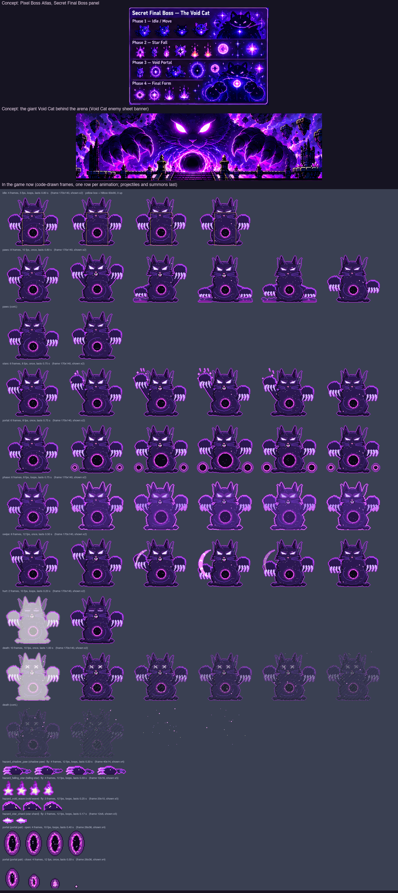

# Painting a boss sheet: The Void Cat (Fluffy's route, level 5)

What a painted sheet for `boss_voidcat` must contain so the build can cut it into the game's animations
(`Tools/sprites/sheet_boss.py`, with a new `characters/boss_voidcat_painted.py` table), the same way as the
Sakura bosses (`docs/boss-kitsune-sheet-brief.md`, `docs/boss-toad-sheet-brief.md`) and the heroes
(`docs/hero-sheet-brief.md`). The Void Cat is drawn in code today; the frame counts and speeds below replace
today's, so the cutter's table, `Sprites.json` and the counts in `Tools/sprites/tests/test_sprites.py` change
with the sheet.

The boss: the final boss, a huge front-facing cat made of black-violet smoke with a starfield inside its body,
blazing white-violet slanted eyes, two enormous paws with crescent claws, wisps of violet flame rising off its
ears and shoulders, and a swirling magenta portal in its chest. A thin magenta rim and a violet glow keep it
readable on the dark purple void backdrop.

The picture shows, on top, the Secret Final Boss panel of `docs/concept/Pixel Boss Atlas_ Feline Realms.png`
(the small cat and its star fall, void portal and final form effects) and the giant Void Cat looming behind the
arena in the banner of `docs/concept/The Void Cat_ Final Boss Sprite Sheet.png` (the same giant cat is in
`Void Cat Final Boss Tileset.png`): match the giant one's look — paws, eyes, chest portal. Below are today's
code-drawn frames, one row per animation with its count and speed, then the projectiles and the portal; the
yellow box on the idle row is the hitbox.

## Abilities (what the game does)

From `App/Resources/Bosses.json`, `Packages/GameCore/Sources/GameCore/World.swift`, `Boss.swift` and
`App/Scenes/GameScene.swift`.

- **Where it stands:** on the ground a fixed distance ahead of the running kitten (210 units wide screen, 140
  upright); it never moves toward it. It slides in over 1.5 s (IDLE), then attacks. The kitten arrives with
  every ability (Yarn Shot, Double Pounce, Ghost Dash, Super Pounce).
- **Toughness:** 30 HP. Hitbox 60 wide × 90 tall, on the ground (the body column from the feet to the eyes; the
  paws and ears stick out).
- **How it is hurt:** only by **Yarn Shot**, 1 HP a ball. In phases 1 and 2 it is **always vulnerable**. In
  **phase 3 yarn is shrugged off** (grey flash, block sound) **unless it is exposed**: the kitten exposes it by
  using a **Ghost Dash or a Super Pounce through an attack** — while dashing or pouncing, an armed hazard is level
  with the kitten (overlapping it along the run, at any height). The boss then flashes white and stays exposed
  for **2 s**, and yarn lands. Stomps, dashes and pounces never damage it themselves. HURT plays when a hit lands
  in the pause after an attack.
- **Phases** (checked when each attack starts; attacks cycle in order):
  1. 30–20 HP: `shadow_paws`, `star_fall`.
  2. 19–10 HP: `portal_paws`, `star_fall`, `portal_shards`.
  3. 9–1 HP: `phase_rush`, `phase_storm` — needs the exposure above.
- **Hazards** (they start at its front edge and fly left toward the kitten, unless placed "ahead"; low = on the
  ground, jump it; high = its bottom 40 up, over a standing kitten (24 tall), stay down):
  - `shadow_paw` 16×14, **low**, closing at 240–250: a smoky paw raking along the ground.
  - `falling_star` 12×12: appears **150 up, 200–270 ahead of the kitten**, hangs there blinking for 0.6 s
    (harmless), then drops under gravity and shatters where it lands — don't be under it.
  - `void_wave` 24×12, **low**, closing at 220–230.
  - `star_shard` 20×8, **high** (40 up), closing at 260–270.
  - **Portal pair** (phase 2): an entry portal ahead of the kitten and an exit further on, each 16×28, open for
    2.2–2.4 s. Yarn that flies into the entry comes out of the exit at the same height within it, once per ball,
    flying on — or, for `portal_shards`, **flying back** toward the kitten (wasted). The kitten passes through
    portals freely.
- **Attacks** (times from the start of the wind-up):

| Attack | Wind-up (warning) | Then | Pause after | What comes |
|---|---|---|---|---|
| `shadow_paws` | 0.7 s | 1.2 s | 1.0 s | Three **low** shadow paws, 0.6 s apart, at 0.7, 1.3 and 1.9 s |
| `star_fall` | 0.7 s | 1.0 s | 1.0 s | A falling star at 0.7 s (200 ahead), another at 1.2 s (260 ahead), then a **low** shadow paw at 1.6 s |
| `portal_paws` | 0.6 s | 2.0 s | 1.0 s | At 0.6 s portals open: entry 70 ahead on the ground, exit 150 ahead and 50 up (yarn from the ground comes out high, toward the boss), open 2.4 s. A **low** void wave at 1.1 s, a **high** star shard at 1.8 s, a **low** void wave at 2.5 s |
| `portal_shards` | 0.6 s | 1.8 s | 1.0 s | At 0.6 s portals open: entry 80 ahead and 10 up, exit 140 ahead on the ground, **reversing** (yarn through it comes back), open 2.2 s. A **high** star shard at 0.9 s, a **low** void wave at 1.5 s, a **high** star shard at 2.1 s |
| `phase_rush` (phase 3) | 0.5 s | 1.6 s | 1.1 s | **Low** void wave at 0.5 s, **high** star shard at 1.0 s, **low** shadow paw at 1.5 s, **high** star shard at 2.0 s |
| `phase_storm` (phase 3) | 0.5 s | 1.4 s | 1.1 s | Falling star at 0.5 s (210 ahead), **low** void wave at 0.9 s, falling star at 1.2 s (270 ahead), **low** shadow paw at 1.7 s |

  **What the player does:** phases 1–2: keep throwing yarn, jump the low paws and waves, stay down for the shards,
  keep out from under the falling stars; in phase 2 aim through the entry portal (and not through a reversing
  one). Phase 3: Ghost Dash or Super Pounce through a wave, paw or shard to expose it, then throw yarn for 2 s.

## What to deliver

- **Three sheets**, because there are about 155 frames:
  - `Void Cat Boss Sheet A.png`: IDLE, PAWS, STARS, HURT, DEATH.
  - `Void Cat Boss Sheet B.png`: PORTAL, RIFT, RUSH, STORM.
  - `Void Cat Boss Sheet C.png`: the projectile rows, the portal rows and the loose-effects row.
- **PNG, about 4096 wide (larger is fine)**, with a **real transparent background**. Long rows wrap onto a
  second line directly below; label it "PORTAL (cont.)" and keep the order.
- **Boss size:** about **3× its game size: about 350 px tall**, the same in every frame of every row.

## Few, steady frames — but full wind-ups

Drifting frames flicker in the game, and a smoke creature drifts easily: an ear flame that changes every frame,
a paw that loses its claws, stars inside the body that jump about. A boss still needs many frames, because its
wind-up is the warning the player reads and each paw and shard must leave on the right frame. So:

- **The same cat in every frame:** the same size, silhouette, eyes, claws and chest portal. Only the pose and
  the glow change. Keep the starfield inside the body calm (it may drift slowly, never jump).
- **No eye blinking.** Both eyes fully open and blazing in every frame of every row: no blinks, no winks, no
  narrowing to slits, not even in IDLE. They may blaze brighter at a wind-up peak and in phase 3. The only
  exceptions: "> <" in HURT, "x x" in DEATH.
- **Paint in-betweens in the wind-ups:** paws rising higher, smoke gathering, the chest portal widening, a
  tremble at the peak. Never paint the same frame twice to fill time.
- **Calm between strikes:** small, steady steps rather than new poses.
- **The strike or release is one clear frame** at the number given in the table, the biggest change of the row.
- **Follow-through:** smoke wisps and ear flames lag a beat behind the paws.
- **Looping rows close the loop** (IDLE); it never grows or shrinks.

## Sheet rules

- **Export as a PNG with a real transparent background.** A checkerboard painted into the picture is not
  transparency, and soft violet smoke is exactly what the cutter would eat. To check, open the PNG over a dark
  background: the squares must disappear. If the tool can't export transparency, use one flat colour that
  never appears on the cat (pure green `#00FF00`), never a checkerboard or gradient.
- **Fully opaque with a dark outline all round, plus the thin magenta rim** inside it. Smoke edges and glow may
  be soft but must not touch or join two frames.
- **One row per animation**, frames left to right in playing order, the label above the row, never touching a
  frame. **The number of frames in a row must equal the count in the table.**
- Paint it **front-facing** as today (its paws reach left and right); if it turns, it turns toward the right —
  the build mirrors it.
- **Figures never touch:** at least **~30 px of empty space** between frames, measured from the claw tips, ear
  flames and smoke. An attack effect (a smoke burst where a paw slams) stays inside its own frame.
- **Same scale in every frame of every row**, its base on one baseline. The game frame is 170×140 with the
  ground 3 px above the bottom; the body the kitten must hit is about 60 wide × 90 tall from the ground. The paws
  and ears stick out; keep the widest pose within the 170 frame width (under 3× the body).
- **Loose effects** (stray stars, violet sparks, smoke wisps that are not part of a strike) go in their own row
  at the bottom of sheet C.
- **Don't paint the projectiles flying away** — the shadow paws, falling stars, void waves, star shards and the
  portal pair are separate sprites. Paint only what stays on the cat: the smoke burst under a slamming paw, the
  stars gathering round a raised paw, the chest portal flaring.

## How the game plays an attack

The game plays the attack row **once**, from its first frame at the **start of the wind-up**, at 10 frames a
second, and holds the last frame until the row ends, then shows IDLE. So frame N shows at (N − 1) ÷ 10 seconds,
and a hazard released at T seconds after the wind-up starts must leave on frame 10 × T + 1. The final phase
has the shortest warnings (0.5 s), on purpose.

## Animations

| # | Row | Frames | Speed | Loops | Lasts | When the game plays it | What the frames show |
|---|---|---|---|---|---|---|---|
| 1 | IDLE | 6 | 6 fps | yes | 1 s | Sliding into the arena, resting after an attack | Looming, paws planted: the body swelling over 1–3 and settling over 4–6, smoke rising off the ears and shoulders, the chest portal turning slowly. Eyes open and steady |
| 2 | PAWS | 22 | 10 fps | no | 2.2 s | `shadow_paws` (phase 1) | 1–3 both paws rearing up, claws spreading; 4–7 paws high, shadow smoke gathering round them, a tremble at 7 (warning peak); **8 left paw slams** (0.7 s): a smoke burst on the ground; 9–13 that paw rising, the other ready; **14 right paw slams** (1.3 s); 15–19 rising; **20 left paw slams** (1.9 s); 21–22 settling |
| 3 | STARS | 19 | 10 fps | no | 1.9 s | `star_fall` (phases 1 and 2) | 1–3 the right paw raised; 4–7 stars gathering round it, brighter each frame (warning peak at 7); **8 fling** (0.7 s): paw flung up, a star streaking up out of the frame; 9–12 stars gathering again; **13 fling** (1.2 s); 14–16 the paw coming down, smoke gathering; **17 slam** (1.6 s): paw slammed down, a smoke burst on the ground (the shadow paw leaves); 18–19 settling |
| 4 | PORTAL | 28 | 10 fps | no | 2.8 s | `portal_paws` (phase 2) | 1–3 rearing back, the chest portal starting to widen; 4–6 the portal yawning wide, spinning faster (warning peak at 6); **7 portals open** (0.6 s): a bright magenta flare from the chest; 8–11 holding the portal open, the left paw sinking low; **12 low swipe** (1.1 s): the paw raked along the ground (the void wave leaves); 13–18 the paw rising high; **19 high flick** (1.8 s): claws flicked forward at head height (the star shard leaves); 20–25 the paw sinking low; **26 low swipe** (2.5 s); 27–28 the chest portal closing down |
| 5 | RIFT | 25 | 10 fps | no | 2.5 s | `portal_shards` (phase 2) | 1–3 rearing back, the chest portal widening; 4–6 yawning wide (warning peak at 6); **7 portals open** (0.6 s): the chest flare; 8–9 the paw rising high; **10 high flick** (0.9 s); 11–15 the paw sinking low; **16 low swipe** (1.5 s); 17–21 rising high; **22 high flick** (2.1 s); 23–25 the chest portal closing |
| 6 | RUSH | 23 | 10 fps | no | 2.3 s | `phase_rush` (phase 3) | Final form in every frame: the body flared bright, the eyes blazing, violet flames rising round it. 1–5 a fast crouch (short warning, peak at 5); **6 low swipe** (0.5 s); 7–10 rising; **11 high flick** (1.0 s); 12–15 dropping; **16 low paw slam** (1.5 s), smoke burst; 17–20 rising; **21 high flick** (2.0 s); 22–23 settling |
| 7 | STORM | 20 | 10 fps | no | 2.0 s | `phase_storm` (phase 3) | Final form as in RUSH. 1–5 a paw thrown up, stars gathering fast (peak at 5); **6 fling** (0.5 s): a star streaking up; 7–9 the paw sweeping down; **10 low swipe** (0.9 s); 11–12 the paw flung up again; **13 fling** (1.2 s); 14–17 the paw coming down, smoke gathering; **18 slam** (1.7 s): smoke burst; 19–20 settling |
| 8 | HURT | 3 | 12 fps | yes | 0.25 s | Just after a hit in the pause after an attack | 1 flinch, eyes squeezed "> <", the smoke thrown back; 2 recoil peak; 3 easing back. Keep the outline (the game flashes it white) |
| 9 | DEATH | 10 | 10 fps | no (last frame stays) | 1 s | Defeated | 1–2 a big flinch, "x x" eyes; 3–4 the chest portal collapsing inward; 5–6 the body coming apart into smoke and stars from the edges in; 7–8 only the eyes and a cloud of stars; 9 the stars drifting up; 10 a few stars left |

Today's PHASE (a looping flare, played for both phase-3 attacks) and SWIPE (unused) rows are not needed: RUSH and
STORM replace PHASE, painted in the same final form. Optional (the game doesn't use it today): EXPOSED 4 frames,
10 fps, loops — the final-form body cracked open and dimmed, for the 2 s it can be hit.

**Total: 156 boss frames**, plus 21 projectile and portal frames.

## Projectile and portal rows (separate sprites, sheet C)

| Row | Frames | Size in game | Loops | What it is |
|---|---|---|---|---|
| SHADOW PAW | 4 | 40×14 (hits 16×14 at the front, low) | yes (12 fps) | A smoky shadow paw raking along the ground, claws first on the left; the solid paw about 16 wide at the front, a smoke trail behind it on the right |
| FALLING STAR | 4 | 12×16 (hits 12×12) | yes (12 fps) | A white-violet star with a short trail above it, twinkling. It hangs blinking, then drops straight down: paint it pointing **down**, the trail on top |
| VOID WAVE | 3 | 26×12 (hits 24×12, low) | yes (12 fps) | A low wave of void smoke with a lit magenta crest rolling left along the ground |
| STAR SHARD | 2 | 22×8 (hits 20×8, 40 up) | yes (12 fps) | A white-violet crystal shard flying point first to the left, a short glint trail behind |
| PORTAL OPEN | 4 | 26×36 (an upright oval about 16×28) | yes (10 fps) | A swirling magenta portal standing on its bottom edge, the swirl turning a step each frame |
| PORTAL CLOSE | 4 | 26×36 | no (12 fps) | The portal shrinking down onto its bottom edge to a last spark |
| EFFECTS | any | — | — | Stray stars, sparks and smoke wisps, if painted |

Projectiles fly toward the left (toward the kitten): paint them pointing **left**, the trail on the right (the
falling star points down).

## Before sending, check

- [ ] The background is transparent: the squares disappear on a dark background.
- [ ] Three sheets; the cat about 350 px tall, the same size in every frame of every row.
- [ ] **Every row has exactly the frame count in the table** — count them.
- [ ] No eye blinking: both eyes open and the same in every frame, except "> <" in HURT and "x x" in DEATH.
- [ ] Opaque with a dark outline and the magenta rim; figures ~30 px apart, never touching.
- [ ] Each wind-up keeps moving, and the release frames are at the numbers in the table (PAWS 8, 14, 20; STARS 8,
      13, 17; PORTAL 7, 12, 19, 26; RIFT 7, 10, 16, 22; RUSH 6, 11, 16, 21; STORM 6, 10, 13, 18).
- [ ] RUSH and STORM are clearly the final form (brighter, flaming) compared with the other rows.
- [ ] IDLE closes the loop; DEATH ends on its final frame.
- [ ] Projectiles point left (the falling star down), each in its own row.

## For the developer cutting the sheet

Cut with `sheet_boss.py` into a new `characters/boss_voidcat_painted.py`, keeping the game frame 170×140 and the
ground row, with the body filling the 60×90 hitbox; it is front-facing, so check whether `faces_left` mirrors it
the way you want. Add the boss, its four hazards and `portal` to the painted `NAMES`. `shadow_paws` → `paws` and
`star_fall` → `stars` already play. **Three rows are new and need entries in `GameScene.attackAnimation`:**
`portal_shards` → `rift` (today both portal attacks play `portal`, whose timing can only match one of them),
`phase_rush` → `rush` and `phase_storm` → `storm` (today both play the `phase` loop, which has no release frame).
`phase` and `swipe` can then be dropped. Update `SPEC` in `Tools/sprites/tests/test_sprites.py` and
`docs/sprite-spec.md`. Today's `hazard_void_wave` (20×10) and `hazard_star_shard` (12×8) are smaller than their
24×12 and 20×8 hitboxes, and `hazard_shadow_paw` (40×14) is much wider than its 16×14 hitbox: cut the painted ones
at the sizes in the table, with the shadow paw's hitting part at its front.
