# Enemy sprite sheet brief: Fluffy's route

A brief for the artist painting the enemies of Fluffy's route in **Purrfectly Dangerous**, a 2D
pixel-art auto-runner for iPhone. Fluffy's route is the base game: levels 1–5, The Purrwood Forest,
Frostpaw Mountains, The Haunted Meowseum, The Cataclysm Citadel and The Void Rift. The game's build cuts
each sheet into animation frames automatically (like the heroes, `docs/hero-sheet-brief.md`, and the
Sakura route's enemies, `docs/enemy-sheet-brief-sakura.md`), so the sheets must follow the rules below
exactly. The looks come from the world enemy sheets in `docs/concept/` (Purrwood Forest Enemy Sprite
Atlas, Frostpaw Mountains Enemy Sprite Sheet, Haunted Meowseum Enemy Sprite Showcase, Cataclysm Citadel
Enemy Sprite Sheet, and the enemy rows of The Void Cat Final Boss Sprite Sheet). The frame counts, speeds
and what each frame shows come from how the game plays each enemy.

Each enemy below has a reference picture (`docs/enemy-refs/<id>.png`): on top, its row from its world's
concept enemy sheet (the look and the poses to match), or for an enemy already done, the painted sheet it
was cut from; under it, the frames the game draws today, one row per animation with its name, frame count
and speed, the projectile rows last, for size and proportion. For the enemies done from painted sheets, the
frame table gives the frames the game plays now.
Seven enemies have no concept art (the Rolling Snowball, Sliding Penguin, Skeleton Mouse, Floating Skull,
Wall Cannon and Mechanical Mouse, and the Rolling Acorn, which only appears as a projectile in the Squirrel
Thief's row); their pictures show only today's frames, so match the look of their world's concept sheet.

**Done from painted sheets** (their pictures show the painted sheet and the cut frames; their tables, what the
game plays now): Squirrel Soldier, Squirrel on a Branch, Hedgehog. The other 49 enemies are still drawn in code. Bosses and their attacks are
not in this brief, and neither are the props, traps and platforms (bush, stump, snowdrift, tombstone, gear,
crate wall, flame vent, piston, falling icicle and debris, the cursed bell and its sound wave, bridges and
ledges) nor the pickups (fish, yarn basket).

## What to deliver

- **One sheet per enemy**, named `<Enemy name> Enemy Sheet.png` (e.g. `Forest Slime Enemy Sheet.png`),
  with the enemy's projectile rows on the same sheet when it has one.
- **PNG, about 2048×1024 (larger is fine)**, with a **real transparent background**.
- **Enemy size:** paint it about **3× its game frame** (the "Game frame" in each section, in points), the
  same size in every frame. E.g. the Forest Slime's game frame is 30×24, so paint it about 90 px wide.

## Few frames, all the same enemy

The game plays only a few frames per animation (the counts below, usually 2–4, never more than 6). The
hero sheets taught us that fewer, steadier frames look better than many drifting ones: with many frames the
tail, scarf or a horn is whole in one frame and gone in the next, and an eye winks now and then, which in
the game looks like flicker. So:

- **The same enemy in every frame.** The same size, face, markings and colours. Only the pose changes.
- **Clear poses.** With 2–4 frames each frame must read on its own: a walk frame shows clearly different
  legs from its neighbours, a wingbeat has the wings clearly up, level and down.
- **No eye blinking.** Both eyes fully open in every frame of every row: no blinks, no winks, no
  half-closed eyes, not even one frame in a resting loop. The only exceptions are the expressions a table
  names: squeezed "> <" eyes in HIT, "x x" or closing eyes in DEATH.
- **Keep the durations.** The "Lasts" column is what the game needs (a warning that lasts 0.5 s, a dash
  that is held, a throw whose projectile appears at once). A different count only works if the speed is
  changed to keep that time.

## Sheet rules

- **Export as a PNG with a real transparent background.** A checkerboard painted into the picture is
  not transparency. To check, open the PNG over a dark background: the squares must disappear. If the
  tool can't export transparency, use one flat colour that never appears on the enemy (pure green
  `#00FF00` or dark navy), never a checkerboard or gradient.
- **Fully opaque with a dark outline all round** (ghosts, wisps and flames too: their glow may be soft,
  but the body has an outline). Glow must not touch or join two frames.
- **One row per animation**, frames left to right in playing order, the label above the row, never
  touching a frame. **The number of frames in a row must equal the count in the table.**
- **Paint the enemy facing right**; the build mirrors it so it faces the hero, who runs towards it.
  **Projectiles are painted pointing left** (towards the hero), the trail on the right.
- **Enemies never touch or overlap.** At least **~30 px of empty space** between frames, measured from
  the tip of a tail, wing, weapon or flame, and an attack effect (a slash, a puff) stays inside its own frame.
- **Same scale in every frame of every row.** Ground enemies: all feet on one baseline. Flying and
  floating enemies: paint a soft ground shadow under each frame so the build knows the height; it is
  removed.
- **Loose effects** (sparks, petals, embers, smoke puffs) that are not part of an attack go in their own
  row at the bottom, never touching the enemy. Small loose specks near the enemy are dropped by the cutter.

## Smooth motion

With so few frames the motion comes from clear key poses, not in-betweens. Looping rows (walk, run, fly,
float, roll, idle) close the loop: the last frame leads straight back into the first. Ears, tails, wings,
scarves and capes lag a frame behind the body. The enemy must not grow or shrink between frames (a squash
on a landing, a stretch on a leap, then back).

## How the game plays an enemy

- **Resting loop** (walk, move, run, fly, float, roll, idle): plays all the time it isn't doing anything
  else.
- **Throw / attack (ranged):** plays **once** each time it throws or shoots, then the resting loop
  resumes. The projectile appears **the moment the attack starts**, so the release must be early: frame 2
  of 4 (a quick wind-up in frame 1, the release in 2, the follow-through after).
- **Attack (melee, "in reach"):** the Snow Cat, Ice Golem, Mini Yeti, Hell Hound, Rift Hound and Chainsaw
  Cat swing **once** as the kitten comes within reach and then **hold the last frame** while it stays
  that close, so the last frame is the strike still out (the paw, fist or saw extended), not a return to
  rest.
- **Hit:** plays once on a hit that doesn't defeat it, then the resting loop resumes. **Only enemies with
  more than one hit point have a HIT row**: a one-hit enemy goes straight to DEATH.
- **Death:** plays once when it is defeated (by yarn, a stomp that kills, or a Super Pounce), then the
  enemy is removed; end on an empty-ish frame (a puff of leaves, snow, smoke or embers) rather than a body
  lying there.
- **State poses** (shut, opening, hanging, dormant, charging): the game shows them for as long as the
  enemy is in that state, looping, so they must loop cleanly.

The **hit area** in each section is the box the game uses for collisions, standing on the ground at the
middle of the frame (or at the given height for flyers). Keep the body inside it; ears, tails, wings,
weapons and effects can stick out. The "Today" line is what the code-drawn sprite has now, from
`App/Resources/Sprites.json`.

## Level 1 — The Purrwood Forest

Easy, speed 110. Green and warm forest colours (see `docs/concept/Purrwood Forest Enemy Sprite Atlas.png`).

**Abilities at a glance** (speeds in units per second on top of the level's scroll; heights above the ground):

| Enemy | Moves | Attacks | HP | Beaten by |
|---|---|---|---|---|
| Squirrel Soldier (`squirrel`) | walks in (20) | touch | 1 | stomp, 1 yarn, pounce |
| Rolling Acorn (`acorn`) | rolls in fast (60) | touch | 1 | hop, 1 yarn, pounce |
| Squirrel on a Branch (`branch_squirrel`) | stands up high (44) | lobbed acorns, 2 s | 1 | 1 yarn |
| Hedgehog (`hedgehog`) | walks (18), curls at 90 | touch, spikes when curled | 1 | stomp/yarn before curl, pounce |
| Forest Slime (`slime`) | creeps in (16) | touch | 1 | stomp, 1 yarn, pounce |
| Mushroom Cat (`mushroom_cat`) | stands | lobbed spores, 2 s | 1 | stomp, 1 yarn |
| Forest Bat (`forest_bat`) | flies 42 up, swoops to 28 | touch | 1 | 1 yarn, stay down |
| Biting Plant (`plant_cat`) | rooted | bite on a 2 s rhythm | 2 | 2 yarn, pass while shut |
| Bee Cat (`bee_cat`) | hovers 40 up, drifts in (10) | low stings, 1.8 s | 1 | 1 yarn from a jump |
| Stump Cat (`stump_cat`) | rooted turret, terrain | low leaves, 2 s | 2 | 2 yarn, jump/bounce |
| Snail Cat (`snail_cat`) | crawls (8), hides at 80 | touch | 1 | stomp/yarn before hiding, bounce, pounce |
| Spider Cat (`spider_cat`) | hangs 60 up, drops at 130, walks (20) | touch once down | 1 | stomp, 1 yarn, pounce |

### Squirrel Soldier (`squirrel`)

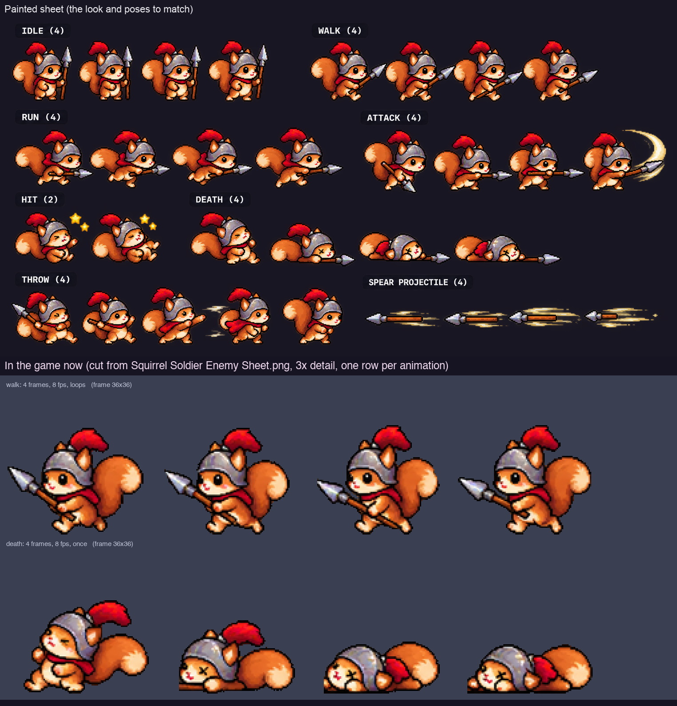

**Done:** cut from `docs/concept/Squirrel Soldier Enemy Sheet.png` (`Tools/sprites/characters/squirrel_painted.py`).
WALK (4) and DEATH (4) are used whole, at 8 fps each. The painting gives it a steel helmet with a red crest, a red
scarf and a spear held forward; the spear sets the scale (it must fit the frame), and the dropped spear painted lying
out in front in DEATH 2-4 is cut off in front of the face. DEATH has no puff of leaves: it ends lying flat with "x x"
eyes. IDLE, RUN, ATTACK, HIT, THROW and SPEAR PROJECTILE are not used by the game.

**Abilities**

- **Moves:** Walks along the ground towards the kitten at 20 (units/s, on top of the level's scroll); turns back at a ravine rim or a step.
- **Attacks:** Touch only (its body hurts from the side).
- **Toughness:** 1 HP, 10 XP.
- **Beaten by:** Stomp (kills), 1 Yarn Shot, Super Pounce defeats it outright; Ghost Dash passes through it; or jump it.

**Look:** As painted: an orange, cat-faced squirrel in a steel helmet with a red crest and a red scarf, a spear held forward, and a huge curled tail.

**Game frame 36×36, hit area 18×24.** Today (painted): walk 4 (8 fps), death 4 (8 fps).

| Row | Frames | Speed | Loops | Lasts | When the game plays it | What the frames show |
|---|---|---|---|---|---|---|
| WALK | 4 | 8 fps | yes | 0.5 s per cycle | All the time | Marching with the spear held forward: contact (1), passing (2), other leg contact (3), passing (4); the crest and tail bob a beat behind |
| DEATH | 4 | 8 fps | no | 0.5 s | Defeated | Struck, eyes squeezed shut (1), pitching forward with "x x" eyes (2), lying flat (3–4), the spear dropped under the chin |

### Rolling Acorn (`acorn`)

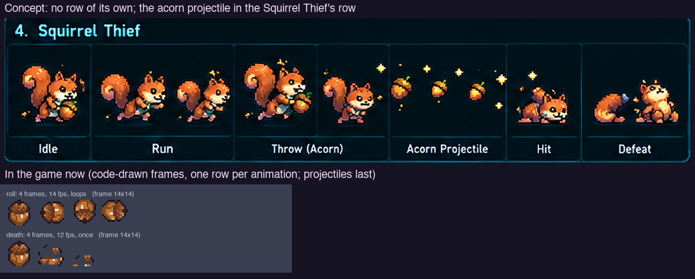

**Abilities**

- **Moves:** Rolls along the ground towards the kitten at 60; turns back at a rim or step.
- **Attacks:** Touch only.
- **Toughness:** 1 HP, 10 XP.
- **Beaten by:** 1 Yarn Shot, Super Pounce defeats it outright; Ghost Dash passes through it; or hop it. A stomp hurts (it is not stompable).

**Look:** A small brown acorn with a cap and stalk. **No concept row of its own**: the acorn is the projectile in the Squirrel Thief's row.

**Game frame 14×14, hit area 12×11.** Today: roll 4 (14 fps), death 4 (12 fps).

| Row | Frames | Speed | Loops | Lasts | When the game plays it | What the frames show |
|---|---|---|---|---|---|---|
| ROLL | 4 | 14 fps | yes | 0.29 s per turn | All the time | The acorn turning a quarter turn per frame, cap and stalk clearly showing the turn |
| DEATH | 4 | 12 fps | no | 0.33 s | Defeated | Cracking (1), splitting into shell pieces (2–3), a few crumbs (4) |

### Squirrel on a Branch (`branch_squirrel`)

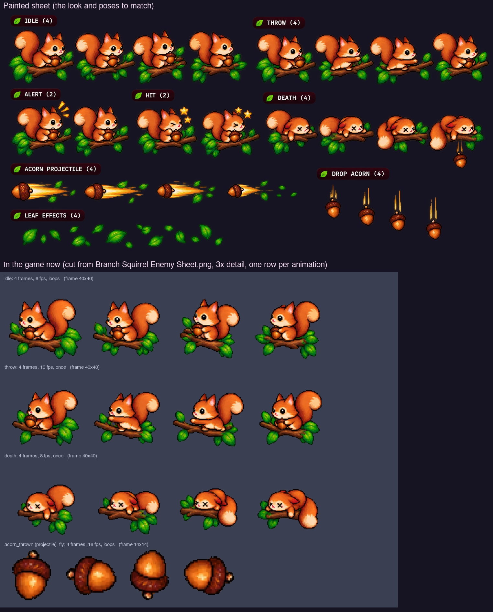

**Done:** cut from `docs/concept/Branch Squirrel Enemy Sheet.png`
(`Tools/sprites/characters/branch_squirrel_painted.py`). IDLE (4), THROW (4) and DEATH (4) are used whole; the leafy
branch is painted under it in every frame and stays part of the sprite, lined up so it holds still. The acorn painted
dropping under DEATH 4 is cut off, and so are the HIT stars (HIT is not used). The thrown acorn is the first DROP
ACORN without its motion lines, turned a quarter turn a frame; the fiery ACORN PROJECTILE row (a long flame trail and
loose leaves) is not used, nor are ALERT and LEAF EFFECTS. The ground line is the branch top under its paws (row 29 of
the frame; the leaves hang about 10 points below it).

**Abilities**

- **Moves:** Stands still on its branch, 44 above the ground.
- **Attacks:** Throws an acorn every 2 s in an arc (lob gravity 500) that lands ahead of the kitten and rolls on at 70; throws while the kitten is 30–300 away; first throw 0.6 s after it comes in range. Acorn hit area 8×8. Its body also hurts on touch.
- **Toughness:** 1 HP, 20 XP.
- **Beaten by:** 1 Yarn Shot (from a jump); landing on it is a safe bounce (no kill); Ghost Dash passes through it and its projectiles.

**Look:** As painted: an orange, cat-faced squirrel with a big curled tail, hugging an acorn, sitting on a short brown branch with green leaves hanging off it.

**Game frame 40×40, hit area 18×20, 44 up.** Today (painted): idle 4 (6 fps), throw 4 (10 fps), death 4 (8 fps); acorn fly 4 (16 fps).

| Row | Frames | Speed | Loops | Lasts | When the game plays it | What the frames show |
|---|---|---|---|---|---|---|
| IDLE | 4 | 6 fps | yes | 0.67 s | Between throws | Sitting on the branch hugging an acorn, breathing, leaning in and back, tail swaying |
| THROW | 4 | 10 fps | no | 0.4 s | Every throw (every 2 s), from the step the acorn leaves | Acorn held to the chest (1), arm flung out (2–3), a new acorn in its paws (4) |
| DEATH | 4 | 8 fps | no | 0.5 s | Defeated | Slumped forward with "x x" eyes (1), sprawled over the branch (2), sliding back, the tail hanging below (3–4); the branch stays |
| ACORN | 4 | 16 fps | yes | — | **Projectile** (game 14×14, hits 8×8): in flight and rolling on | The painted acorn turning a quarter turn a frame, no trail |

### Hedgehog (`hedgehog`)

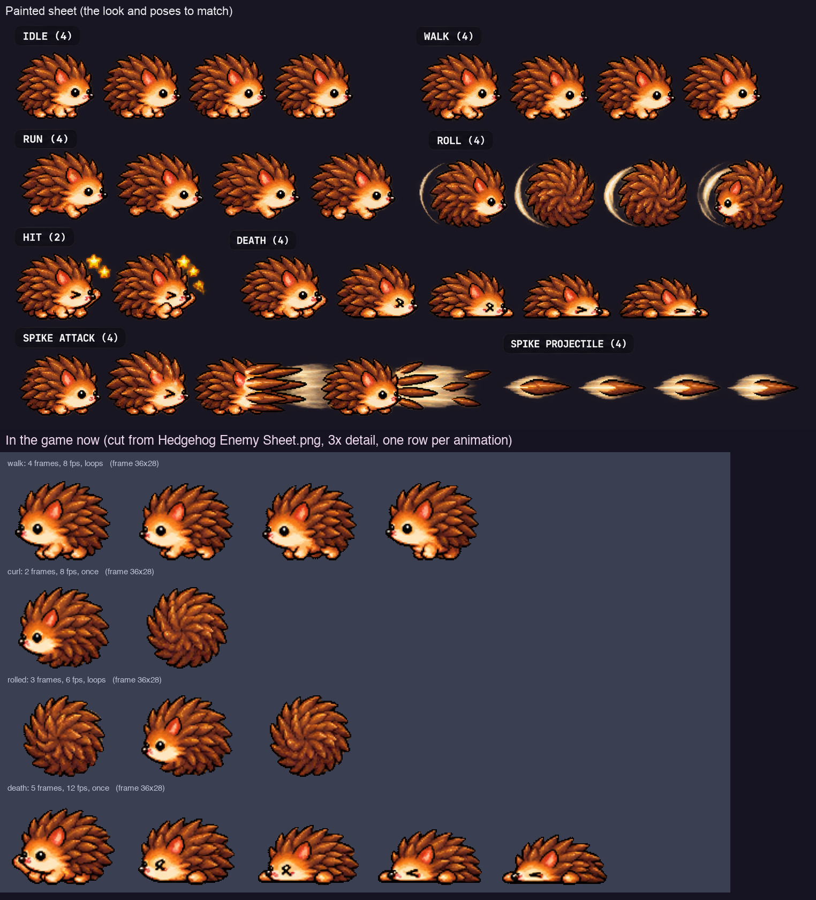

**Done:** cut from `docs/concept/Hedgehog Enemy Sheet.png` (`Tools/sprites/characters/hedgehog_painted.py`). The
sheet has no CURL row: CURL is the first two ROLL frames (head tucked into a half ball, then the ball) and ROLLED
goes on round the same turn (ROLL 3, 1, 2; the fourth ball, its face turned back, is left out). WALK and DEATH
(painted 5) are used whole; IDLE, RUN, HIT, SPIKE ATTACK and SPIKE PROJECTILE are not used by the game.

**Abilities**

- **Moves:** Walks towards the kitten at 18; once the kitten is within 90 it curls into a spiky ball and keeps creeping at 18.
- **Attacks:** Touch; curled, its spikes hurt from any side, from above too.
- **Toughness:** 1 HP, 15 XP.
- **Beaten by:** Before it curls: stomp (kills) or 1 Yarn Shot. Curled: yarn bounces off and a stomp hurts. Super Pounce defeats it outright (curled too); Ghost Dash passes through it.
- **Special:** Curls up at 90 (plays CURL once, then ROLLED).

**Look:** As painted: a round orange hedgehog with a pale cat face and pink ears under a dome of brown quills.

**Game frame 36×28, hit area 20×15.** Today (painted): walk 4 (8 fps), curl 2 (8 fps), rolled 3 (6 fps), death 5 (12 fps).

| Row | Frames | Speed | Loops | Lasts | When the game plays it | What the frames show |
|---|---|---|---|---|---|---|
| WALK | 4 | 8 fps | yes | 0.5 s | Before it curls | A trundling walk, quills bouncing |
| CURL | 2 | 8 fps | no | 0.25 s | Once, when it curls | Head tucking into the quills (1), a tight spiky ball (2) |
| ROLLED | 3 | 6 fps | yes | 0.5 s | Curled, creeping in | The spiky ball turning, the face showing once per turn (2) |
| DEATH | 5 | 12 fps | no | 0.42 s | Defeated (before it curls) | Struck (1), "x x" eyes (2–3), sinking flat (4), lying flat with eyes shut (5) |

### Forest Slime (`slime`)

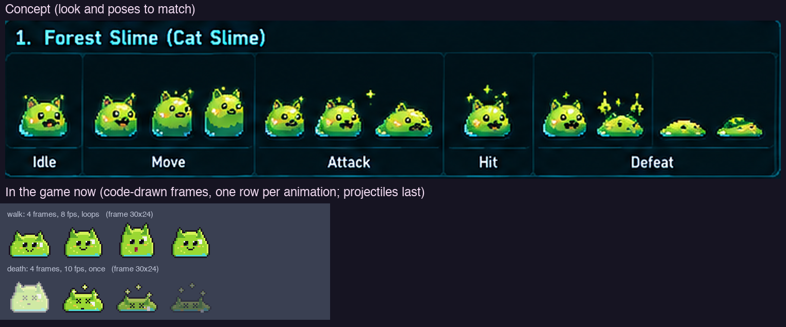

**Abilities**

- **Moves:** Creeps along the ground towards the kitten at 16.
- **Attacks:** Touch only.
- **Toughness:** 1 HP, 10 XP.
- **Beaten by:** Stomp (kills), 1 Yarn Shot, Super Pounce defeats it outright; Ghost Dash passes through it; or hop it.

**Look:** A green cat-eared slime.

**Game frame 30×24, hit area 20×14.** Today: walk 4 (8 fps), death 4 (10 fps).

| Row | Frames | Speed | Loops | Lasts | When the game plays it | What the frames show |
|---|---|---|---|---|---|---|
| WALK | 4 | 8 fps | yes | 0.5 s | All the time | One creep forward: squash (1), stretch forward (2), slide (3), settle (4) |
| DEATH | 4 | 8 fps | no | 0.5 s | Defeated | Flattened with "x x" eyes (1), splashing into green droplets (2–3), a small puddle fading (4) |

### Mushroom Cat (`mushroom_cat`)

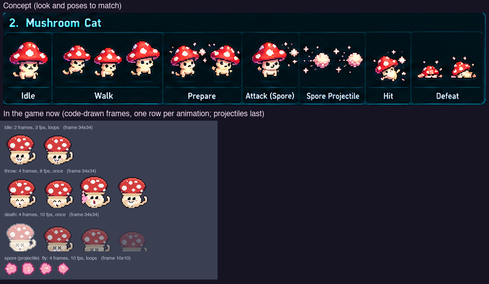

**Abilities**

- **Moves:** Stands still.
- **Attacks:** Puffs a spore from the top of its cap (24 up) every 2 s; it arcs down ahead of the kitten and rolls on at 60 (spore hit area 6×6); throws while the kitten is 30–300 away; first throw 0.6 s after it comes in range. Its body hurts on touch.
- **Toughness:** 1 HP, 15 XP.
- **Beaten by:** Stomp (kills), 1 Yarn Shot; Ghost Dash passes through it and its projectiles; hop the spores.

**Look:** A round cat under a red spotted cap.

**Game frame 34×34, hit area 18×22.** Today: idle 2 (3 fps), throw 4 (8 fps), death 4 (10 fps).

| Row | Frames | Speed | Loops | Lasts | When the game plays it | What the frames show |
|---|---|---|---|---|---|---|
| IDLE | 4 | 4 fps | yes | 1 s | Between puffs | Standing, the cap bobbing a little, breathing |
| THROW | 4 | 10 fps | no | 0.4 s | Every puff (every 2 s) | Squat (1), **puffs the spore from the cap** (2), cap springs back (3), settle (4) |
| DEATH | 4 | 8 fps | no | 0.5 s | Defeated | Squashed under its cap (1), the cap tipping off (2), a puff of spores (3), a few spores (4) |
| SPORE | 4 | 10 fps | yes | — | **Projectile** (game 10×10, hits 6×6): in flight | A pink spore ball turning as it rolls |

### Forest Bat (`forest_bat`)

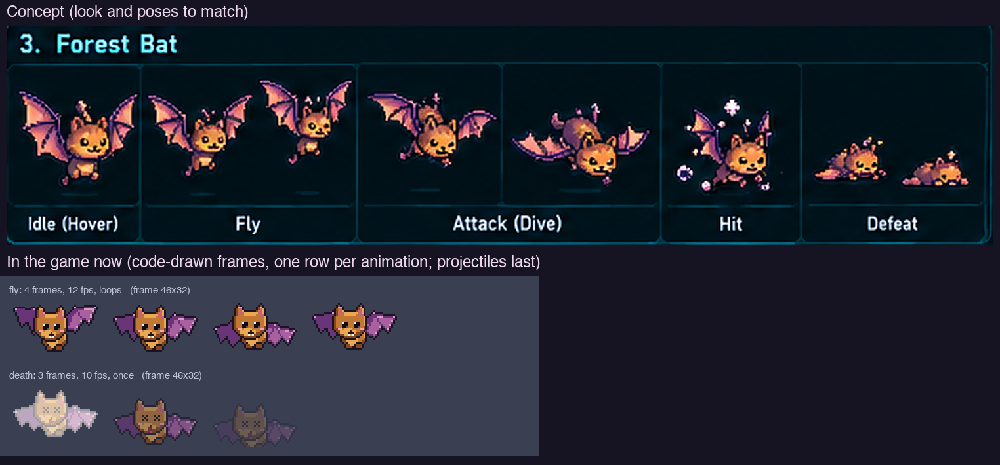

**Abilities**

- **Moves:** Flies in at 40, 42 up; between 150 and 70 from the kitten it swoops down to 28 (just over a standing kitten's head), never lower.
- **Attacks:** Touch only.
- **Toughness:** 1 HP, 15 XP.
- **Beaten by:** 1 Yarn Shot; Ghost Dash passes through it; stay down or jump late. A stomp hurts.

**Look:** A brown cat-faced bat with purple wings.

**Game frame 46×32, hit area 18×14, flying 42 up (down to 28 in the swoop).** Today: fly 4 (12 fps), death 3 (10 fps).

| Row | Frames | Speed | Loops | Lasts | When the game plays it | What the frames show |
|---|---|---|---|---|---|---|
| FLY | 4 | 12 fps | yes | 0.33 s per wingbeat | All the time (the swoop is the same row) | Wings up (1), level going down (2), down (3), level coming up (4) |
| DEATH | 4 | 8 fps | no | 0.5 s | Defeated | Wings crumpled, "x x" eyes (1), tumbling (2), a puff of feathers and leaves (3–4) |

### Biting Plant (`plant_cat`)

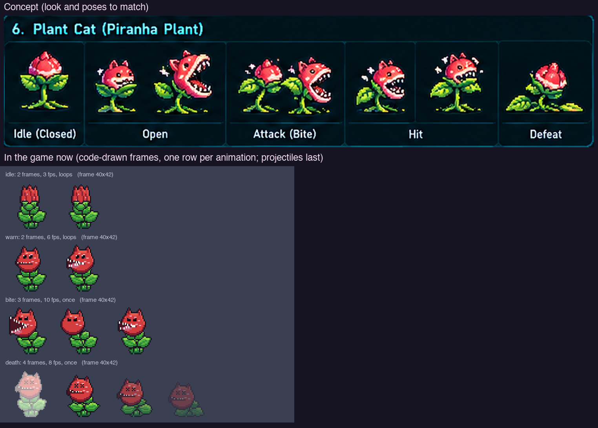

**Abilities**

- **Moves:** Rooted, never moves.
- **Attacks:** A trap on the world clock, every 2 s: shut and harmless for 0.9 s, opening (the warning) for 0.5 s, then biting for 0.6 s; it hurts only while biting.
- **Toughness:** 2 HP, 20 XP.
- **Beaten by:** 2 Yarn Shots (yarn hits it in any state); Ghost Dash passes through it; pass while it is shut, or jump it. It can't be stomped.

**Look:** A tall leafy stem with a cat-faced bud.

**Game frame 40×42, hit area 18×30.** Today: idle 2 (3 fps), warn 2 (6 fps), bite 3 (10 fps), death 4 (8 fps).

| Row | Frames | Speed | Loops | Lasts | When the game plays it | What the frames show |
|---|---|---|---|---|---|---|
| IDLE | 4 | 4 fps | yes | 1 s | Shut (0.9 s of each 2 s) | The closed bud swaying gently on its stem |
| WARN | 2 | 6 fps | yes | 0.5 s | Opening (0.5 s) | Petals parting, teeth showing, trembling |
| BITE | 3 | 8 fps | no | 0.38 s, last frame held | Biting (0.6 s) | Lunges forward with jaws wide (1), **snaps** (2), jaws open and snapping (3, held to the end of the bite) |
| HIT | 2 | 10 fps | no | 0.2 s | Hit by the first yarn | Flinching back, "> <" eyes (1), easing back (2) |
| DEATH | 4 | 8 fps | no | 0.5 s | Defeated | Wilting (1), drooping (2), leaves falling off (3), a few leaves (4) |

### Bee Cat (`bee_cat`)

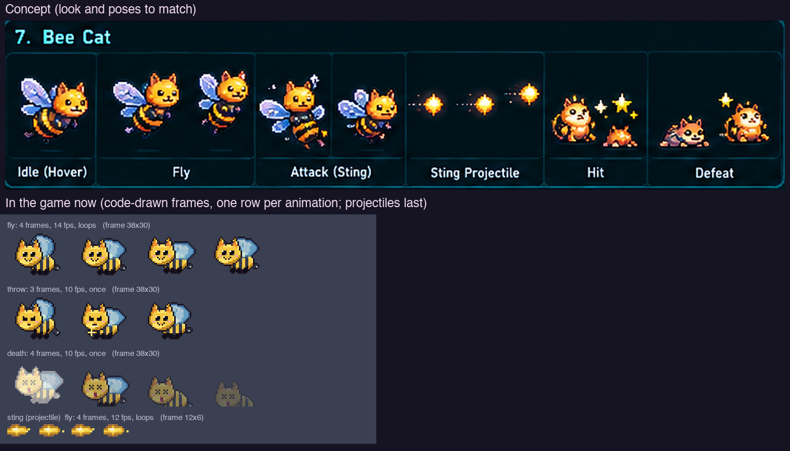

**Abilities**

- **Moves:** Hovers 40 up (above a standing kitten), drifting in at 10.
- **Attacks:** Fires a sting every 1.8 s low along the ground (4 up) at 90 (sting hit area 8×4); throws while the kitten is 30–300 away; first throw 0.6 s after it comes in range. Its body hurts on touch.
- **Toughness:** 1 HP, 20 XP.
- **Beaten by:** 1 Yarn Shot (from a jump); Ghost Dash passes through it and its projectiles; jump the stings. A stomp hurts.

**Look:** A bee-striped cat with gauzy wings and a sting.

**Game frame 38×30, hit area 18×16, 40 up.** Today: fly 4 (14 fps), throw 3 (10 fps), death 4 (10 fps).

| Row | Frames | Speed | Loops | Lasts | When the game plays it | What the frames show |
|---|---|---|---|---|---|---|
| FLY | 4 | 14 fps | yes | 0.29 s | All the time | A fast buzzing wingbeat, the body bobbing a little |
| THROW | 4 | 10 fps | no | 0.4 s | Every sting (every 1.8 s) | Curls its tail under (1), **fires the sting** (2), recoil (3), back to flying (4) |
| DEATH | 4 | 8 fps | no | 0.5 s | Defeated | Wings stop, "x x" eyes (1), falling (2), a puff (3), a few sparkles (4) |
| STING | 4 | 12 fps | yes | — | **Projectile** (game 12×6, hits 8×4): in flight | A glowing golden sting, trail on the right |

### Stump Cat (`stump_cat`)

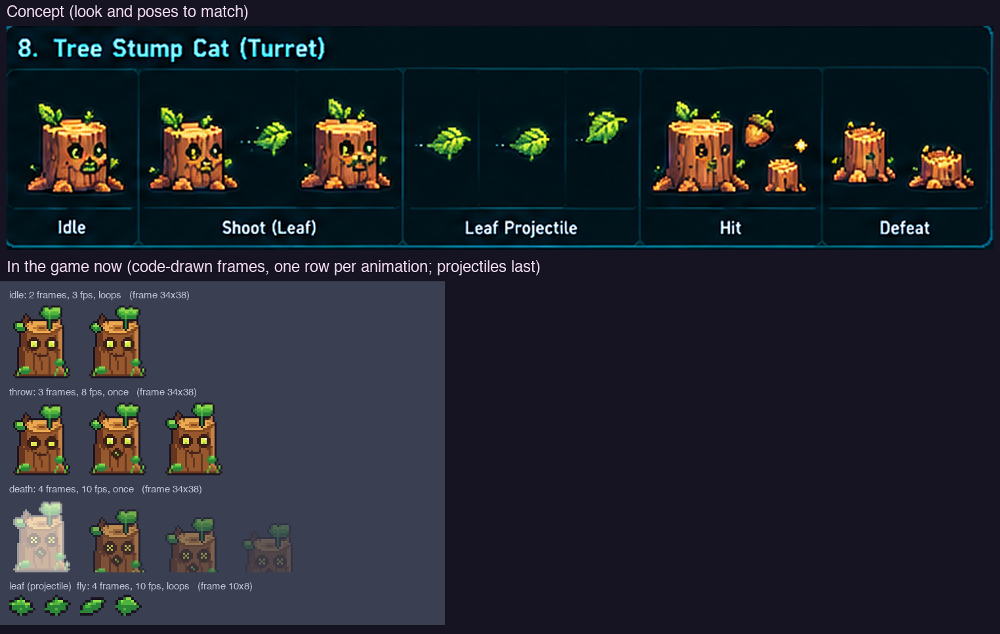

**Abilities**

- **Moves:** Rooted, never moves.
- **Attacks:** Sends a leaf every 2 s low along the ground (2 up) at 80 (leaf hit area 8×5); throws while the kitten is 30–300 away; first throw 0.6 s after it comes in range. Its sides hurt.
- **Toughness:** 2 HP, 25 XP.
- **Beaten by:** 2 Yarn Shots; its flat top is a safe bounce (no kill). **Ghost Dash does not pass it** (it is terrain); jump the leaves and the stump.
- **Special:** Solid terrain like the stump prop.

**Look:** A tree stump with a cat face in the bark and sprout leaves on top.

**Game frame 34×38, hit area 20×28.** Today: idle 2 (3 fps), throw 3 (8 fps), death 4 (10 fps); no hit row yet.

| Row | Frames | Speed | Loops | Lasts | When the game plays it | What the frames show |
|---|---|---|---|---|---|---|
| IDLE | 4 | 4 fps | yes | 1 s | Between shots | The stump with a sleepy cat face in the bark, sprout leaves stirring |
| THROW | 4 | 10 fps | no | 0.4 s | Every leaf (every 2 s) | Mouth opens (1), **spits the leaf** (2), recoil (3), settle (4) |
| HIT | 2 | 10 fps | no | 0.2 s | Hit by the first yarn | Bark cracking, "> <" eyes (1), easing back (2) |
| DEATH | 4 | 8 fps | no | 0.5 s | Defeated | Splitting (1), sinking into the soil (2–3), a few chips and leaves (4) |
| LEAF | 4 | 10 fps | yes | — | **Projectile** (game 10×8, hits 8×5): in flight | A green leaf fluttering low |

### Snail Cat (`snail_cat`)

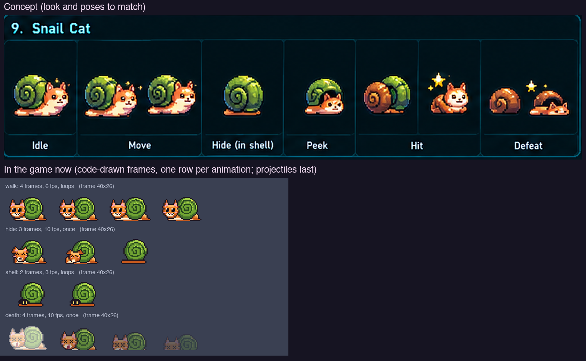

**Abilities**

- **Moves:** Crawls towards the kitten at 8; once the kitten is within 80 it hides in its shell and keeps creeping.
- **Attacks:** Touch from the side.
- **Toughness:** 1 HP, 15 XP.
- **Beaten by:** Before it hides: stomp (kills) or 1 Yarn Shot. Hidden: yarn bounces off and landing on the shell is a safe bounce (no kill). Super Pounce defeats it outright; Ghost Dash passes through it.
- **Special:** Hides at 80 (plays HIDE once, then SHELL).

**Look:** A cat with a green snail shell on its back.

**Game frame 40×26, hit area 24×16.** Today: walk 4 (6 fps), hide 3 (10 fps), shell 2 (3 fps), death 4 (10 fps).

| Row | Frames | Speed | Loops | Lasts | When the game plays it | What the frames show |
|---|---|---|---|---|---|---|
| WALK | 4 | 6 fps | yes | 0.67 s | Before it hides | A slow crawl, the cat body stretching and gathering under the green shell |
| HIDE | 3 | 10 fps | no | 0.3 s | Once, when it hides | Head pulling back (1), half in (2), only the shell (3) |
| SHELL | 2 | 3 fps | yes | 0.67 s | Hidden | The shell, eyes peeking out of the opening, a tiny rock side to side (eyes open in both) |
| DEATH | 4 | 8 fps | no | 0.5 s | Defeated (before it hides) | Knocked over (1), the shell rolling off (2), a puff (3), a few specks (4) |

### Spider Cat (`spider_cat`)

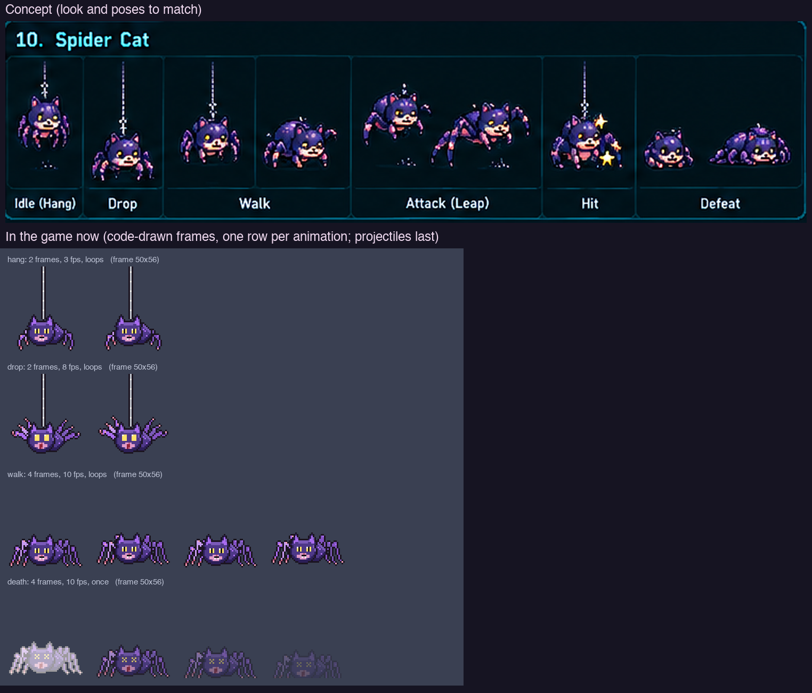

**Abilities**

- **Moves:** Hangs on a thread 60 up; when the kitten is 130 away it flashes for 0.4 s, drops to the ground ahead of it, and walks in at 20.
- **Attacks:** Touch, once it is down (while it hangs it is out of reach and harmless).
- **Toughness:** 1 HP, 20 XP.
- **Beaten by:** Once down: stomp (kills), 1 Yarn Shot, Super Pounce defeats it outright; while it hangs yarn passes it; Ghost Dash passes through it.
- **Special:** Drops at 130 after a 0.4 s warning.

**Look:** A purple cat-faced spider with long jointed legs; **paint the thread from its back straight up to the top of the frame** in HANG and DROP.

**Game frame 50×56, hit area 18×16.** Today: hang 2 (3 fps), drop 2 (8 fps), walk 4 (10 fps), death 4 (10 fps).

| Row | Frames | Speed | Loops | Lasts | When the game plays it | What the frames show |
|---|---|---|---|---|---|---|
| HANG | 2 | 3 fps | yes | 0.67 s | Hanging, and while it flashes before the drop | Dangling on the thread, legs curled, swaying a little |
| DROP | 2 | 8 fps | yes | 0.25 s | Falling | Legs spread wide, thread stretched above |
| WALK | 4 | 10 fps | yes | 0.4 s | Down on the ground | A scuttling walk, legs alternating |
| DEATH | 4 | 8 fps | no | 0.5 s | Defeated | Flipped on its back (1), legs curling (2), a puff (3), a few specks (4) |

## Level 2 — Frostpaw Mountains

Medium, speed 120. Icy blues and white (see `docs/concept/Frostpaw Mountains Enemy Sprite Sheet.png`).

**Abilities at a glance** (speeds in units per second on top of the level's scroll; heights above the ground):

| Enemy | Moves | Attacks | HP | Beaten by |
|---|---|---|---|---|
| Rolling Snowball (`snowball`) | rolls in fast (60) | touch | 2 | jump, 2 yarn, pounce |
| Sliding Penguin (`penguin`) | slides in very fast (90) | touch | 1 | 1 yarn, bounce, pounce |
| Ice Slime (`ice_slime`) | hops in (22) | touch | 1 | stomp, 1 yarn, pounce |
| Snow Cat (`snow_cat`) | runs in fast (55) | touch (paw slash) | 2 | stomp, 2 yarn, pounce |
| Ice Bat (`ice_bat`) | flies 42 up, swoops to 28 | touch | 1 | 1 yarn, stay down |
| Small Ice Golem (`ice_golem`) | walks slowly (8) | touch | 3 | 3 yarn, bounce over, pounce |
| Penguin Soldier (`penguin_soldier`) | patrols ±30 (30) | spear stab within 70, 1 s | 2 | stomp, 2 yarn, pounce |
| Snowy Owl (`snowy_owl`) | hovers 60 up, drifts in (10) | drops icicles, 3 s, 0.4 s warning | 1 | 1 yarn from a jump |
| Ice Hedgehog (`ice_hedgehog`) | walks (20), curls at 100, rolls (110) | touch, spikes when curled | 1 | stomp/yarn before curl, jump, pounce |
| Snowman (`snowman`) | stands | lobbed snowballs, 2.2 s | 2 | 2 yarn, bounce |
| Icicle Plant (`icicle_plant`) | rooted | open on a 2.4 s rhythm + low bolt | 2 | 2 yarn, pass while shut |
| Mini Yeti (`mini_yeti`) | walks slowly (6) | touch (wide swipe) | 4 | 4 yarn, Double Pounce over, pounce |

### Rolling Snowball (`snowball`)

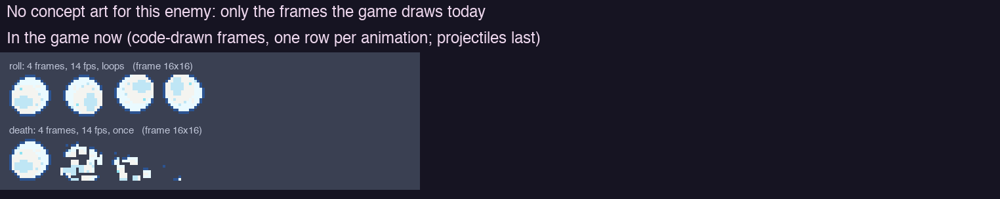

**Abilities**

- **Moves:** Rolls along the ground towards the kitten at 60.
- **Attacks:** Touch only.
- **Toughness:** 2 HP, 20 XP.
- **Beaten by:** 2 Yarn Shots, Super Pounce defeats it outright; Ghost Dash passes through it; or jump it. A stomp hurts.

**Look:** A packed snowball. **No concept art**: match the snow of the Frostpaw sheet (the Snowman's snowball, bigger).

**Game frame 16×16, hit area 14×14.** Today: roll 4 (14 fps), death 4 (14 fps); no hit row yet.

| Row | Frames | Speed | Loops | Lasts | When the game plays it | What the frames show |
|---|---|---|---|---|---|---|
| ROLL | 4 | 14 fps | yes | 0.29 s per turn | All the time | A packed snowball turning a quarter turn per frame (lumps show the turn), a little snow spray behind |
| HIT | 2 | 10 fps | no | 0.2 s | Hit by the first yarn | A chunk knocked off, cracks (1), rolling on (2) |
| DEATH | 4 | 12 fps | no | 0.33 s | Defeated | Bursting into snow (1–2), flakes settling (3), a few flakes (4) |

### Sliding Penguin (`penguin`)

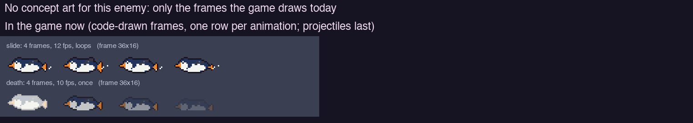

**Abilities**

- **Moves:** Belly-slides towards the kitten very fast, at 90.
- **Attacks:** Touch from the side.
- **Toughness:** 1 HP, 20 XP.
- **Beaten by:** 1 Yarn Shot, Super Pounce defeats it outright; Ghost Dash passes through it; landing on it is a safe bounce (no kill); or jump it.

**Look:** A blue penguin on its belly. **No concept art**: match the Penguin Soldier of the Frostpaw sheet, without the spear.

**Game frame 36×16, hit area 18×12.** Today: slide 4 (12 fps), death 4 (10 fps).

| Row | Frames | Speed | Loops | Lasts | When the game plays it | What the frames show |
|---|---|---|---|---|---|---|
| SLIDE | 4 | 12 fps | yes | 0.33 s | All the time | Flat on its belly, flippers back, feet kicking; snow spraying from under it |
| DEATH | 4 | 8 fps | no | 0.5 s | Defeated | Spinning over, "x x" eyes (1–2), a puff of snow (3), a few flakes (4) |

### Ice Slime (`ice_slime`)

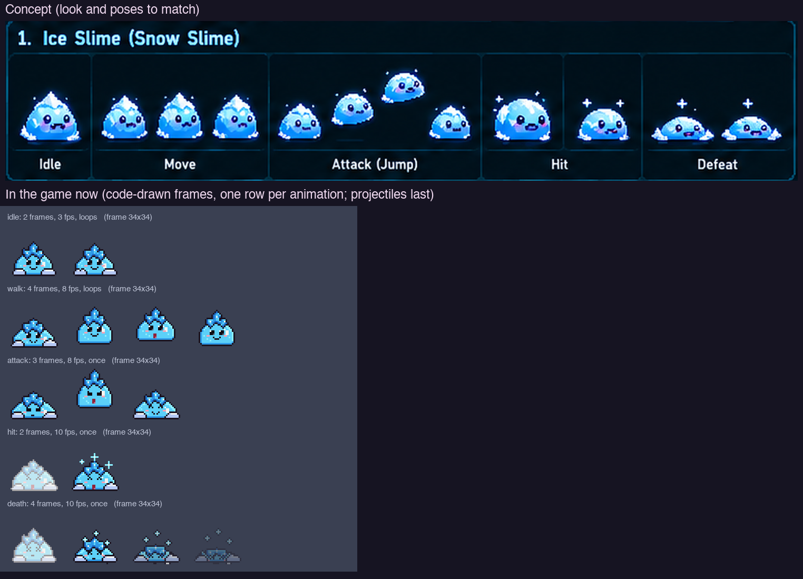

**Abilities**

- **Moves:** Hops along towards the kitten at 22 (the hop is only drawn; its hit area stays on the ground).
- **Attacks:** Touch only.
- **Toughness:** 1 HP, 12 XP.
- **Beaten by:** Stomp (kills), 1 Yarn Shot, Super Pounce defeats it outright; Ghost Dash passes through it; or hop it.

**Look:** An ice-blue gumdrop slime with a crystal peak and snow at its foot.

**Game frame 34×34, hit area 20×14.** Today: idle 2, walk 4 (8 fps), attack 3, hit 2, death 4 (10 fps); the game only plays walk and death.

| Row | Frames | Speed | Loops | Lasts | When the game plays it | What the frames show |
|---|---|---|---|---|---|---|
| WALK | 4 | 8 fps | yes | 0.5 s per hop | All the time | One hop: squash (1), spring up (2), top of the hop (3), landing squash (4); keep the bottom of frames 1 and 4 on the baseline |
| DEATH | 4 | 8 fps | no | 0.5 s | Defeated | Cracking (1), melting (2), a puddle with ice chips (3), a few chips (4) |

### Snow Cat (`snow_cat`)

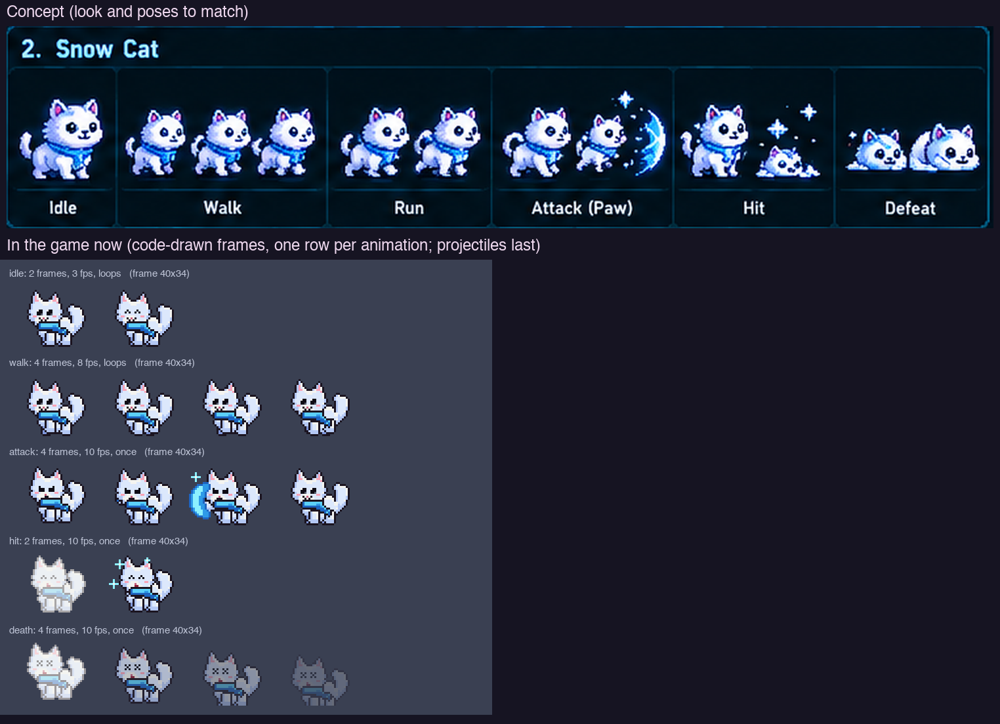

**Abilities**

- **Moves:** Runs towards the kitten fast, at 55.
- **Attacks:** Its paw slash is its body: touching it from the side hurts (the ATTACK swing is looks only).
- **Toughness:** 2 HP, 25 XP.
- **Beaten by:** Stomp (kills), 2 Yarn Shots, Super Pounce defeats it outright; Ghost Dash passes through it; or jump it.

**Look:** A fluffy white cat with a blue scarf.

**Game frame 40×34, hit area 20×20.** Today: idle 2, walk 4 (8 fps), attack 4 (10 fps), hit 2, death 4.

| Row | Frames | Speed | Loops | Lasts | When the game plays it | What the frames show |
|---|---|---|---|---|---|---|
| WALK | 4 | 10 fps | yes | 0.4 s | All the time | A fast trotting run, scarf streaming back |
| ATTACK | 4 | 10 fps | no | 0.4 s, last frame held | Once the kitten is within reach (melee) | Crouch (1), paw raised (2), **slash with an ice arc** (3), paw still out, arc fading (4, held) |
| HIT | 2 | 10 fps | no | 0.2 s | Hit by the first yarn | Knocked back, "> <" eyes (1), easing back (2) |
| DEATH | 4 | 8 fps | no | 0.5 s | Defeated | Tumbling, "x x" eyes (1–2), a puff of snow (3), a few flakes (4) |

### Ice Bat (`ice_bat`)

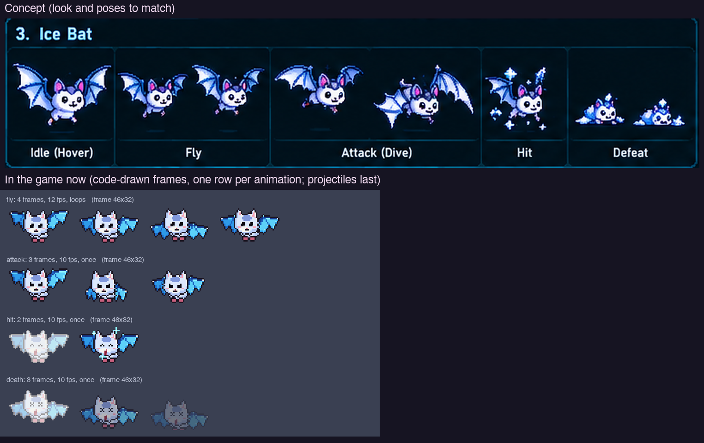

**Abilities**

- **Moves:** Flies in at 45, 42 up; between 150 and 70 from the kitten it swoops down to 28, never lower.
- **Attacks:** Touch only.
- **Toughness:** 1 HP, 15 XP.
- **Beaten by:** 1 Yarn Shot; Ghost Dash passes through it; stay down. A stomp hurts.

**Look:** A white cat-faced bat with ice-blue wings.

**Game frame 46×32, hit area 18×14, flying 42 up (down to 28).** Today: fly 4 (12 fps), attack 3, hit 2, death 3 (10 fps); the game only plays fly and death.

| Row | Frames | Speed | Loops | Lasts | When the game plays it | What the frames show |
|---|---|---|---|---|---|---|
| FLY | 4 | 12 fps | yes | 0.33 s per wingbeat | All the time (the swoop too) | Wings up (1), level (2), down (3), level (4) |
| DEATH | 4 | 8 fps | no | 0.5 s | Defeated | Wings frozen stiff (1), falling (2), shattering into ice flakes (3–4) |

### Small Ice Golem (`ice_golem`)

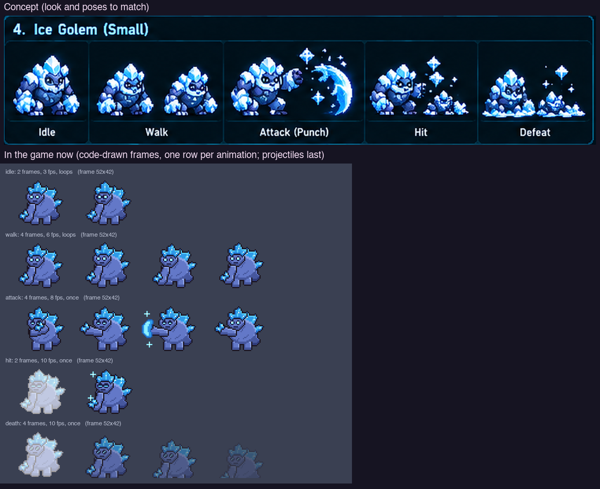

**Abilities**

- **Moves:** Walks slowly towards the kitten at 8.
- **Attacks:** Touch from the side (the punch is looks only).
- **Toughness:** 3 HP, 40 XP.
- **Beaten by:** 3 Yarn Shots, Super Pounce defeats it outright; landing on it is a safe bounce that doesn't break it; jump or Double Pounce over it; Ghost Dash passes through it.
- **Special:** Needs kitten level 3 to pass unhurt (Double Pounce).

**Look:** A blue-grey boulder with ice crystals and glowing eyes.

**Game frame 52×42, hit area 26×30.** Today: idle 2, walk 4 (6 fps), attack 4 (8 fps), hit 2, death 4.

| Row | Frames | Speed | Loops | Lasts | When the game plays it | What the frames show |
|---|---|---|---|---|---|---|
| WALK | 4 | 6 fps | yes | 0.67 s | All the time | A heavy stomp, the crystals on its back rocking |
| ATTACK | 4 | 10 fps | no | 0.4 s, last frame held | Once the kitten is within reach (melee) | Arm back (1), wind-up (2), **punch with an ice arc** (3), fist still out (4, held) |
| HIT | 2 | 10 fps | no | 0.2 s | Hit by yarn, not defeated | Chips flying, rocking back (1), steadying (2) |
| DEATH | 4 | 8 fps | no | 0.5 s | Defeated | Cracking (1), falling apart into blocks (2), crumbling (3), a few ice chips (4) |

### Penguin Soldier (`penguin_soldier`)

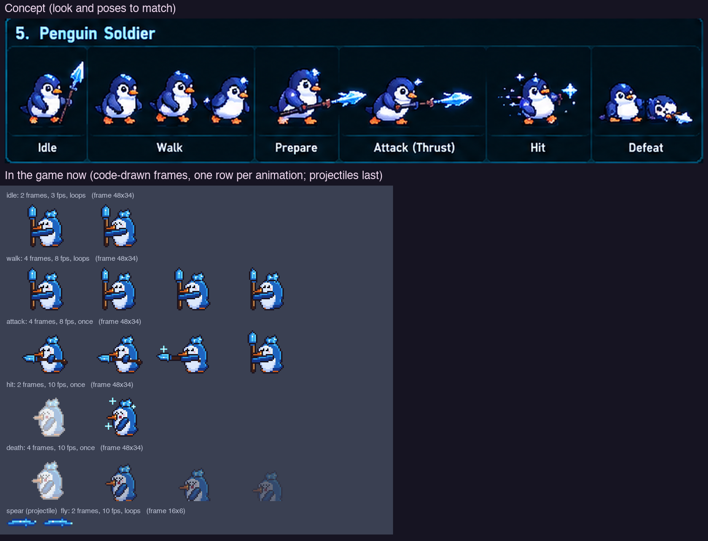

**Abilities**

- **Moves:** Marches back and forth at 30, no more than 30 either side of its post.
- **Attacks:** When the kitten is within 70 it thrusts its spear: a short, fast, low stab (6 up, 140, hit area 14×4), at most once a second, with a 0.1 s wind-up before each. Its body hurts on touch.
- **Toughness:** 2 HP, 25 XP.
- **Beaten by:** Stomp (kills), 2 Yarn Shots, Super Pounce defeats it outright; Ghost Dash passes through it and its projectiles; or jump it early.

**Look:** A blue penguin with an ice-tipped spear.

**Game frame 48×34, hit area 18×24.** Also in level 5. Today: idle 2, walk 4 (8 fps), attack 4 (8 fps), hit 2, death 4.

| Row | Frames | Speed | Loops | Lasts | When the game plays it | What the frames show |
|---|---|---|---|---|---|---|
| WALK | 4 | 8 fps | yes | 0.5 s | Marching (it turns round at each end; the game flips it) | A proud waddle, spear upright |
| ATTACK | 4 | 10 fps | no | 0.4 s | Every thrust (at most once a second, close up) | Spear drawn back (1), **thrust** (2), arm fully out (3), spear back upright (4) |
| HIT | 2 | 10 fps | no | 0.2 s | Hit by the first yarn | Knocked back, helmet askew, "> <" eyes (1), easing back (2) |
| DEATH | 4 | 8 fps | no | 0.5 s | Defeated | Falling over (1), spear dropping (2), a puff of snow (3–4) |
| SPEAR | 2 | 10 fps | yes | — | **Projectile** (game 16×6, hits 14×4): in flight | The ice-tipped spear thrust flying low, point left |

### Snowy Owl (`snowy_owl`)

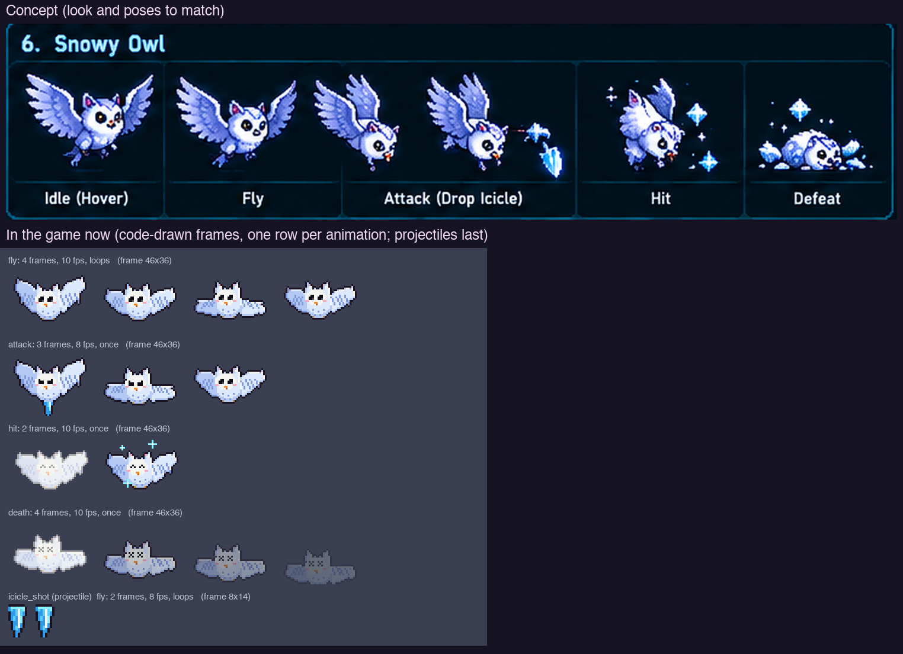

**Abilities**

- **Moves:** Hovers 60 up, drifting in at 10.
- **Attacks:** Every 3 s, while the kitten is within 170, it flashes for 0.4 s, then drops an icicle straight down ahead of the kitten, where it lies as a spike to hop (icicle hit area 6×10). First drop 0.4 s after the kitten comes in range.
- **Toughness:** 1 HP, 25 XP.
- **Beaten by:** 1 Yarn Shot (from a jump); Ghost Dash passes through it and its projectiles; hop the icicle. It can't be stomped.

**Look:** A white owl with ear tufts.

**Game frame 46×36, hit area 20×16, 60 up.** Today: fly 4 (10 fps), attack 3 (8 fps), hit 2, death 4.

| Row | Frames | Speed | Loops | Lasts | When the game plays it | What the frames show |
|---|---|---|---|---|---|---|
| FLY | 4 | 10 fps | yes | 0.4 s | All the time | A slow wingbeat, wings up, level, down, level |
| PREPARE | 2 | 5 fps | no | 0.4 s | The flashing warning before each drop | Wings up, an icicle held in its talons (1–2) |
| ATTACK | 4 | 10 fps | no | 0.4 s | Every drop (every 3 s) | Talons open (1), **lets the icicle go** (2), wings sweep down (3), back to flying (4) |
| DEATH | 4 | 8 fps | no | 0.5 s | Defeated | Tumbling, "x x" eyes (1), feathers bursting (2–3), a few feathers (4) |
| ICICLE | 2 | 8 fps | yes | — | **Projectile** (game 8×14, hits 6×10): in flight | An icicle falling point down, glinting |

### Ice Hedgehog (`ice_hedgehog`)

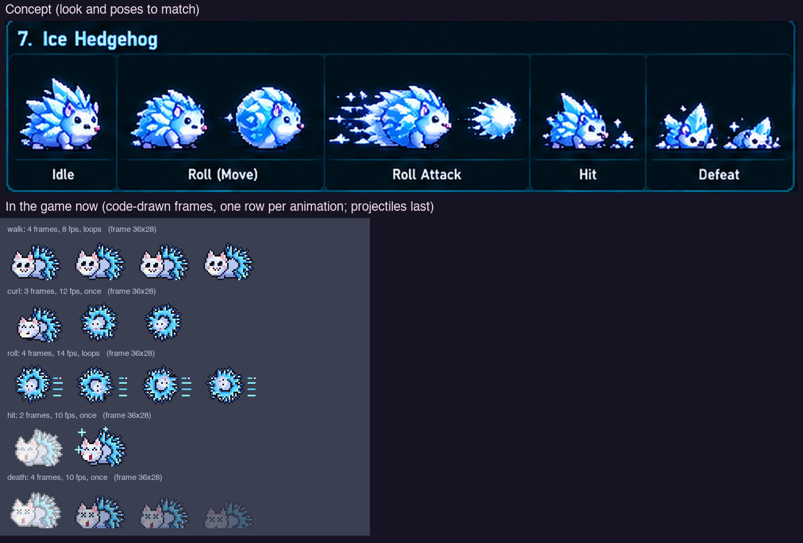

**Abilities**

- **Moves:** Walks towards the kitten at 20; once the kitten is within 100 it curls up and rolls in fast, at 110, turning back at steps and rims.
- **Attacks:** Touch; curled, its spikes hurt from any side.
- **Toughness:** 1 HP, 20 XP.
- **Beaten by:** Before it curls: stomp (kills) or 1 Yarn Shot. Curled: yarn bounces off and a stomp hurts; jump it. Super Pounce defeats it outright; Ghost Dash passes through it.
- **Special:** Curls at 100 (CURL once, then ROLL).

**Look:** A white hedgehog with crystal quills.

**Game frame 36×28, hit area 20×16.** Today: walk 4 (8 fps), curl 3 (12 fps), roll 4 (14 fps), hit 2, death 4.

| Row | Frames | Speed | Loops | Lasts | When the game plays it | What the frames show |
|---|---|---|---|---|---|---|
| WALK | 4 | 8 fps | yes | 0.5 s | Before it curls | A trundling walk, quills bouncing |
| CURL | 3 | 12 fps | no | 0.25 s | Once, when it curls | Head tucking in (1), half curled (2), a tight ice ball (3) |
| ROLL | 4 | 14 fps | yes | 0.29 s per turn | Rolling in | The spiky ice ball turning a quarter turn per frame, frosty streaks behind |
| DEATH | 4 | 8 fps | no | 0.5 s | Defeated (before it curls) | Flipped over (1), quills shattering (2–3), a few ice chips (4) |

### Snowman (`snowman`)

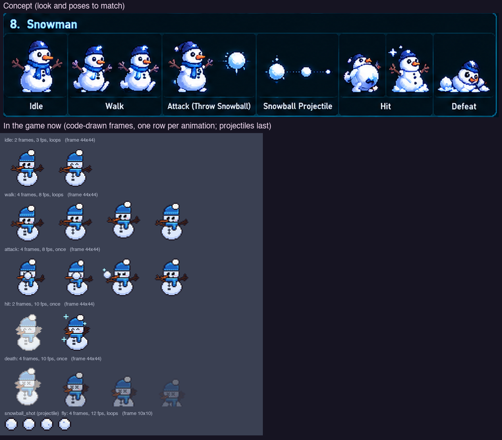

**Abilities**

- **Moves:** Stands still.
- **Attacks:** Lobs a snowball from its head (28 up) every 2.2 s; it lands ahead of the kitten and rolls on at 60 (hit area 8×8); throws while the kitten is 30–300 away; first throw 0.6 s after it comes in range. Its body hurts from the side.
- **Toughness:** 2 HP, 25 XP.
- **Beaten by:** 2 Yarn Shots; a stomp is only a safe bounce; Ghost Dash passes through it and its projectiles; hop the snowballs, jump it.

**Look:** A snowman with a blue beanie and scarf, a carrot nose and twig arms.

**Game frame 44×44, hit area 20×30.** Also in level 5. Today: idle 2, walk 4, attack 4 (8 fps), hit 2, death 4; the game doesn't play walk.

| Row | Frames | Speed | Loops | Lasts | When the game plays it | What the frames show |
|---|---|---|---|---|---|---|
| IDLE | 4 | 4 fps | yes | 1 s | Between throws | Standing, twig arms waving a little, scarf stirring |
| ATTACK | 4 | 10 fps | no | 0.4 s | Every throw (every 2.2 s) | Arm back with a snowball (1), **lobs it** (2), arm forward (3), back to idle (4) |
| HIT | 2 | 10 fps | no | 0.2 s | Hit by the first yarn | A chunk knocked off, beanie askew (1), steadying (2) |
| DEATH | 4 | 8 fps | no | 0.5 s | Defeated | Head tumbling off (1), body slumping (2), a heap of snow (3), a few flakes (4) |
| SNOWBALL | 4 | 12 fps | yes | — | **Projectile** (game 10×10, hits 8×8): in flight | A small snowball turning |

### Icicle Plant (`icicle_plant`)

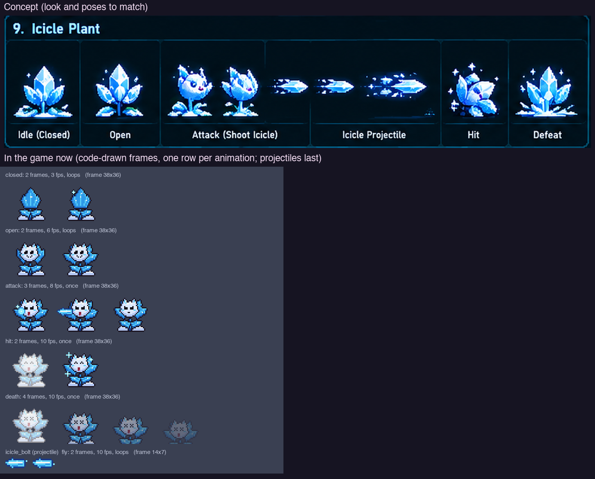

**Abilities**

- **Moves:** Rooted, never moves.
- **Attacks:** A trap on the world clock, every 2.4 s: shut and harmless for 1.3 s, opening (the warning) for 0.5 s, then open for 0.6 s: it hurts, and each time it opens it fires an icicle bolt low along the ground (4 up) at 100 (hit area 10×4).
- **Toughness:** 2 HP, 25 XP.
- **Beaten by:** 2 Yarn Shots (any state); Ghost Dash passes through it and its projectiles; jump the bolt, pass while shut or jump it. It can't be stomped.

**Look:** A crystal bud on a snow mound that opens round a snowy cat face.

**Game frame 38×36, hit area 18×24.** Today: closed 2 (3 fps), open 2 (6 fps), attack 3 (8 fps), hit 2, death 4.

| Row | Frames | Speed | Loops | Lasts | When the game plays it | What the frames show |
|---|---|---|---|---|---|---|
| CLOSED | 4 | 4 fps | yes | 1 s | Shut (1.3 s of each 2.4 s) | A tall closed crystal bud, glinting, swaying slightly |
| OPEN | 2 | 6 fps | yes | 0.5 s | Opening (0.5 s) | Crystal petals parting round a snowy cat face, trembling |
| ATTACK | 4 | 10 fps | no | 0.4 s, last frame held | Each time it opens (0.6 s) | Charge (1), **fires the bolt** (2), recoil (3), petals wide open (4, held to the end) |
| HIT | 2 | 10 fps | no | 0.2 s | Hit by the first yarn | Petals ruffled, "> <" eyes (1), easing back (2) |
| DEATH | 4 | 8 fps | no | 0.5 s | Defeated | Cracking (1), shattering (2–3), a few crystal chips (4) |
| ICICLE BOLT | 2 | 10 fps | yes | — | **Projectile** (game 14×7, hits 10×4): in flight | An ice bolt flying low, frosty trail on the right |

### Mini Yeti (`mini_yeti`)

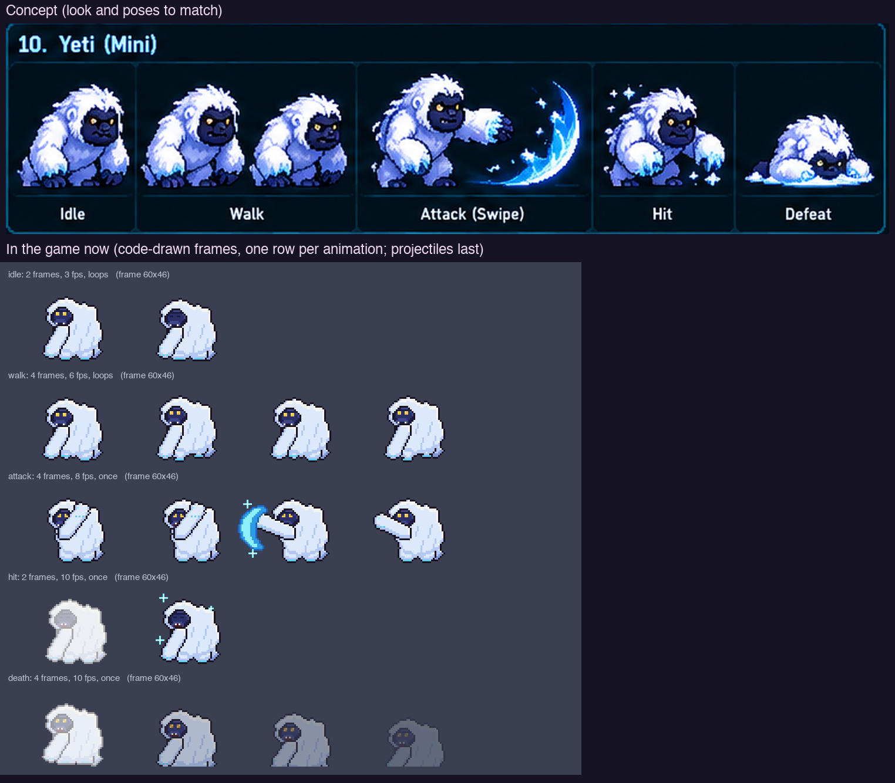

**Abilities**

- **Moves:** Walks slowly towards the kitten at 6.
- **Attacks:** Touch: its wide swipe is its wide body (hit area 30×34; the ATTACK swing is looks only).
- **Toughness:** 4 HP, 60 XP.
- **Beaten by:** 4 Yarn Shots, Super Pounce defeats it outright, or Double Pounce over it; Ghost Dash passes through it. It can't be stomped.
- **Special:** Needs kitten level 3 to pass unhurt.

**Look:** A hunched shaggy white yeti with a dark face and golden eyes.

**Game frame 60×46, hit area 30×34.** Today: idle 2, walk 4 (6 fps), attack 4 (8 fps), hit 2, death 4.

| Row | Frames | Speed | Loops | Lasts | When the game plays it | What the frames show |
|---|---|---|---|---|---|---|
| WALK | 4 | 6 fps | yes | 0.67 s | All the time | A heavy knuckle-walk, fur swaying |
| ATTACK | 4 | 10 fps | no | 0.4 s, last frame held | Once the kitten is within reach (melee) | Arm back (1), wind-up (2), **swipe with a big ice arc** (3), arm still out (4, held) |
| HIT | 2 | 10 fps | no | 0.2 s | Hit by yarn, not defeated | Snow puffing off its fur, "> <" eyes (1), easing back (2) |
| DEATH | 4 | 8 fps | no | 0.5 s | Defeated | Toppling (1), flat in the snow (2), a burst of snow (3), a few flakes (4) |

## Level 3 — The Haunted Meowseum

Hard, speed 130. A dark purple museum: give these enemies a strong dark outline and bright magenta/violet
accents (see `docs/concept/Haunted Meowseum Enemy Sprite Showcase.png`).

**Abilities at a glance** (speeds in units per second on top of the level's scroll; heights above the ground):

| Enemy | Moves | Attacks | HP | Beaten by |
|---|---|---|---|---|
| Ghost Cat (`ghost_cat`) | drifts 44→2 up (20), blinks in/out | touch while visible, spirit balls 2.4 s | — | can't be defeated; time it, Ghost Dash |
| Bat Cat (`bat`) | flies 40 up, swoops to 26 | touch | 1 | 1 yarn, stay down |
| Haunted Portrait (`haunted_portrait`) | floats 32 up, drifts in (12) | low magic shots, 2.2 s | 2 | 2 yarn from a hop |
| Cursed Armor Cat (`cursed_armor`) | statue, wakes at 140, walks (12) | touch once awake | 3 | 3 yarn awake, Double Pounce over, pounce |
| Candle Cat (`candle_cat`) | walks (15) | low fire orbs, 2.5 s | 1 | 1 yarn, pounce |
| Poltergeist Book (`poltergeist_book`) | floats 48 up, drifts in (8) | lobbed bolts that fizzle, 2.4 s | 1 | 1 yarn from a full jump |
| Gargoyle Cat (`gargoyle_cat`) | perched, leaps at 240, walks (25) | touch once awake | 2 | 2 yarn once down, bounce, pounce |
| Shadow Cat (`shadow_cat`) | unseen, appears 80 ahead, dashes (120) | touch | 1 | stomp, 1 yarn, jump, pounce |
| Skeleton Mouse (`skeleton_mouse`) | stands | low bones, 1.8 s | 2 | stomp, 2 yarn |
| Floating Skull (`skull`) | flies in at head height (80) | touch | — | can't be defeated; stay down, Ghost Dash |

### Ghost Cat (`ghost_cat`)

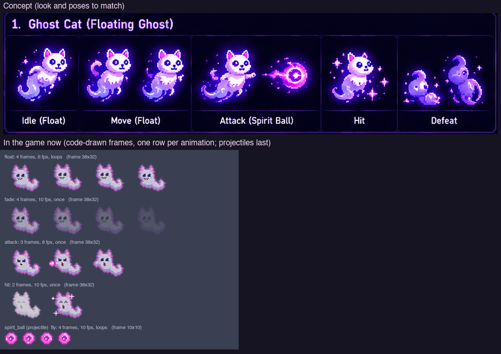

**Abilities**

- **Moves:** Drifts in at 20, 44 up; between 150 and 80 from the kitten it sinks to 2 above the ground.
- **Attacks:** Blinks in and out on the world clock, every 2 s: visible 1.2 s, hidden 0.5 s, fading back in 0.3 s; it only hurts while visible. While visible it throws a spirit ball every 2.4 s straight in at head height (26 up, 100, hit area 8×8), just over a standing kitten; throws while the kitten is 30–300 away; first throw 0.6 s after it comes in range.
- **Toughness:** Can't be defeated (no HP that yarn can reach), 0 XP.
- **Beaten by:** Nothing defeats it: yarn passes through, a stomp hurts, Super Pounce doesn't touch it (it isn't a walker). Time it, or Ghost Dash through it; stay down for the spirit balls.

**Look:** A white ghost cat with a misty tail. The game makes it see-through, so paint it solid with an outline.

**Game frame 38×32, hit area 14×14, floating 44 up, down to 2 as it nears.** Also in level 5. Today: float 4 (6 fps), fade 4 (10 fps), attack 3 (8 fps), hit 2.

| Row | Frames | Speed | Loops | Lasts | When the game plays it | What the frames show |
|---|---|---|---|---|---|---|
| FLOAT | 4 | 6 fps | yes | 0.67 s | Visible | Bobbing up (1–2) and down (3–4), the misty tail waving |
| FADE | 4 | 10 fps | no | 0.4 s | Once each time it blinks out | Thinning and stretching upward, smaller each frame, to a wisp (4) |
| ATTACK | 4 | 10 fps | no | 0.4 s | Every spirit ball (every 2.4 s, while visible) | Glare (1), **paw out, the ball leaves** (2), follow-through (3), back to floating (4) |
| SPIRIT BALL | 4 | 10 fps | yes | — | **Projectile** (game 10×10, hits 8×8): in flight | A glowing violet ball, swirl inside, trail on the right |

### Bat Cat (`bat`)

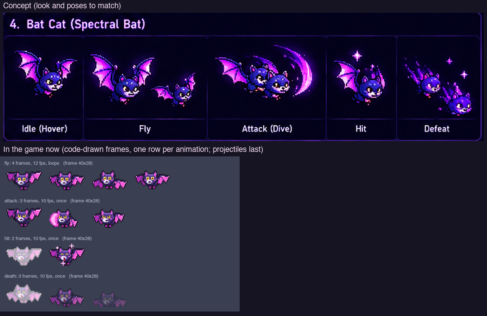

**Abilities**

- **Moves:** Flies in at 40, 40 up; between 150 and 70 from the kitten it swoops down to 26, never lower.
- **Attacks:** Touch only.
- **Toughness:** 1 HP, 15 XP.
- **Beaten by:** 1 Yarn Shot; Ghost Dash passes through it; stay down or jump late. A stomp hurts.

**Look:** The Bat Cat: a navy cat-faced bat with pink wings and gold eyes.

**Game frame 40×28, hit area 14×10, flying 40 up (down to 26).** Today: fly 4 (12 fps), attack 3, hit 2, death 3 (10 fps); the game only plays fly and death.

| Row | Frames | Speed | Loops | Lasts | When the game plays it | What the frames show |
|---|---|---|---|---|---|---|
| FLY | 4 | 12 fps | yes | 0.33 s per wingbeat | All the time (the swoop too) | Wings up (1), level (2), down (3), level (4) |
| DEATH | 4 | 8 fps | no | 0.5 s | Defeated | Wings crumpled (1), falling (2), a violet puff (3), sparkles (4) |

### Haunted Portrait (`haunted_portrait`)

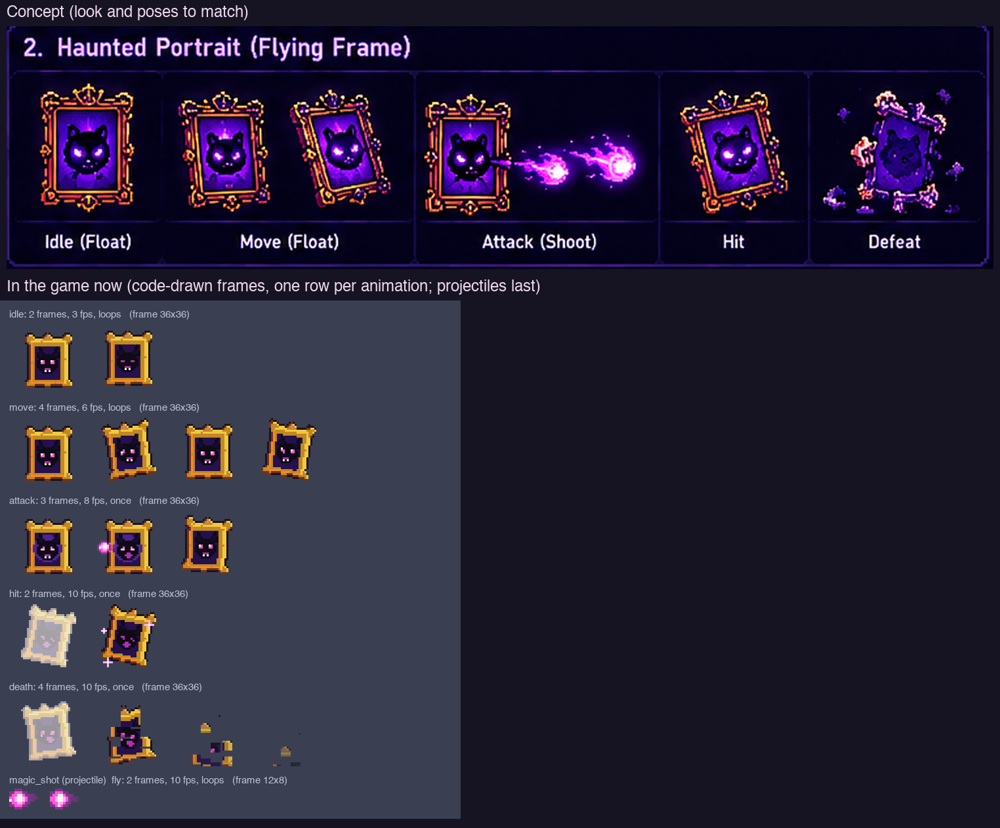

**Abilities**

- **Moves:** Floats 32 up (just over a standing kitten), drifting in at 12.
- **Attacks:** Fires a magic shot every 2.2 s low along the ground (4 up) at 110 (hit area 10×6); throws while the kitten is 30–300 away; first throw 0.6 s after it comes in range. Its body hurts on touch.
- **Toughness:** 2 HP, 25 XP.
- **Beaten by:** 2 Yarn Shots (from a hop); Ghost Dash passes through it and its projectiles; jump the shots. A stomp hurts.

**Look:** An orange-gold picture frame round a black cat face with glowing pink eyes.

**Game frame 36×36, hit area 18×20, 32 up.** Today: idle 2, move 4 (6 fps), attack 3 (8 fps), hit 2, death 4; the game doesn't play idle.

| Row | Frames | Speed | Loops | Lasts | When the game plays it | What the frames show |
|---|---|---|---|---|---|---|
| MOVE | 4 | 6 fps | yes | 0.67 s | All the time | Floating, tilting left (1), level (2), right (3), level (4) |
| ATTACK | 4 | 10 fps | no | 0.4 s | Every shot (every 2.2 s) | Eyes glow (1), **the shot leaves the mouth** (2), glow fading (3), settle (4) |
| HIT | 2 | 10 fps | no | 0.2 s | Hit by the first yarn | The frame jolting, the canvas rippling (1), steadying (2) |
| DEATH | 4 | 8 fps | no | 0.5 s | Defeated | The canvas tearing (1), the frame breaking apart (2–3), a few splinters (4) |
| MAGIC SHOT | 2 | 10 fps | yes | — | **Projectile** (game 12×8, hits 10×6): in flight | A pink magic bolt flying low |

### Cursed Armor Cat (`cursed_armor`)

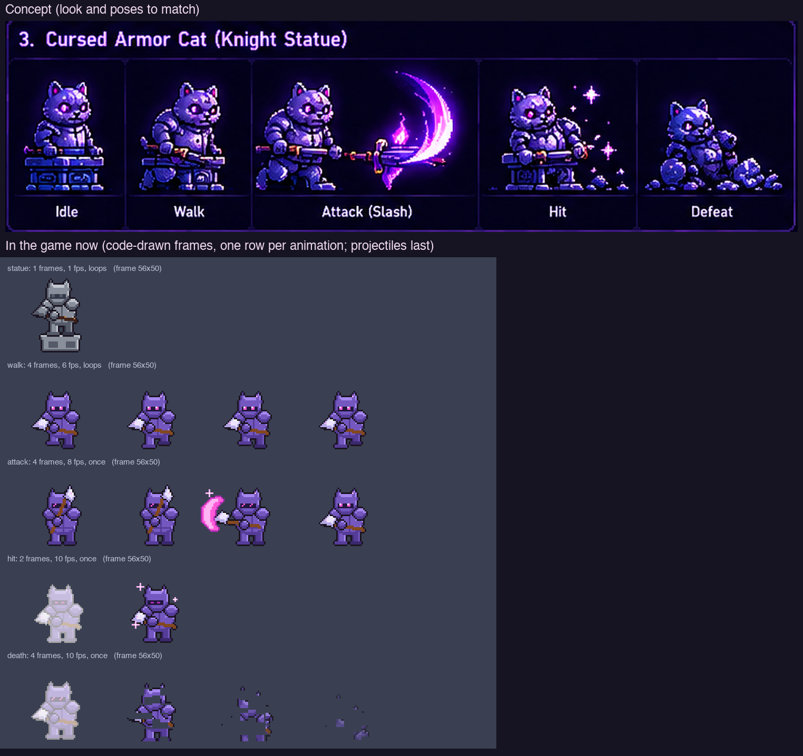

**Abilities**

- **Moves:** A still statue until the kitten is within 140; then it flashes for 0.5 s, wakes and walks in at 12.
- **Attacks:** Awake: touch. Asleep it is harmless.
- **Toughness:** 3 HP, 45 XP.
- **Beaten by:** Awake: 3 Yarn Shots, Super Pounce defeats it outright; Double Pounce over it; Ghost Dash passes through it. Asleep, yarn bounces off and landing on it is a safe bounce. Awake it can't be stomped (a stomp hurts).
- **Special:** Needs kitten level 3 to pass unhurt; wakes at 140 after a 0.5 s warning.

**Look:** An armoured knight cat with a cat-eared helm, a glowing visor and a halberd, on a plinth while asleep.

**Game frame 56×50, hit area 20×28.** Today: statue 1, walk 4 (6 fps), attack 4, hit 2, death 4; the game doesn't play attack.

| Row | Frames | Speed | Loops | Lasts | When the game plays it | What the frames show |
|---|---|---|---|---|---|---|
| STATUE | 1 | — | — | — | Asleep and while it flashes awake | The grey stone knight standing still on its plinth, visor dark |
| WALK | 4 | 6 fps | yes | 0.67 s | Awake | A clanking march, halberd held forward, the visor glowing |
| HIT | 2 | 10 fps | no | 0.2 s | Hit by yarn, not defeated | Sparks off the armour, rocking back (1), steadying (2) |
| DEATH | 4 | 8 fps | no | 0.5 s | Defeated | The helm falling off (1), armour collapsing (2), a heap of plates (3), a violet puff (4) |

### Candle Cat (`candle_cat`)

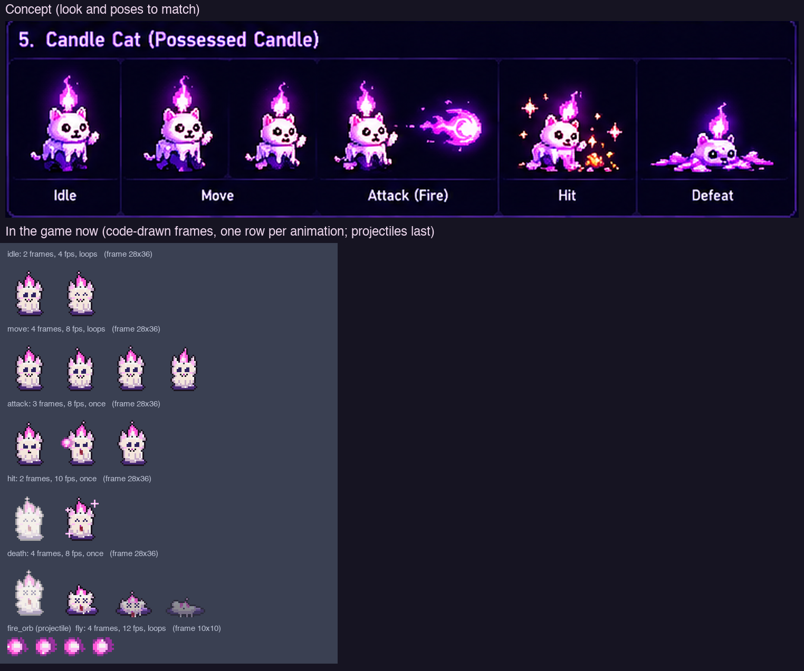

**Abilities**

- **Moves:** Walks slowly towards the kitten at 15.
- **Attacks:** Sends a fire orb every 2.5 s low along the ground (2 up) at 80 (hit area 8×8); throws while the kitten is 30–300 away; first throw 0.6 s after it comes in range. Its body hurts, and the flame on its head burns a kitten that lands on it.
- **Toughness:** 1 HP, 15 XP.
- **Beaten by:** 1 Yarn Shot, Super Pounce defeats it outright; Ghost Dash passes through it and its projectiles; jump the orbs and it. A stomp hurts.

**Look:** A white wax cat with a magenta flame on its head.

**Game frame 28×36, hit area 14×16.** Today: idle 2, move 4 (8 fps), attack 3 (8 fps), hit 2, death 4; the game doesn't play idle or hit.

| Row | Frames | Speed | Loops | Lasts | When the game plays it | What the frames show |
|---|---|---|---|---|---|---|
| MOVE | 4 | 8 fps | yes | 0.5 s | All the time | A waddling walk, the head flame flickering a beat behind |
| ATTACK | 4 | 10 fps | no | 0.4 s | Every fire orb (every 2.5 s) | Crouch (1), **paw throws the orb** (2), follow-through (3), settle (4) |
| DEATH | 4 | 8 fps | no | 0.5 s | Defeated | Flame going out (1), melting (2), a violet wax puddle (3), a wisp of smoke (4) |
| FIRE ORB | 4 | 12 fps | yes | — | **Projectile** (game 10×10, hits 8×8): in flight | A magenta fireball rolling low, flame trail on the right |

### Poltergeist Book (`poltergeist_book`)

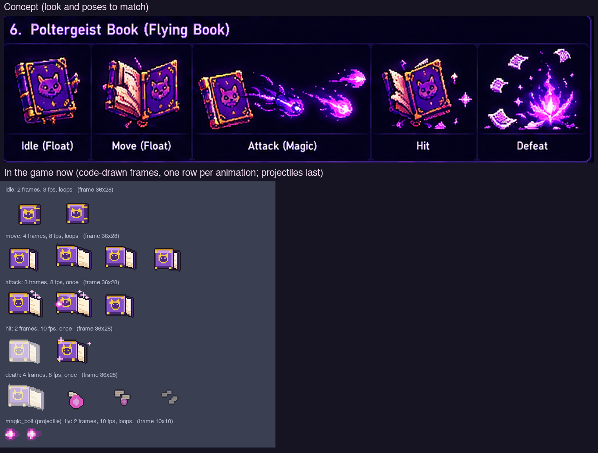

**Abilities**

- **Moves:** Floats high, 48 up, drifting in at 8.
- **Attacks:** Lobs a magic bolt every 2.4 s that lands ahead of the kitten and fizzles out where it lands (hit area 8×8; it rolls nowhere); throws while the kitten is 30–220 away; first throw 0.6 s after it comes in range.
- **Toughness:** 1 HP, 20 XP.
- **Beaten by:** 1 Yarn Shot (from a full jump); Ghost Dash passes through it and its projectiles; don't jump into a falling bolt.

**Look:** A purple book with gold corners and a cat crest.

**Game frame 36×28, hit area 16×14, 48 up.** Today: idle 2, move 4 (8 fps), attack 3 (8 fps), hit 2, death 4; the game doesn't play idle or hit.

| Row | Frames | Speed | Loops | Lasts | When the game plays it | What the frames show |
|---|---|---|---|---|---|---|
| MOVE | 4 | 8 fps | yes | 0.5 s | All the time | Covers flapping open (1–2) and shut (3–4) like wings |
| ATTACK | 4 | 10 fps | no | 0.4 s | Every bolt (every 2.4 s) | Opens wide with glowing pages (1), **the bolt flies out** (2), pages settle (3), closing (4) |
| DEATH | 4 | 8 fps | no | 0.5 s | Defeated | A magenta flare (1), pages bursting out (2–3), a few pages fluttering (4) |
| MAGIC BOLT | 2 | 10 fps | yes | — | **Projectile** (game 10×10, hits 8×8): in flight | A violet bolt falling in an arc, sparkling |

### Gargoyle Cat (`gargoyle_cat`)

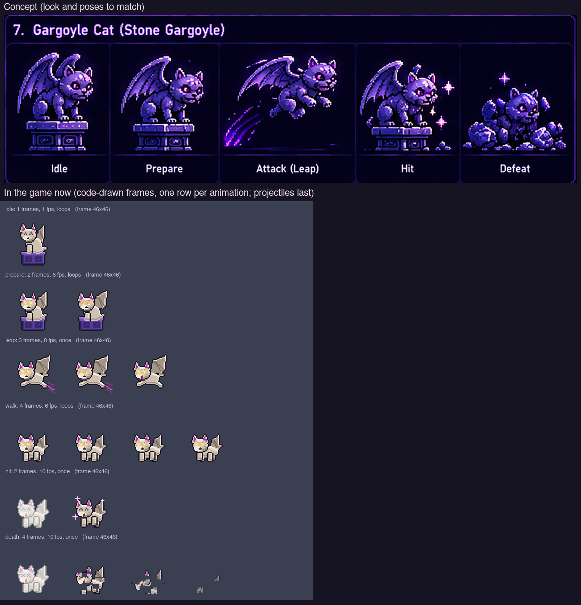

**Abilities**

- **Moves:** Perched and still until the kitten is 240 away; then it flashes for 0.5 s, leaps 70 towards the kitten (28 high, about 0.5 s in the air), lands ahead of it and walks in at 25.
- **Attacks:** Touch, in the air and after it lands. Perched it is harmless.
- **Toughness:** 2 HP, 35 XP.
- **Beaten by:** Once down: 2 Yarn Shots, Super Pounce defeats it outright; landing on it is a safe bounce (no kill) asleep or awake; Ghost Dash passes through it; jump or bounce over it. Perched, yarn bounces off.
- **Special:** Wakes at 240 after a 0.5 s warning, then leaps.

**Look:** A stone cat with bat wings, perched on a pedestal while asleep.

**Game frame 46×46, hit area 20×24.** Today: idle 1, prepare 2 (6 fps), leap 3 (8 fps), walk 4 (6 fps), hit 2, death 4.

| Row | Frames | Speed | Loops | Lasts | When the game plays it | What the frames show |
|---|---|---|---|---|---|---|
| IDLE | 1 | — | — | — | Asleep | Perched on its pedestal, wings folded, eyes dark stone |
| PREPARE | 2 | 6 fps | yes | 0.5 s | The flashing warning | Crouched to spring, wings lifting, eyes glowing (1–2) |
| LEAP | 3 | 6 fps | no | 0.5 s, last frame held | In the air | Springing off (1), wings spread at the top (2), coming down, legs forward (3) |
| WALK | 4 | 6 fps | yes | 0.67 s | Down and walking in | On all fours, wings folded, a heavy prowl |
| HIT | 2 | 10 fps | no | 0.2 s | Hit by the first yarn | Stone chips flying (1), steadying (2) |
| DEATH | 4 | 8 fps | no | 0.5 s | Defeated | Cracking (1), crumbling into rubble (2–3), a little dust (4) |

The pedestal shows only in IDLE (it stays behind when it leaps).

### Shadow Cat (`shadow_cat`)

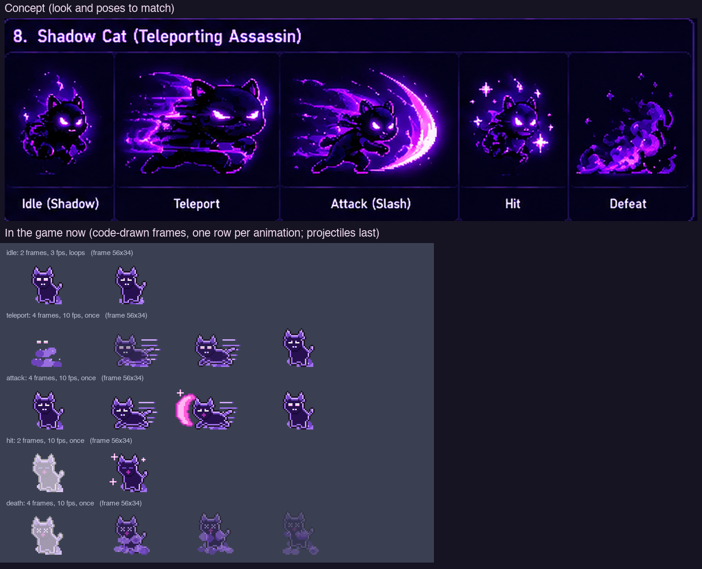

**Abilities**

- **Moves:** Unseen and intangible until the kitten is within 180; then it appears 80 ahead, flashes for 0.4 s holding that distance, and dashes in fast, at 120.
- **Attacks:** Touch while dashing.
- **Toughness:** 1 HP, 30 XP.
- **Beaten by:** Stomp (kills) as it dashes, 1 Yarn Shot once visible, Super Pounce defeats it outright; Ghost Dash passes through it; jump it. While unseen, yarn passes through.
- **Special:** Teleports ahead at 180 (0.4 s warning).

**Look:** A black cat edged in violet with glowing violet eyes and smoke at its feet.

**Game frame 56×34, hit area 16×20.** Today: idle 2, teleport 4 (10 fps), attack 4 (10 fps), hit 2, death 4.

| Row | Frames | Speed | Loops | Lasts | When the game plays it | What the frames show |
|---|---|---|---|---|---|---|
| TELEPORT | 4 | 10 fps | no | 0.4 s | Appearing, while it flashes | Smoke and two eyes (1), the body forming (2–3), formed and crouched (4) |
| ATTACK | 4 | 10 fps | no | 0.4 s, last frame held | The dash, all the way in | Crouch (1), spring (2), **streaking forward with a violet crescent** (3), stretched dash pose with speed streaks (4, held while it dashes) |
| DEATH | 4 | 8 fps | no | 0.5 s | Defeated | Recoiling (1), dissolving into smoke (2–3), a wisp (4) |

### Skeleton Mouse (`skeleton_mouse`)

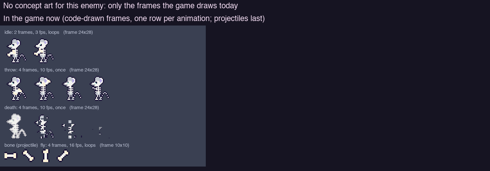

**Abilities**

- **Moves:** Stands still.
- **Attacks:** Throws a bone every 1.8 s low along the ground (2 up) at 90 (hit area 8×5); throws while the kitten is 30–300 away; first throw 0.6 s after it comes in range. Its body hurts from the side.
- **Toughness:** 2 HP, 25 XP.
- **Beaten by:** Stomp (kills), 2 Yarn Shots; Ghost Dash passes through it and its projectiles; jump the bones.

**Look:** A small skeleton mouse in bone white with glowing eye sockets. **No concept art** (the concept's Bone Mouse Captain is a future mini-boss).

**Game frame 24×28, hit area 14×14.** Today: idle 2 (3 fps), throw 4 (10 fps), death 4 (10 fps); no hit row yet.

| Row | Frames | Speed | Loops | Lasts | When the game plays it | What the frames show |
|---|---|---|---|---|---|---|
| IDLE | 4 | 4 fps | yes | 1 s | Between throws | Standing, rattling a little, holding a bone, glowing eye sockets |
| THROW | 4 | 10 fps | no | 0.4 s | Every bone (every 1.8 s) | Arm back (1), **throws the bone** (2), follow-through (3), reaching for another (4) |
| HIT | 2 | 10 fps | no | 0.2 s | Hit by the first yarn | Bones rattling apart a little (1), snapping back (2) |
| DEATH | 4 | 8 fps | no | 0.5 s | Defeated | Falling apart (1), a pile of bones (2), a violet puff (3), a few bones (4) |
| BONE | 4 | 16 fps | yes | — | **Projectile** (game 10×10, hits 8×5): in flight | A bone spinning end over end, low |

### Floating Skull (`skull`)

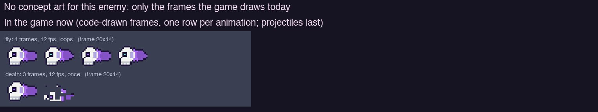

**Abilities**

- **Moves:** Flies straight in at head height, 26 up, at 80 (just over a kitten on the ground).
- **Attacks:** Touch only (it is a projectile on its own).
- **Toughness:** Can't be defeated, 0 XP.
- **Beaten by:** Nothing defeats it: yarn passes through, a stomp hurts. Stay down, or Ghost Dash through it.

**Look:** A cat skull with a violet flame trail. **No concept art.**

**Game frame 20×14, hit area 10×10, 26 up.** Also in level 5. Today: fly 4 (12 fps), death 3; the game doesn't play death.

| Row | Frames | Speed | Loops | Lasts | When the game plays it | What the frames show |
|---|---|---|---|---|---|---|
| FLY | 4 | 12 fps | yes | 0.33 s | All the time | The skull flying left, jaw chattering open and shut, the flame trail flickering on the right |

## Level 4 — The Cataclysm Citadel

Expert, speed 140. Black stone, lava and fire (see `docs/concept/Cataclysm Citadel Enemy Sprite Sheet.png`).

**Abilities at a glance** (speeds in units per second on top of the level's scroll; heights above the ground):

| Enemy | Moves | Attacks | HP | Beaten by |
|---|---|---|---|---|
| Wall Cannon (`cannon`) | fixed, 30 up | head-high cannonballs, 2.2 s | 2 | 2 yarn, stay down |
| Mechanical Mouse (`mech_mouse`) | runs in fast (80) | touch | 2 | 2 yarn, jump/bounce, pounce |
| Lava Slime (`lava_slime`) | creeps (14) | lava globs → 1 s puddle, 2.4 s | 1 | 1 yarn, pounce |
| Fire Imp (`fire_imp`) | hovers 40 up, keeps 140 ahead 3 s | low fireballs, 2.2 s | 1 | 1 yarn from a hop |
| Stone Guard Cat (`stone_guard`) | walks slowly (8) | magma blast within 60, 1 s | 4 | 4 yarn, bounce over, pounce |
| Hell Hound Cat (`hell_hound`) | chases from behind (+130) | touch (burns) | 2 | jump as it passes, pounce, 2 yarn |
| Ember Bat (`ember_bat`) | flies 42 up, swoops to 28 | touch | 1 | 1 yarn, stay down |
| Flame Archer Cat (`flame_archer`) | stands | low flame arrows, 2 s | 2 | stomp, 2 yarn |
| Chainsaw Cat (`chainsaw_cat`) | walks slowly (10) | touch + saw reaching 20 ahead | 5 | pounce, 5 yarn |
| Fire Wisp (`fire_wisp`) | drifts in low (20 up, 40) | bursts into a 40-wide fire ring | 1 | 1 yarn first, hop the ring, Ghost Dash |

### Wall Cannon (`cannon`)

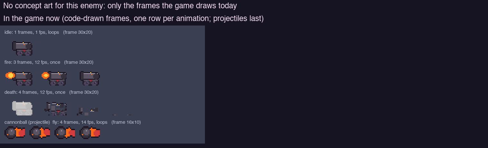

**Abilities**

- **Moves:** Fixed in place, 30 up.
- **Attacks:** Fires a cannonball every 2.2 s at head height (26 up) at 110 (hit area 8×8); throws while the kitten is 30–320 away; first throw 0.6 s after it comes in range. Its body hurts on touch.
- **Toughness:** 2 HP, 25 XP.
- **Beaten by:** 2 Yarn Shots; Ghost Dash passes through it and its projectiles; stay down for the balls.

**Look:** A dark iron wall cannon with glowing red seams. **No concept art.**

**Game frame 30×20, hit area 14×12, 30 up.** Today: idle 1, fire 3 (12 fps), death 4 (12 fps); no hit row yet.

| Row | Frames | Speed | Loops | Lasts | When the game plays it | What the frames show |
|---|---|---|---|---|---|---|
| IDLE | 1 | — | — | — | Between shots | The cannon at rest, muzzle pointing right (towards the kitten once mirrored) |
| FIRE | 4 | 12 fps | no | 0.33 s | Every shot (every 2.2 s) | Fuse glowing (1), **the muzzle flash, ball out** (2), recoil back (3), back in place (4) |
| HIT | 2 | 10 fps | no | 0.2 s | Hit by the first yarn | Sparks, the barrel jolting (1), steadying (2) |
| DEATH | 4 | 10 fps | no | 0.4 s | Defeated | Bursting (1), barrel breaking (2), falling pieces (3), a puff of smoke (4) |
| CANNONBALL | 4 | 14 fps | yes | — | **Projectile** (game 16×10, hits 8×8): in flight | A black ball with a fiery trail on the right |

### Mechanical Mouse (`mech_mouse`)

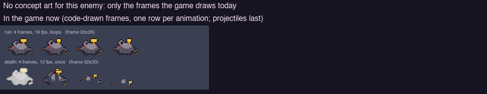

**Abilities**

- **Moves:** Runs in fast along the ground, at 80.
- **Attacks:** Touch from the side.
- **Toughness:** 2 HP, 30 XP.
- **Beaten by:** 2 Yarn Shots, Super Pounce defeats it outright; Ghost Dash passes through it; jump it. Landing on it is a safe bounce only (no kill).

**Look:** An iron wind-up mouse with a key on its back and red glowing eyes. **No concept art.**

**Game frame 32×20, hit area 18×12.** Today: run 4 (16 fps), death 4 (12 fps); no hit row yet.

| Row | Frames | Speed | Loops | Lasts | When the game plays it | What the frames show |
|---|---|---|---|---|---|---|
| RUN | 4 | 16 fps | yes | 0.25 s | All the time | Wheels or legs whirring, the key turning a quarter per frame, tail sparking |
| HIT | 2 | 10 fps | no | 0.2 s | Hit by the first yarn | Sparks, a spring popping (1), rattling on (2) |
| DEATH | 4 | 10 fps | no | 0.4 s | Defeated | Jolting (1), springs and gears bursting out (2–3), a puff of smoke (4) |

### Lava Slime (`lava_slime`)

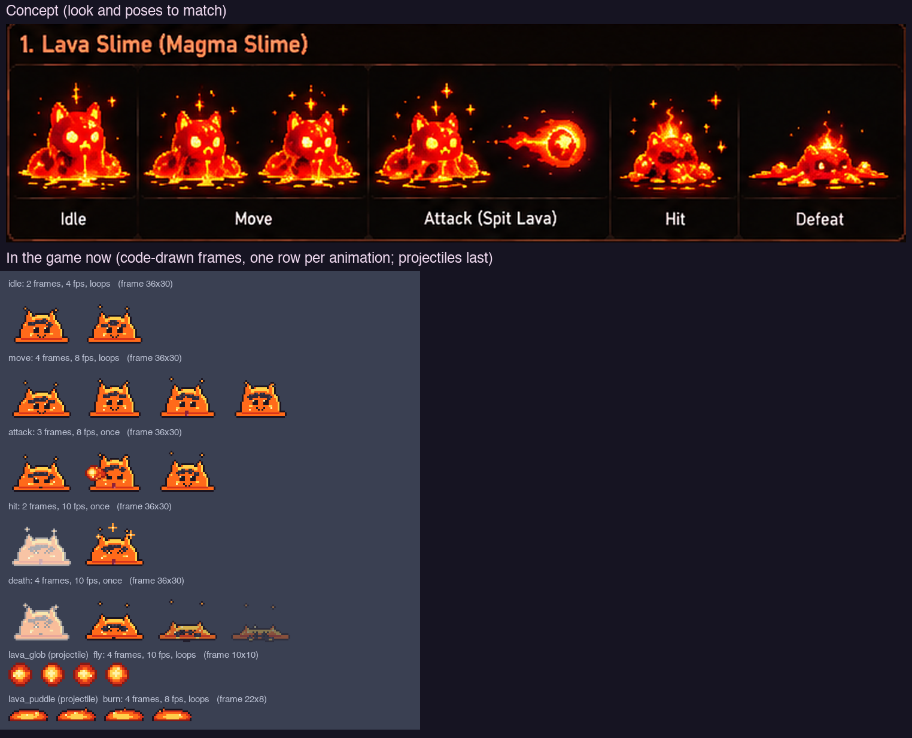

**Abilities**

- **Moves:** Creeps towards the kitten at 14.
- **Attacks:** Spits a lava glob every 2.4 s from 12 up in an arc that lands ahead of the kitten and burns there as a puddle for 1 s (puddle hit area 18×4); throws while the kitten is 30–300 away; first throw 0.6 s after it comes in range. Molten: its body hurts from any side.
- **Toughness:** 1 HP, 15 XP.
- **Beaten by:** 1 Yarn Shot, Super Pounce defeats it outright; Ghost Dash passes through it and its projectiles; hop the puddle and it. It can't be stomped.

**Look:** A molten cat-eared dome with a black crust on its crown and a lava pool at its foot.

**Game frame 36×30, hit area 20×14.** Today: idle 2, move 4 (8 fps), attack 3 (8 fps), hit 2, death 4; the game doesn't play idle or hit.

| Row | Frames | Speed | Loops | Lasts | When the game plays it | What the frames show |
|---|---|---|---|---|---|---|
| MOVE | 4 | 8 fps | yes | 0.5 s | All the time | One ooze forward: squash, stretch, slide, settle; lava bubbling |
| ATTACK | 4 | 10 fps | no | 0.4 s | Every glob (every 2.4 s) | Puffing up (1), **spits the glob** (2), shrinking back (3), settle (4) |
| DEATH | 4 | 8 fps | no | 0.5 s | Defeated | Crust cracking (1), melting flat (2), a cooling puddle (3), a wisp of smoke (4) |
| LAVA GLOB | 4 | 10 fps | yes | — | **Projectile** (game 10×10, hits 8×8): in flight | A lava blob falling in an arc, dripping |
| LAVA PUDDLE | 4 | 8 fps | yes | — | **Where the glob lands** (game 22×8, hurts 18×4, 1 s): on the ground | A flat bubbling puddle |

### Fire Imp (`fire_imp`)

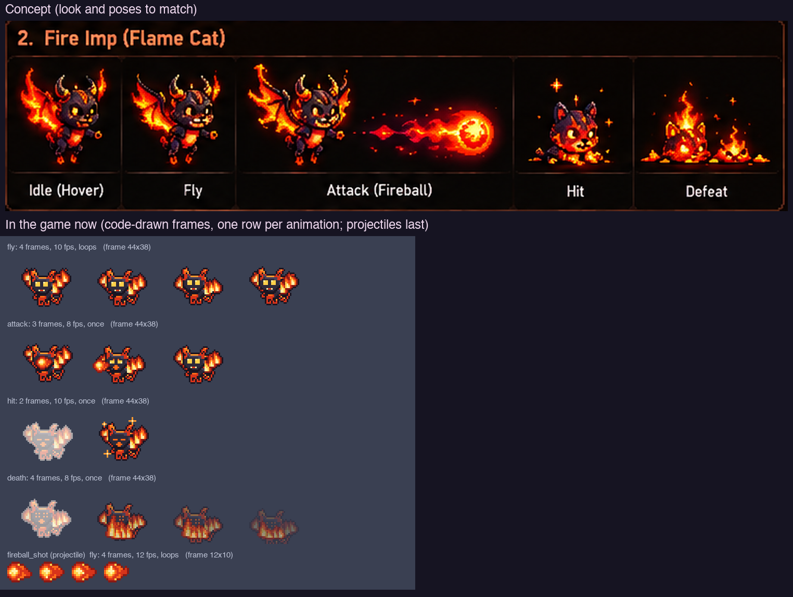

**Abilities**

- **Moves:** Hovers 40 up (above a standing kitten); once within 140 it keeps 140 ahead of the kitten, moving with it, for 3 s, then drifts in at 20.
- **Attacks:** Fires a fireball every 2.2 s low along the ground (4 up) at 110 (hit area 10×6); throws while the kitten is 30–300 away; first throw 0.6 s after it comes in range. Its body hurts on touch.
- **Toughness:** 1 HP, 25 XP.
- **Beaten by:** 1 Yarn Shot (from a hop); Ghost Dash passes through it and its projectiles; jump the fireballs. A stomp hurts.
- **Special:** Keeps its distance for 3 s.

**Look:** A horned black cat with flame wings, a glowing belly and a flame-tipped tail.

**Game frame 44×38, hit area 18×18, 40 up.** Today: fly 4 (10 fps), attack 3 (8 fps), hit 2, death 4; the game doesn't play hit.

| Row | Frames | Speed | Loops | Lasts | When the game plays it | What the frames show |
|---|---|---|---|---|---|---|
| FLY | 4 | 10 fps | yes | 0.4 s | All the time | Flame wings beating, tail flicking |
| ATTACK | 4 | 10 fps | no | 0.4 s | Every fireball (every 2.2 s) | Wind-up (1), **throws the fireball** (2), follow-through (3), back to flying (4) |
| DEATH | 4 | 8 fps | no | 0.5 s | Defeated | Flames guttering (1), burning away (2–3), embers (4) |
| FIREBALL | 4 | 12 fps | yes | — | **Projectile** (game 12×10, hits 10×6): in flight | A fireball flying low, flame trail on the right |

### Stone Guard Cat (`stone_guard`)

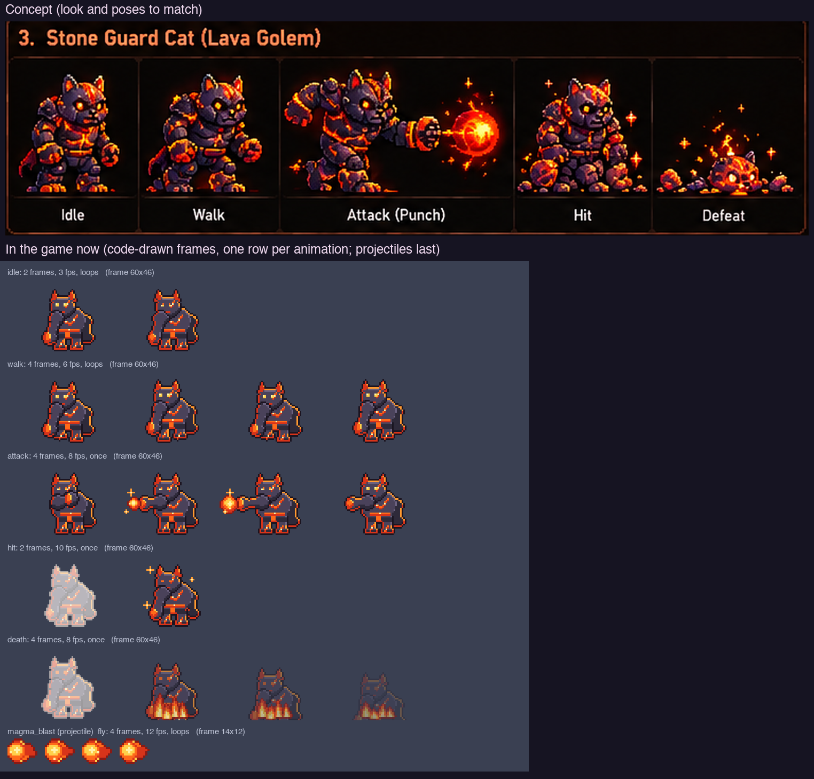

**Abilities**

- **Moves:** Walks slowly towards the kitten at 8.
- **Attacks:** Close up (within 60) it punches out a short, low magma blast (8 up, 120, hit area 12×8), at most once a second, with a 0.1 s wind-up. Its body hurts from the side.
- **Toughness:** 4 HP, 50 XP.
- **Beaten by:** 4 Yarn Shots, Super Pounce defeats it outright; landing on it is a safe bounce (no kill); Ghost Dash passes through it and its projectiles; jump or bounce over it early.
- **Special:** Needs kitten level 3 to pass unhurt.

**Look:** A cat-eared golem of black stone plates with glowing lava seams and molten knuckles.

**Game frame 60×46, hit area 26×32.** Also in level 5. Today: idle 2, walk 4 (6 fps), attack 4 (8 fps), hit 2, death 4.

| Row | Frames | Speed | Loops | Lasts | When the game plays it | What the frames show |
|---|---|---|---|---|---|---|
| WALK | 4 | 6 fps | yes | 0.67 s | All the time | A heavy stomp, the lava seams pulsing |
| ATTACK | 4 | 10 fps | no | 0.4 s | Every blast (at most once a second, close up) | Fist drawn back, magma gathering (1), **punch, the blast leaves** (2), arm out (3), recover (4) |
| HIT | 2 | 10 fps | no | 0.2 s | Hit by yarn, not defeated | Stone chips flying (1), steadying (2) |
| DEATH | 4 | 8 fps | no | 0.5 s | Defeated | Cracking (1), plates falling apart (2), a heap of glowing rubble (3), smoke (4) |
| MAGMA BLAST | 4 | 12 fps | yes | — | **Projectile** (game 14×12, hits 12×8): in flight | A short burst of magma flying low |

### Hell Hound Cat (`hell_hound`)

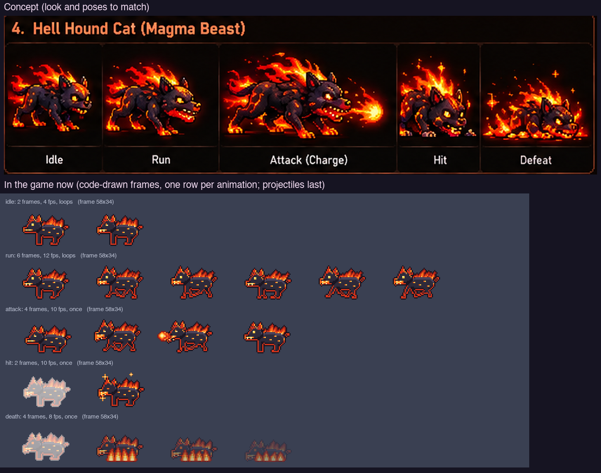

**Abilities**

- **Moves:** Unseen until the kitten reaches its spot; then it flashes at the left edge of the screen for 0.6 s and runs in from 120 behind, 130 faster than the kitten, past it and away ahead.
- **Attacks:** Touch: it burns on any touch, from above too.
- **Toughness:** 2 HP, 35 XP.
- **Beaten by:** Super Pounce defeats it outright, 2 Yarn Shots; Ghost Dash passes through it; jump it as it passes. A stomp hurts.
- **Special:** Comes from behind (a chase).

**Look:** A lean black hound-cat with a flaming mane, lava spots and glowing jaws.

**Game frame 58×34, hit area 26×18.** Today: idle 2, run 6 (12 fps), attack 4 (10 fps), hit 2, death 4.

| Row | Frames | Speed | Loops | Lasts | When the game plays it | What the frames show |
|---|---|---|---|---|---|---|
| RUN | 6 | 12 fps | yes | 0.5 s per stride | Flashing at the edge, and running in | A full gallop: front paws land (1), gather (2), back paws pass under (3), push off (4), stretched in the air (5), reaching (6); the mane streams back |
| ATTACK | 4 | 10 fps | no | 0.4 s, last frame held | As it passes the kitten (melee) | Head down (1), lunge (2), **bite with a fire breath** (3), jaws still open, flames trailing (4, held) |
| HIT | 2 | 10 fps | no | 0.2 s | Hit by the first yarn | Flinching, "> <" eyes (1), running on (2) |
| DEATH | 4 | 8 fps | no | 0.5 s | Defeated | Tumbling (1), bursting into flame (2), burning out (3), embers (4) |

### Ember Bat (`ember_bat`)

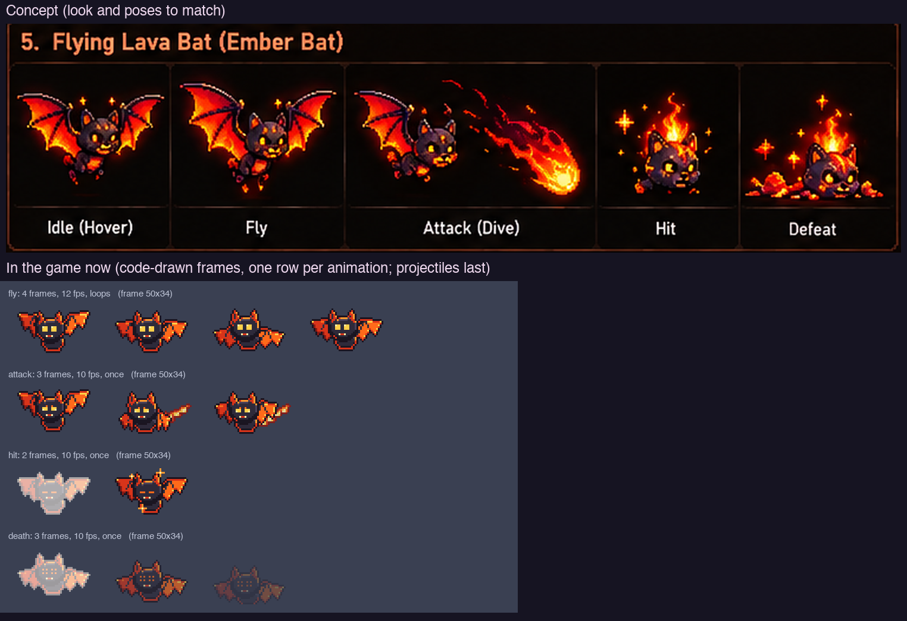

**Abilities**

- **Moves:** Flies in at 50, 42 up; between 150 and 70 from the kitten it swoops down to 28, never lower. The game trails sparks behind it.
- **Attacks:** Touch only.
- **Toughness:** 1 HP, 15 XP.
- **Beaten by:** 1 Yarn Shot; Ghost Dash passes through it; stay down. A stomp hurts.

**Look:** A black cat-faced bat with ember-orange wings.

**Game frame 50×34, hit area 18×14, flying 42 up (down to 28).** Today: fly 4 (12 fps), attack 3, hit 2, death 3; the game only plays fly and death.

| Row | Frames | Speed | Loops | Lasts | When the game plays it | What the frames show |
|---|---|---|---|---|---|---|
| FLY | 4 | 12 fps | yes | 0.33 s per wingbeat | All the time (the swoop too) | Wings up (1), level (2), down (3), level (4), the wing edges glowing |
| DEATH | 4 | 8 fps | no | 0.5 s | Defeated | Wings crumpled (1), falling in flames (2), burning out (3), embers (4) |

### Flame Archer Cat (`flame_archer`)

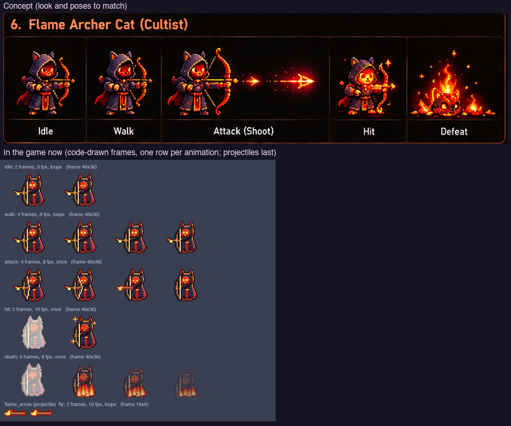

**Abilities**

- **Moves:** Stands still (often on a ledge).
- **Attacks:** Shoots a flame arrow every 2 s low along the ground (6 up) at 120 (hit area 12×4); throws while the kitten is 30–300 away; first throw 0.6 s after it comes in range. Its body hurts from the side.
- **Toughness:** 2 HP, 30 XP.
- **Beaten by:** Stomp (kills), 2 Yarn Shots; Ghost Dash passes through it and its projectiles; jump the arrows.

**Look:** A hooded cultist cat in a charcoal robe with a red sash and cape, a glowing face and a recurve bow.

**Game frame 46×36, hit area 16×24.** Also in level 5. Today: idle 2, walk 4, attack 4 (8 fps), hit 2, death 4; the game doesn't play walk.

| Row | Frames | Speed | Loops | Lasts | When the game plays it | What the frames show |
|---|---|---|---|---|---|---|
| IDLE | 4 | 4 fps | yes | 1 s | Between shots | Standing, bow held low, the cape stirring, the face glowing under the hood |
| ATTACK | 4 | 10 fps | no | 0.4 s | Every arrow (every 2 s) | Drawing the bow (1), **looses the flame arrow** (2), bow arm still up (3), lowering (4) |
| HIT | 2 | 10 fps | no | 0.2 s | Hit by the first yarn | Knocked back, hood slipping (1), steadying (2) |
| DEATH | 4 | 8 fps | no | 0.5 s | Defeated | Falling (1), the robe bursting into flame (2–3), embers (4) |
| FLAME ARROW | 2 | 10 fps | yes | — | **Projectile** (game 16×6, hits 12×4): in flight | A burning arrow flying low, flame trail on the right |

### Chainsaw Cat (`chainsaw_cat`)

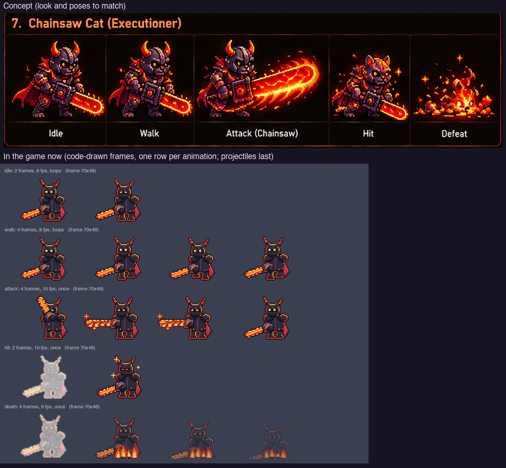

**Abilities**

- **Moves:** Walks slowly towards the kitten at 10.
- **Attacks:** Touch, and its chainsaw: a zone 20 wide and 24 tall in front of its body that hurts like the body (yarn and stomps only see the body).
- **Toughness:** 5 HP, 80 XP.
- **Beaten by:** Super Pounce defeats it outright (cuts through it), or 5 Yarn Shots; Ghost Dash passes through it. It can't be stomped.
- **Special:** Needs kitten level 5 to pass unhurt (Super Pounce).

**Look:** A horned executioner cat in black armour with a red cape and a glowing chainsaw.

**Game frame 70×48, hit area 26×30 (the saw reaches 20 more in front).** Also in level 5. Today: idle 2, walk 4 (8 fps), attack 4 (10 fps), hit 2, death 4.

| Row | Frames | Speed | Loops | Lasts | When the game plays it | What the frames show |
|---|---|---|---|---|---|---|
| WALK | 4 | 8 fps | yes | 0.5 s | All the time | A heavy march, the saw held out in front angled down, cape swaying |
| ATTACK | 4 | 10 fps | no | 0.4 s, last frame held | Once the kitten is within reach (melee) | Saw raised (1), **swept level with fire and embers** (2), swept again (3), saw held level, still roaring (4, held) |
| HIT | 2 | 10 fps | no | 0.2 s | Hit by yarn, not defeated | Sparks off the armour (1), steadying (2) |
| DEATH | 4 | 8 fps | no | 0.5 s | Defeated | Saw dropping (1), toppling (2), bursting into flame (3), embers (4) |

### Fire Wisp (`fire_wisp`)

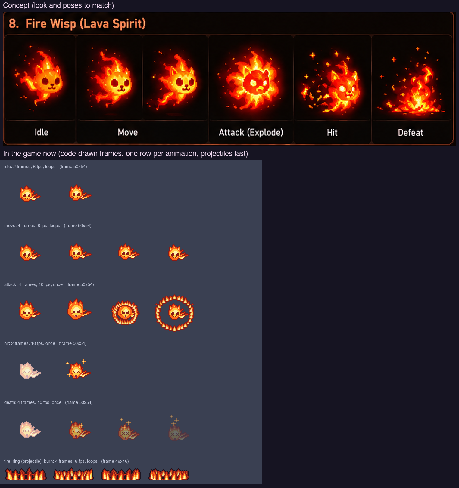

**Abilities**

- **Moves:** Drifts in low, 20 up, at 40.
- **Attacks:** Within 50 of the kitten it flashes for 0.5 s, keeping that gap, then bursts into a ring of fire on the ground (40 wide, 10 tall) for 0.4 s and is gone. Its body also hurts on touch.
- **Toughness:** 1 HP, 20 XP (only if yarned before it bursts).
- **Beaten by:** 1 Yarn Shot (from a hop) before it bursts; hop the ring; Ghost Dash passes through it and its projectiles.
- **Special:** A fuse: lit at 50, 0.5 s warning.

**Look:** A floating flame with a cat face, flame ears and crown, fire licks streaming behind.

**Game frame 50×54, hit area 14×14, 20 up.** Today: idle 2, move 4 (8 fps), attack 4 (10 fps), hit 2, death 4.

| Row | Frames | Speed | Loops | Lasts | When the game plays it | What the frames show |
|---|---|---|---|---|---|---|
| MOVE | 4 | 8 fps | yes | 0.5 s | Drifting in, and while it flashes | The flame flickering, fire licks streaming behind |
| ATTACK | 4 | 10 fps | no | 0.4 s | The burst (it is gone after it) | Swelling (1), swelling more (2), **bursting into a ring of flames** (3), the ring breaking up (4) |
| DEATH | 4 | 8 fps | no | 0.5 s | Defeated by yarn | Guttering (1), shrinking (2), embers (3), a wisp of smoke (4) |
| FIRE RING | 4 | 8 fps | yes | — | **Where it bursts** (game 48×16, hurts 40×10, 0.4 s): on the ground | A low ring of flames on the ground |

## Level 5 — The Void Rift

The final world, speed 150. Near-black violet with magenta and starlight (see the enemy rows of
`docs/concept/The Void Cat_ Final Boss Sprite Sheet.png`). This level also has the Penguin Soldier, Snowman,
Ghost Cat, Floating Skull, Stone Guard Cat, Flame Archer Cat and Chainsaw Cat from the worlds above.

**Abilities at a glance** (speeds in units per second on top of the level's scroll; heights above the ground):

| Enemy | Moves | Attacks | HP | Beaten by |
|---|---|---|---|---|
| Void Slime (`void_slime`) | lurches in bursts (30) | low void orbs, 2.2 s | 1 | 1 yarn, pounce |
| Void Bat (`void_bat`) | flies 42 up, swoops to 28 | head-high void orbs, 2 s | 1 | 1 yarn from a hop, stay down |
| Void Sentinel (`void_sentinel`) | floats 36 up | low laser after 0.8 s charge, 2.6 s | 3 | 3 yarn from hops |
| Rift Hound (`rift_hound`) | chases from behind (+170) | touch | 2 | jump as it passes, pounce, 2 yarn |
| Void Mage (`void_mage`) | stands | summons wisps / low bolts, 3 s | 3 | stomp, 3 yarn |
| Rift Crystal (`rift_turret`) | hovers 20 up (in the way) | fast low shot after 1 s charge, 2.8 s | 2 | 2 yarn, jump |
| Void Wisp (`void_wisp`) | floats 30 up, drifts in (30) | homing orbs, 2.5 s | 1 | 1 yarn, jump late, Ghost Dash |
| Mini Void Cat (`mini_void_cat`) | unseen, appears ahead, dashes twice (120) | touch | 1 | stomp/jump each dash, 1 yarn, pounce |

### Void Slime (`void_slime`)

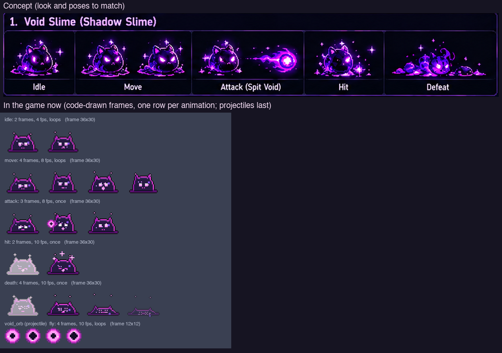

**Abilities**

- **Moves:** Lurches in at 30 on the world clock: 0.5 s moving, 0.5 s still.
- **Attacks:** Spits a void orb every 2.2 s low along the ground (2 up) at 90 (hit area 8×8); throws while the kitten is 30–300 away; first throw 0.6 s after it comes in range. Its body burns a kitten that lands on it.
- **Toughness:** 1 HP, 20 XP.
- **Beaten by:** 1 Yarn Shot, Super Pounce defeats it outright; Ghost Dash passes through it and its projectiles; jump the orbs and it. It can't be stomped.

**Look:** A near-black violet cat-eared dome with starlight inside, a bright magenta rim and eyes, a pool of void at its foot.

**Game frame 36×30, hit area 20×14.** Today: idle 2 (4 fps), move 4 (8 fps), attack 3 (8 fps), hit 2, death 4; the game doesn't play hit.

| Row | Frames | Speed | Loops | Lasts | When the game plays it | What the frames show |
|---|---|---|---|---|---|---|
| IDLE | 2 | 4 fps | yes | 0.5 s | The still half of each lurch | Settled, the starlight inside twinkling |
| MOVE | 4 | 8 fps | yes | 0.5 s | The moving half of each lurch | One lurch forward: squash, stretch, slide, settle |
| ATTACK | 4 | 10 fps | no | 0.4 s | Every orb (every 2.2 s) | Puffing up (1), **spits the orb** (2), shrinking back (3), settle (4) |
| DEATH | 4 | 8 fps | no | 0.5 s | Defeated | Melting flat (1–2), a pool of void (3), a few stars (4) |
| VOID ORB | 4 | 10 fps | yes | — | **Projectile** (game 12×12, hits 8×8): in flight | A dark orb with a magenta rim, swirling |

### Void Bat (`void_bat`)

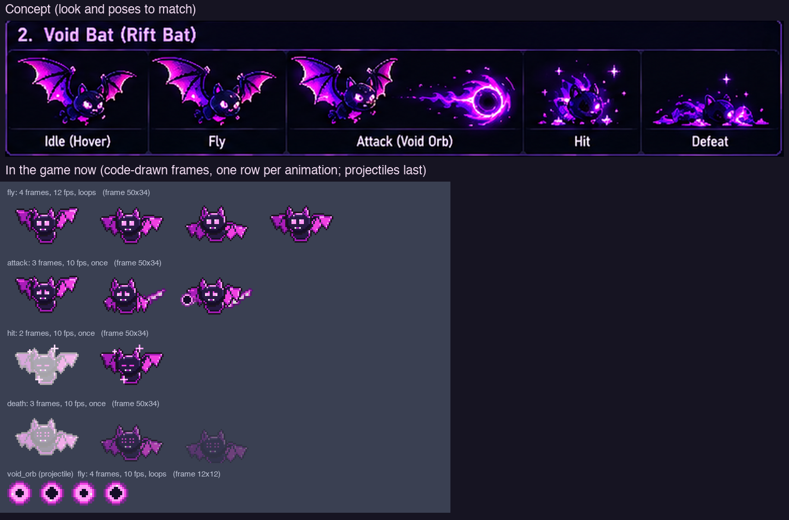

**Abilities**

- **Moves:** Flies in at 45, 42 up; between 150 and 70 from the kitten it swoops down to 28, never lower.
- **Attacks:** Fires a void orb every 2 s at head height (30 up) at 100 (hit area 8×8): staying down is safe; throws while the kitten is 30–300 away; first throw 0.6 s after it comes in range. Its body hurts on touch.
- **Toughness:** 1 HP, 20 XP.
- **Beaten by:** 1 Yarn Shot (from a hop); Ghost Dash passes through it and its projectiles; stay down. A stomp hurts.

**Look:** The ember bat's build in void colours: near-black violet with magenta wings.

**Game frame 50×34, hit area 18×14, flying 42 up (down to 28).** Today: fly 4 (12 fps), attack 3 (10 fps), hit 2, death 3.

| Row | Frames | Speed | Loops | Lasts | When the game plays it | What the frames show |
|---|---|---|---|---|---|---|
| FLY | 4 | 12 fps | yes | 0.33 s per wingbeat | All the time | Wings up (1), level (2), down (3), level (4) |
| ATTACK | 4 | 10 fps | no | 0.4 s | Every orb (every 2 s) | Wings up (1), **fires the orb from its mouth** (2), wings down (3), back to flying (4) |
| DEATH | 4 | 8 fps | no | 0.5 s | Defeated | Wings crumpled (1), falling (2), dissolving into violet smoke (3), stars (4) |

It fires the Void Slime's **void orb** (above); no extra row needed.

### Void Sentinel (`void_sentinel`)

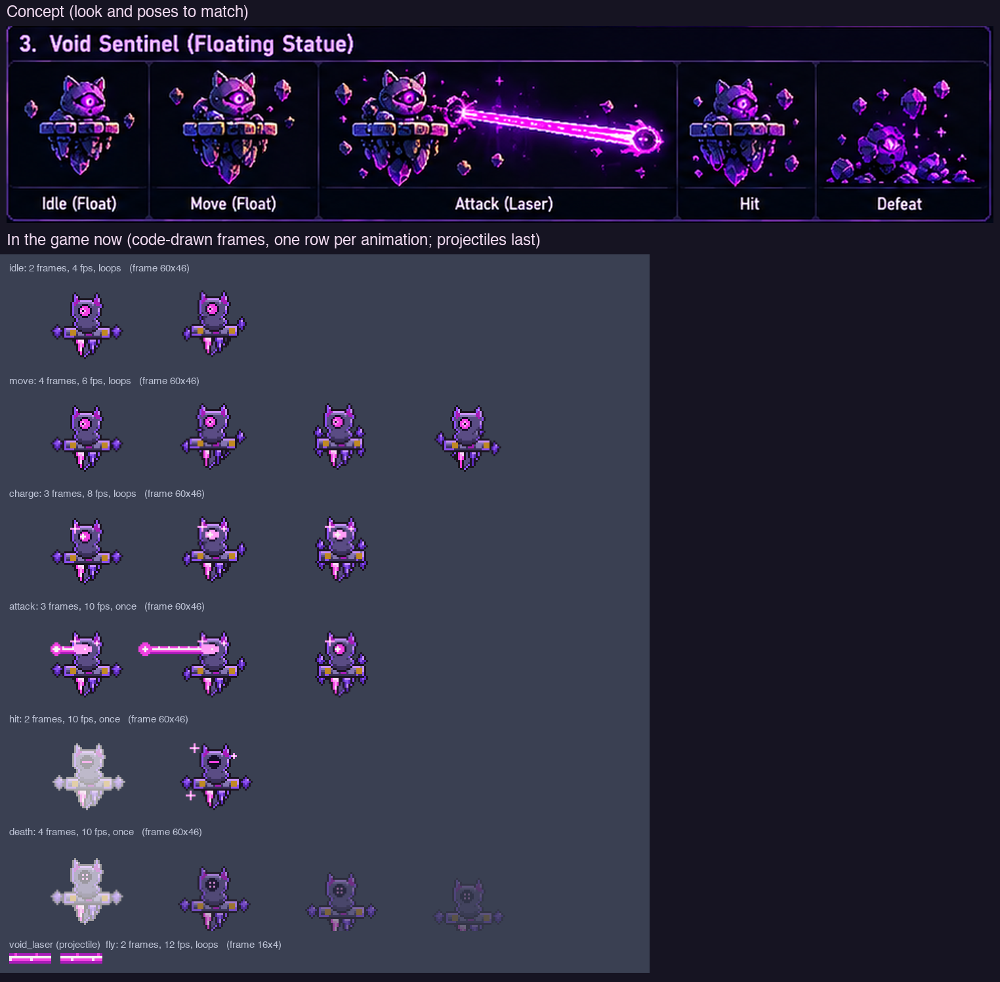

**Abilities**

- **Moves:** Floats in place, 36 up.
- **Attacks:** Every 2.6 s it charges for 0.8 s (it flashes), then fires a long low void laser (4 up, 170, 30 wide and 4 tall); first shot 0.8 s after the kitten comes within 300. Its body hurts on touch.
- **Toughness:** 3 HP, 40 XP.
- **Beaten by:** 3 Yarn Shots (from hops); Ghost Dash passes through it and its projectiles; jump the laser. A stomp hurts.

**Look:** A one-eyed cat bust of violet stone on a carved slab over a crystal-studded rock, four crystals orbiting.

**Game frame 60×46, hit area 20×22, 36 up.** Today: idle 2 (4 fps), move 4, charge 3 (8 fps), attack 3 (10 fps), hit 2, death 4; the game doesn't play move.

| Row | Frames | Speed | Loops | Lasts | When the game plays it | What the frames show |
|---|---|---|---|---|---|---|
| IDLE | 4 | 6 fps | yes | 0.67 s | Between shots | Floating, bobbing up (1–2) and down (3–4), crystals orbiting a quarter turn per frame |
| CHARGE | 2 | 6 fps | yes | 0.8 s (the charge) | Charging, while it flashes | The eye glowing bright (1), brighter with crystals drawn in (2) |
| ATTACK | 4 | 10 fps | no | 0.4 s | Every laser (every 2.6 s) | Eye flash (1), **the laser leaves the eye** (2), the beam dying (3), the eye cooling (4) |
| HIT | 2 | 10 fps | no | 0.2 s | Hit by yarn, not defeated | Stone chips, the eye squinting (1), steadying (2) |
| DEATH | 4 | 8 fps | no | 0.5 s | Defeated | Cracking (1), the slab breaking apart (2), crystals scattering (3), violet dust (4) |
| VOID LASER | 2 | 12 fps | yes | — | **Projectile** (game 16×4; the laser hits 30×4): in flight | A bright magenta beam segment, flickering |

### Rift Hound (`rift_hound`)

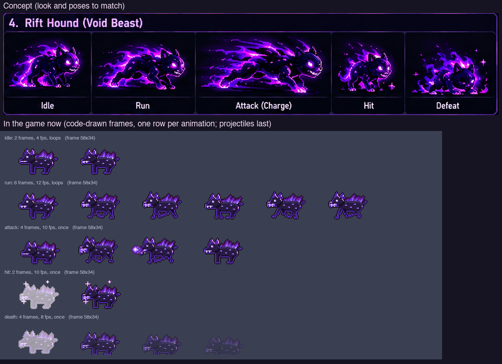

**Abilities**

- **Moves:** Unseen until the kitten reaches its spot; then it flashes at the left edge for 0.45 s and runs in from 120 behind, 170 faster than the kitten, past it and away.
- **Attacks:** Touch, from any side.
- **Toughness:** 2 HP, 40 XP.
- **Beaten by:** Super Pounce defeats it outright, 2 Yarn Shots; Ghost Dash passes through it; jump it as it passes. A stomp hurts.
- **Special:** Comes from behind (a chase), less warning than the Hell Hound.

**Look:** The hell hound's build in void colours with a violet-flame mane.

**Game frame 58×34, hit area 26×18.** Today: idle 2, run 6 (12 fps), attack 4 (10 fps), hit 2, death 4.

| Row | Frames | Speed | Loops | Lasts | When the game plays it | What the frames show |
|---|---|---|---|---|---|---|
| RUN | 6 | 12 fps | yes | 0.5 s per stride | Flashing at the edge, and running in | A full gallop as the Hell Hound's, the violet mane streaming back |
| ATTACK | 4 | 10 fps | no | 0.4 s, last frame held | As it passes the kitten (melee) | Head down (1), lunge (2), **bite with a void flame** (3), jaws still open (4, held) |
| HIT | 2 | 10 fps | no | 0.2 s | Hit by the first yarn | Flinching, "> <" eyes (1), running on (2) |
| DEATH | 4 | 8 fps | no | 0.5 s | Defeated | Tumbling (1), fading into the void (2–3), a few stars (4) |

### Void Mage (`void_mage`)

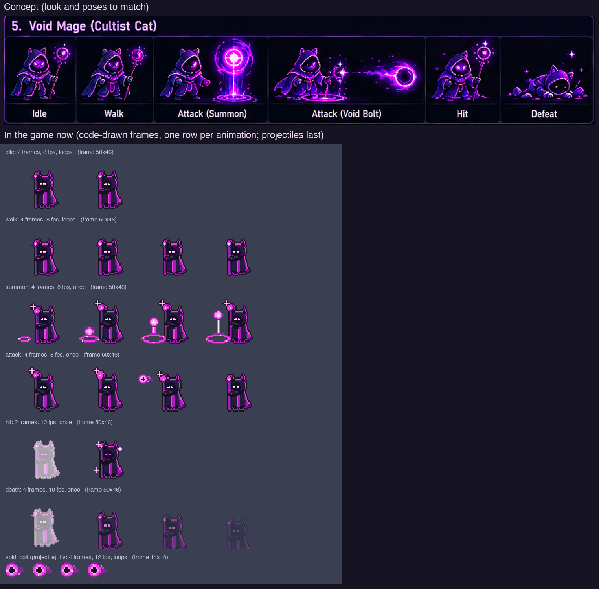

**Abilities**

- **Moves:** Stands still.
- **Attacks:** Every 3 s, by turns: summons a Void Wisp 80 ahead of the kitten (the first, third, … cast), or fires a low void bolt (6 up, 120, hit area 10×6); throws while the kitten is 30–300 away; first throw 0.6 s after it comes in range. Its body hurts from the side.
- **Toughness:** 3 HP, 45 XP.
- **Beaten by:** Stomp (kills), 3 Yarn Shots; Ghost Dash passes through it and its projectiles; jump the bolts.
- **Special:** Summons Void Wisps.

**Look:** A hooded cultist cat in a dark violet robe with a magenta stole and a crescent staff.

**Game frame 50×46, hit area 16×24.** Today: idle 2 (3 fps), walk 4, summon 4 (8 fps), attack 4 (8 fps), hit 2, death 4; the game doesn't play walk.

| Row | Frames | Speed | Loops | Lasts | When the game plays it | What the frames show |
|---|---|---|---|---|---|---|
| IDLE | 4 | 4 fps | yes | 1 s | Between casts | Standing, staff glowing, robe stirring |
| SUMMON | 4 | 8 fps | no | 0.5 s | Every other cast (the wisp appears ahead of the kitten) | Staff raised (1), a portal ring opening on the ground in front (2), a pillar of light (3), fading (4) |
| ATTACK | 4 | 10 fps | no | 0.4 s | The other casts | Staff raised, glowing (1), **the void bolt flies** (2), staff forward (3), recover (4) |
| HIT | 2 | 10 fps | no | 0.2 s | Hit by yarn, not defeated | Knocked back, hood slipping (1), steadying (2) |
| DEATH | 4 | 8 fps | no | 0.5 s | Defeated | Staff falling (1), the robe collapsing (2), violet smoke (3), stars (4) |
| VOID BOLT | 4 | 12 fps | yes | — | **Projectile** (game 14×10, hits 10×6): in flight | A magenta ring-orb flying low, trail on the right |

### Rift Crystal (`rift_turret`)

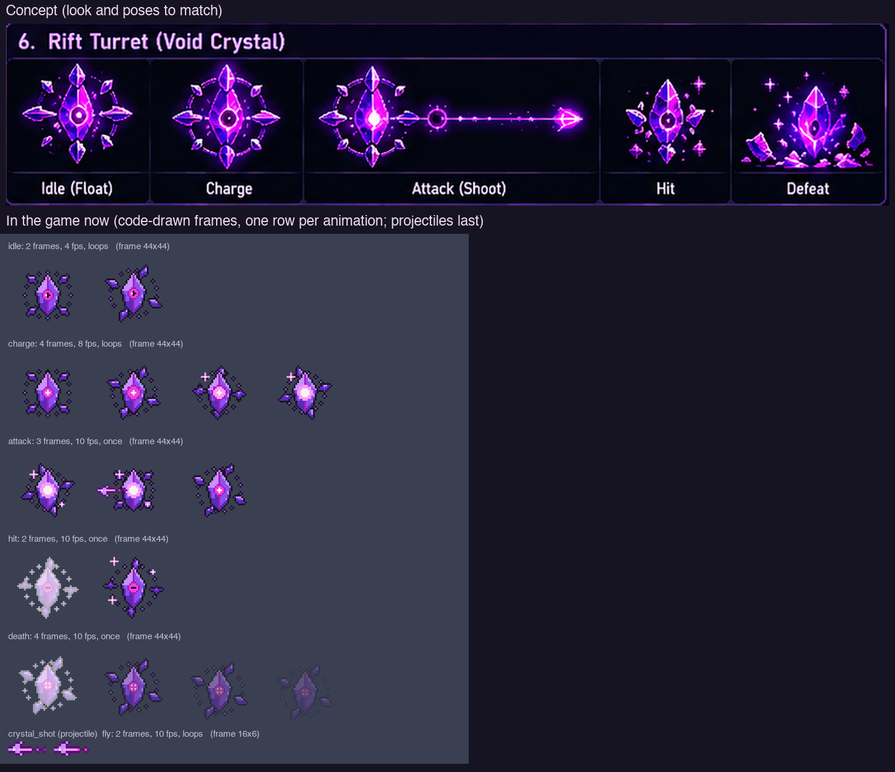

**Abilities**

- **Moves:** Hovers in place 20 up, right in the kitten's way.
- **Attacks:** Every 2.8 s it charges for 1 s (it flashes), then fires a fast low crystal shot (4 up, 200, hit area 10×4); first shot 1 s after the kitten comes within 300. Its body hurts on touch.
- **Toughness:** 2 HP, 35 XP.
- **Beaten by:** 2 Yarn Shots; Ghost Dash passes through it and its projectiles; jump the shot, then it. A stomp hurts.

**Look:** A floating violet crystal with a glowing core and four crystal shards orbiting on a dotted ring.

**Game frame 44×44, hit area 16×20, 20 up.** Today: idle 2 (4 fps), charge 4 (8 fps), attack 3 (10 fps), hit 2, death 4.

| Row | Frames | Speed | Loops | Lasts | When the game plays it | What the frames show |
|---|---|---|---|---|---|---|
| IDLE | 4 | 6 fps | yes | 0.67 s | Between shots | Hovering, the shards orbiting a quarter turn per frame, the core pulsing |
| CHARGE | 2 | 6 fps | yes | 1 s (the charge) | Charging, while it flashes | The core brightening (1), brightest with the shards drawn in (2) |
| ATTACK | 4 | 10 fps | no | 0.4 s | Every shot (every 2.8 s) | Flash (1), **the shot leaves** (2), shards flung out (3), settle (4) |
| HIT | 2 | 10 fps | no | 0.2 s | Hit by the first yarn | Cracked, flickering (1), steadying (2) |
| DEATH | 4 | 8 fps | no | 0.5 s | Defeated | Cracking (1), shattering (2), shards scattering (3), violet dust (4) |
| CRYSTAL SHOT | 2 | 10 fps | yes | — | **Projectile** (game 16×6, hits 10×4): in flight | A fast crystal shard, point left, trail on the right |

### Void Wisp (`void_wisp`)

**Abilities**

- **Moves:** Floats 30 up, drifting in at 30.
- **Attacks:** Fires a homing orb every 2.5 s from its own height at 100 (hit area 8×8): while still ahead of the kitten it steers its height towards the kitten's middle at up to 40 units/s; throws while the kitten is 30–300 away; first throw 0.6 s after it comes in range. Its body hurts on touch.
- **Toughness:** 1 HP, 20 XP.
- **Beaten by:** 1 Yarn Shot; Ghost Dash passes through it and its projectiles; jump late (the orb can't climb that fast). A stomp hurts.
- **Special:** Also summoned by the Void Mage.

**Look:** The fire wisp's build as a pink-white spirit flame with a cat face.

**Game frame 50×54, hit area 14×14, 30 up.** Today: idle 2, move 4 (8 fps), attack 3 (8 fps), hit 2, death 4; the game doesn't play idle or hit.

| Row | Frames | Speed | Loops | Lasts | When the game plays it | What the frames show |
|---|---|---|---|---|---|---|
| MOVE | 4 | 8 fps | yes | 0.5 s | All the time | The flame flickering, bobbing, the tail waving |
| ATTACK | 4 | 10 fps | no | 0.4 s | Every orb | Swelling (1), **launches the orb** (2), shrinking back (3), settle (4) |
| DEATH | 4 | 8 fps | no | 0.5 s | Defeated | Rising (1), fading (2–3), a few sparks (4) |
| HOMING ORB | 4 | 12 fps | yes | — | **Projectile** (game 14×12, hits 8×8): in flight | A glowing ring-orb with a curling tail on the right |

### Mini Void Cat (`mini_void_cat`)

**Abilities**

- **Moves:** Unseen until the kitten is within 180; then it appears 80 ahead, flashes for 0.4 s and dashes in at 120. Once its dash has passed the kitten it appears 80 ahead once more and dashes again (two dashes in all).
- **Attacks:** Touch while dashing.
- **Toughness:** 1 HP, 50 XP.
- **Beaten by:** Stomp (kills) or jump each dash, 1 Yarn Shot once visible, Super Pounce defeats it outright; Ghost Dash passes through it.
- **Special:** Teleports twice.

**Look:** The shadow cat's build in void colours: a black cat with a magenta rim, glowing eyes and violet smoke.

**Game frame 56×34, hit area 18×20.** Today: idle 2, teleport 4 (10 fps), attack 4 (10 fps), hit 2, death 4.

| Row | Frames | Speed | Loops | Lasts | When the game plays it | What the frames show |
|---|---|---|---|---|---|---|
| TELEPORT | 4 | 10 fps | no | 0.4 s | Appearing (twice), while it flashes | Violet smoke and eyes (1), the body forming (2–3), formed and crouched (4) |
| ATTACK | 4 | 10 fps | no | 0.4 s, last frame held | Each dash, all the way in | Crouch (1), spring (2), **a big magenta crescent slash** (3), stretched dash pose with speed streaks (4, held while it dashes) |
| DEATH | 4 | 8 fps | no | 0.5 s | Defeated | Recoiling (1), dissolving into violet smoke (2–3), a few stars (4) |

## Before sending, check

- [ ] The background is transparent: the squares disappear on a dark background.
- [ ] One sheet per enemy, the enemy about 3× its game frame, the same size in every frame.
- [ ] **Every row has exactly the frame count in the table** — count them. No extra rows the table
      doesn't ask for.
- [ ] Enemy facing right, projectiles pointing left; feet on one line, a shadow under flyers.
- [ ] Throwers release on frame 2 of ATTACK / THROW / FIRE; melee "in reach" attacks end on the strike
      still out (it is held).
- [ ] No eye blinking: both eyes open and the same in every frame, except "> <" in HIT and "x x" in DEATH.
- [ ] Looping rows close the loop; DEATH ends on a near-empty frame.
- [ ] Frames don't touch (~30 px apart), and effects stay inside their own frame.

## For the developer cutting the sheets

The counts are close to today's code-drawn ones (usually 2–4 frames per row), with the speeds chosen so
each animation lasts what the game needs; the game reads frame counts and fps from `Sprites.json`. Every
animation name above is one GameScene already plays (`App/Scenes/GameScene.swift`: `defaultAnimation`,
`sheetRest`, `animate(_:for:)`, `throwAnimation`, `curlAnimation`), so no Swift change is needed. Cut them
with the hero/boss cutters (`Tools/sprites/sheet_hero.py`, `sheet_boss.py`) into the existing sprite names
and game frame sizes, with `faces_left=True`, and update the frame counts in `SPEC`
(`Tools/sprites/tests/test_sprites.py`) and `docs/sprite-spec.md`. Notes:

- **New rows the game already plays when present:** HIT for the two-hit Stump Cat, Rolling Snowball,
  Skeleton Mouse, Wall Cannon and Mechanical Mouse (the `enemyHit` flinch looks for `hit`), and PREPARE
  for the Snowy Owl (its warning looks for `prepare`). For the Biting Plant and the Icicle Plant,
  `animate` sets the trap pose every frame, so their HIT only shows for a frame unless it is allowed to
  finish (the Sakura spike plant has the same issue).
- **Rows dropped:** animations the game never plays (the one-hit enemies' `hit`, and `idle`, `walk`,
  `move` or `attack` where the table above leaves them out) can stay as they are or be removed; nothing
  looks for them. The Ghost Cat and Floating Skull can't be defeated, so they have no `death`.
- **The hounds run the same way as the kitten** (in from behind, past it). With `faces_left=True` and no
  flip in `renderEntities` (a chaser never sets `reversed`), today's Hell Hound and Rift Hound face left
  while running right; cut them with `faces_left=False` or flip them in the scene.
- **Charge rows** (Void Sentinel, Rift Crystal) and the opening rows of the plants loop for as long as the
  state lasts; gargoyle LEAP and the plants' BITE / ATTACK hold their last frame until the state ends.
