# Enemy sprite sheet brief: Sakura's route

A brief for the artist painting the enemies of Sakura's route in **Purrfectly Dangerous**, a 2D
pixel-art auto-runner for iPhone. The game's build cuts each sheet into animation frames
automatically (like the heroes, `docs/hero-sheet-brief.md`, and bosses, `docs/boss-kitsune-sheet-brief.md`),
so the sheets must follow the rules below exactly. The looks come from the route's concept,
`docs/concept/Purrfectly_Dangerous_Game_Concept_Expanded_Sakura (2).docx`, and the level sheets in
`docs/concept/` (Sakura World Level 1/2/3 Enemy Sprites). The frame counts, speeds and what each frame
shows come from how the game plays each enemy.

Each enemy below has a reference picture (`docs/enemy-refs/<id>.png`): on top, its row from the route's
concept enemy sheet (the look and the poses to match); under it, the frames the game draws today, one row
per animation, for size and proportion.

**Done from painted sheets** (their pictures show the cut frames): Sakura Bunny, Rolling Onigiri and
Sakura Bat. The other thirteen are still drawn in code.

## What to deliver

- **One sheet per enemy**, named `<Enemy name> Enemy Sheet.png` (e.g. `Sakura Slime Enemy Sheet.png`),
  with the enemy's projectile rows on the same sheet when it has one.
- **PNG, about 2048×1024 (larger is fine)**, with a **real transparent background**.
- **Enemy size:** paint it about **3× its game frame** (the "Game frame" in each section, in points), the
  same size in every frame. E.g. the Sakura Slime's game frame is 34×28, so paint it about 100 px wide.

## Sheet rules

- **Export as a PNG with a real transparent background.** A checkerboard painted into the picture is
  not transparency. To check, open the PNG over a dark background: the squares must disappear. If the
  tool can't export transparency, use one flat colour that never appears on the enemy (pure green
  `#00FF00` or dark navy), never a checkerboard or gradient.
- **Fully opaque with a dark outline all round** (spirits and wisps too: their glow may be soft, but the
  body has an outline). Glow must not touch or join two frames.
- **One row per animation**, frames left to right in playing order, the label above the row, never
  touching a frame. **The number of frames in a row must equal the count in the table.**
- **Paint the enemy facing right**; the build mirrors it so it faces the hero, who runs towards it.
  **Projectiles are painted pointing left** (towards the hero), the trail on the right.
- **At least ~30 px of empty space** between frames, and an attack effect (a slash, a puff) stays inside
  its own frame.
- **Same scale in every frame of every row.** Ground enemies: all feet on one baseline. Flying and
  floating enemies: paint a soft ground shadow under each frame so the build knows the height; it is
  removed.
- **Both eyes open** unless the table says otherwise; one blink in the resting loop only.

## Smooth motion

The game plays enemies at about **10–16 frames a second**, so paint small in-between steps: no two
neighbouring frames should look like different poses. Looping rows (walk, fly, float, roll, idle) close
the loop: the last frame leads straight back into the first. Ears, tails, scarves, hats and petals lag
a frame behind the body. The enemy must not grow or shrink between frames (a squash on a landing, a
stretch on a leap, then back).

## How the game plays an enemy

- **Resting loop** (walk, fly, float, roll, idle): plays all the time it isn't doing anything else.
- **Attack:** plays **once** when it attacks, then the resting loop resumes. For an enemy that throws or
  shoots, the projectile appears **the moment the attack starts**, so the release must be early: frame 2
  of 6 (a quick wind-up in frame 1, the release in 2, the follow-through after). For a melee lunge or
  slash, the attack plays while it lunges, so the strike can be in the middle (frame 3 or 4 of 6).
- **Hurt:** plays once on a hit that doesn't defeat it (only enemies with more than one hit point), then
  the resting loop resumes.
- **Death:** plays once when it is defeated, then the enemy is removed; end on an empty-ish frame (a puff
  of petals) rather than a body lying there.

The **hit area** in each section is the box the game uses for collisions, standing on the ground at the
middle of the frame (or at the given height for flyers). Keep the body inside it; ears, tails, weapons
and effects can stick out.

## Level 1 — Blossom Path

### Sakura Slime (`sakura_slime`)

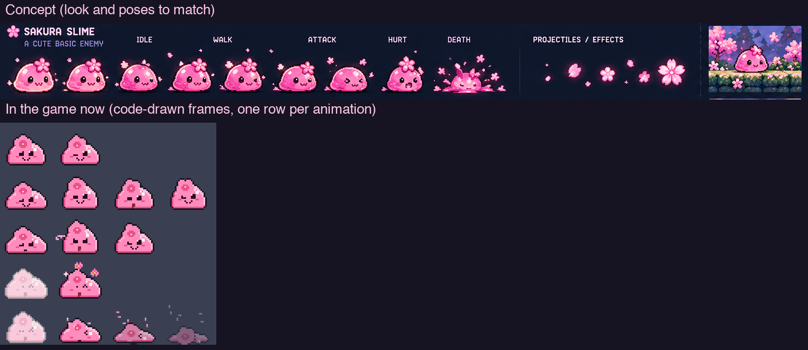

Slow basic enemy; shuffles forward in short bursts and, once close, makes a short bounce lunge.
A pink jelly slime with a blossom on top. **Game frame 34×28, hit area 20×14 on the ground.** One hit; a stomp defeats it.

| Row | Frames | Speed | Loops | What the frames show |
|---|---|---|---|---|
| IDLE | 6 | 8 fps | yes | Resting between bursts: squashing down and back up once, the blossom bobbing; a blink in 5 |
| WALK | 8 | 14 fps | yes | One shuffle forward: squash, stretch forward, slide, settle; the jelly wobbles |
| ATTACK | 6 | 12 fps | no | The bounce lunge when the hero is close: squash (1–2), spring up and forward (3), top (4), landing squash (5), settle (6) |
| HURT | 3 | 12 fps | no | Flattened with squeezed eyes, wobbling back |
| DEATH | 8 | 12 fps | no | Squashed flat, splitting into pink droplets and petals that scatter and fade |

### Sakura Bunny (`sakura_bunny`)

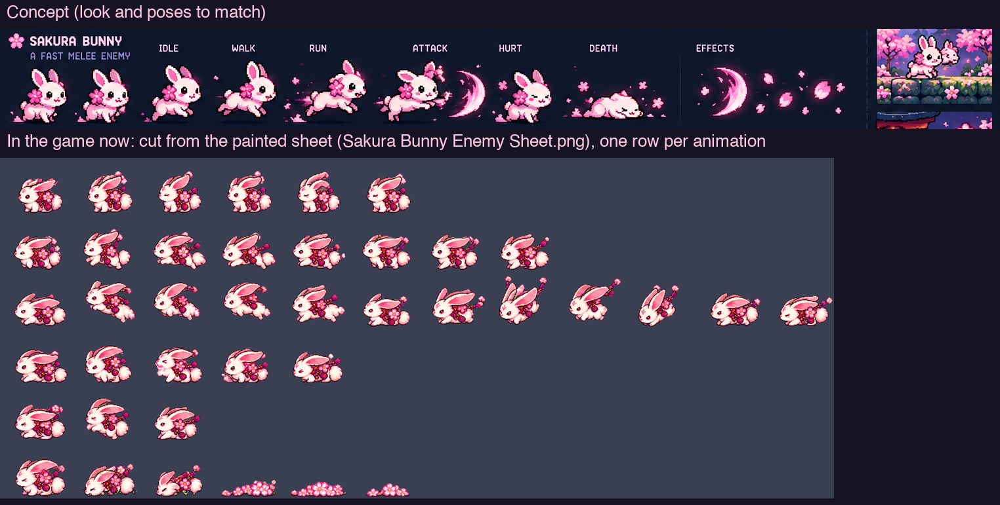

**Done:** cut from `docs/concept/Sakura Bunny Enemy Sheet.png` (`Tools/sprites/characters/sakura_bunny_painted.py`).

Fast melee enemy; runs in fast, hops back once when close, then lunges with a crescent swipe.
A white-and-pink bunny with long ears. **Game frame 44×36, hit area 18×20.** One hit; a stomp defeats it.

| Row | Frames | Speed | Loops | What the frames show |
|---|---|---|---|---|
| IDLE | 6 | 8 fps | yes | Standing, ears twitching, nose wiggling; blink in 5 |
| WALK | 8 | 12 fps | yes | A hop cycle at walking pace (the hop back before the lunge plays this) |
| RUN | 8 | 18 fps | yes | A fast bounding run, ears streaming back |
| ATTACK | 6 | 12 fps | no | The lunge: crouch (1–2), leap forward with the paw out (3), **swipe through a pink crescent** (4), crescent breaking into petals (5), landing (6) |
| HURT | 3 | 12 fps | no | Knocked back, ears flopped, eyes "> <" |
| DEATH | 8 | 12 fps | no | Spinning over, bursting into petals that fade |

### Lantern Spirit (`lantern_spirit`)

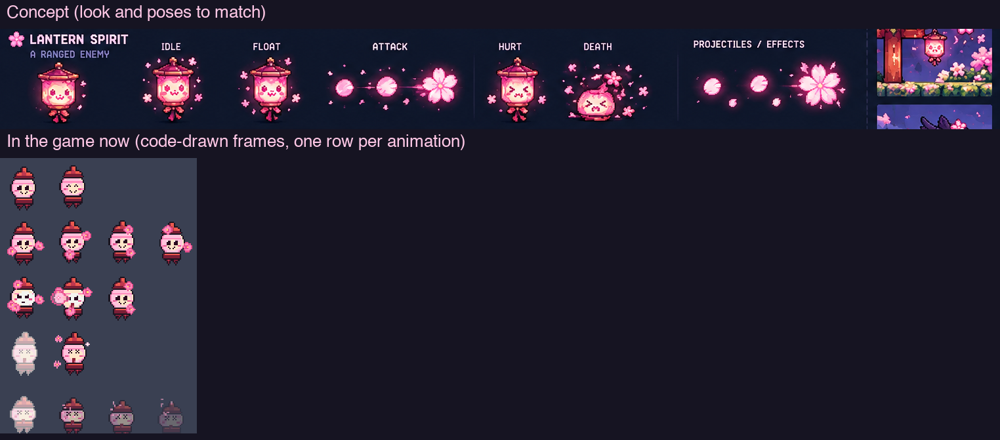

Floating ranged enemy; hovers over the hero and sends slow glowing blossom shots along the ground.
A paper-lantern spirit with a face and a soft glow. **Game frame 34×38, hit area 16×18, floating 36 up.** One hit.

| Row | Frames | Speed | Loops | What the frames show |
|---|---|---|---|---|
| IDLE | 6 | 8 fps | yes | Hovering in place, glow pulsing |
| FLOAT | 8 | 10 fps | yes | Bobbing smoothly up and down once, tassels swaying |
| ATTACK | 6 | 14 fps | no | Glow gathers (1), **releases the shot** (2), recoils up (3–4), settles (5–6) |
| HURT | 3 | 12 fps | no | Flickering, eyes squeezed |
| DEATH | 8 | 12 fps | no | Paper tearing, light going out, ash and petals drifting away |
| BLOSSOM SHOT | 6 | 12 fps | yes | **Projectile** (game 12×12, hits 10×10): a glowing blossom turning as it flies, trail on the right |

### Bird Crow (`bird_crow`)

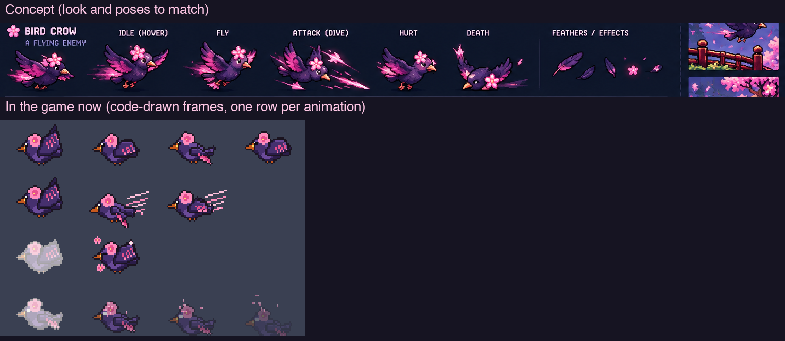

Flying enemy; hovers high, tracks the hero, then dives all the way to the ground as it nears.
A dark crow with pink accents. **Game frame 48×34, hit area 18×14, flying 50 up.** One hit.

| Row | Frames | Speed | Loops | What the frames show |
|---|---|---|---|---|
| FLY | 8 | 14 fps | yes | One full wingbeat, wings up to down and back |
| ATTACK | 6 | 12 fps | no | The dive: wings folding (1–2), plunging down-left (3–5), pulling up (6) |
| HURT | 3 | 12 fps | no | Feathers puffed, tumbling a little |
| DEATH | 8 | 12 fps | no | Spinning down, bursting into feathers and petals |

### Spike Plant (`spike_plant`)

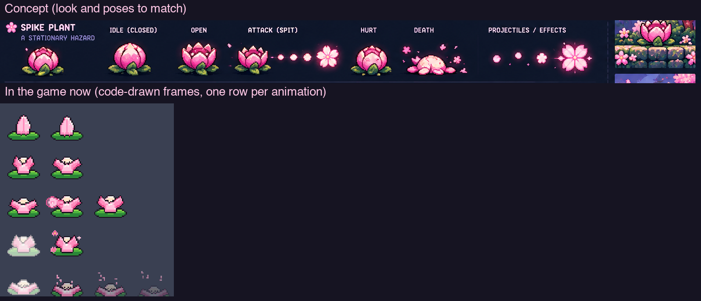

Stationary hazard-enemy; opens on a rhythm and spits a blossom shot low along the ground.
A thorny bud on a stem. **Game frame 36×32, hit area 18×20.** Two hits.

| Row | Frames | Speed | Loops | What the frames show |
|---|---|---|---|---|
| IDLE | 6 | 6 fps | yes | Shut, swaying gently on its stem |
| OPEN | 4 | 8 fps | yes | The warning: petals parting, the mouth showing, trembling |
| ATTACK | 6 | 14 fps | no | Mouth wide (1), **spits the shot** (2), recoil (3–4), closing (5–6) |
| HURT | 3 | 12 fps | no | Flinching, petals ruffled |
| DEATH | 8 | 12 fps | no | Wilting, petals falling off, crumbling away |

It fires the Lantern Spirit's **blossom shot** (above); no extra row needed.

### Rolling Onigiri (`rolling_onigiri`)

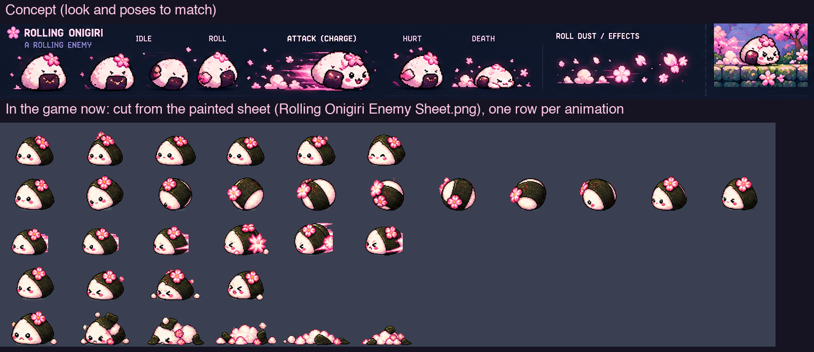

**Done:** cut from `docs/concept/Rolling Onigiri Enemy Sheet.png` (`Tools/sprites/characters/rolling_onigiri_painted.py`).

Ground charger; sits still until the hero is close, then curls up and rolls in fast.
A rice-ball critter with a nori wrap. **Game frame 44×28, hit area 18×16.** One hit; a stomp defeats it.

| Row | Frames | Speed | Loops | What the frames show |
|---|---|---|---|---|
| IDLE | 6 | 6 fps | yes | Sitting, blinking, a little wobble |
| ROLL | 8 | 18 fps | yes | Curled into a ball, one full turn (the first time it plays it curls up from sitting: make frame 1 the curl-up) |
| ATTACK | 6 | 16 fps | yes | Rolling at full speed: faster turn with speed lines, also looped |
| HURT | 3 | 12 fps | no | Squashed, rice grains flying |
| DEATH | 8 | 12 fps | no | Breaking into rice grains and petals that scatter |

## Level 2 — Petal Bridges (sunset)

### Lantern Slime (`lantern_slime`)

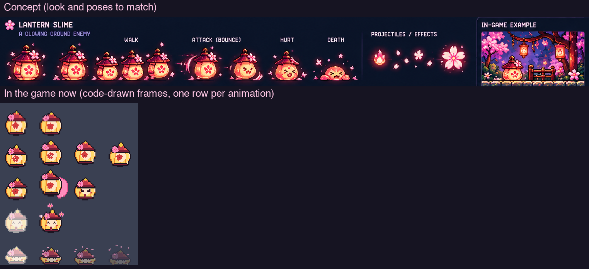

Glowing ground slime; bounces in, dropping a little lantern flame that burns briefly where it lands.
**Game frame 34×32, hit area 20×16.** One hit; a stomp defeats it.

| Row | Frames | Speed | Loops | What the frames show |
|---|---|---|---|---|
| IDLE | 6 | 8 fps | yes | Glowing softly, squashing once; blink in 5 |
| WALK | 8 | 14 fps | yes | One bounce forward, the inner flame flickering |
| ATTACK | 6 | 14 fps | no | Squash (1), **pops out a flame** (2), wobble (3–4), settle (5–6) |
| HURT | 3 | 12 fps | no | Flattened, flame dimming |
| DEATH | 8 | 12 fps | no | Popping, the flame going out in a puff of embers and petals |
| LANTERN FLAME | 6 | 12 fps | yes | **Projectile** (game 12×12): a small flickering flame |

### Ninja Tanuki (`ninja_tanuki`)

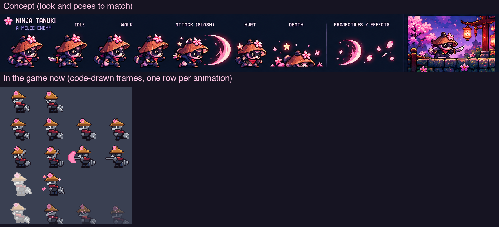

Mobile melee fighter; walks in, stops close to wind up, then slashes forward with a crescent.
**Game frame 48×40, hit area 18×22.** Two hits; a stomp defeats it.

| Row | Frames | Speed | Loops | What the frames show |
|---|---|---|---|---|
| IDLE | 6 | 8 fps | yes | The wind-up stance (shown while it gets ready): blade drawn, bouncing on its toes |
| WALK | 8 | 12 fps | yes | A sneaky walk, tail swaying |
| ATTACK | 6 | 12 fps | no | Step in (1–2), **slash through a pink crescent** (3–4), follow-through (5), recover (6) |
| HURT | 3 | 12 fps | no | Knocked back, hat askew |
| DEATH | 8 | 12 fps | no | Vanishing in a ninja smoke puff with leaves and petals |

### Sakura Bat (`sakura_bat`)

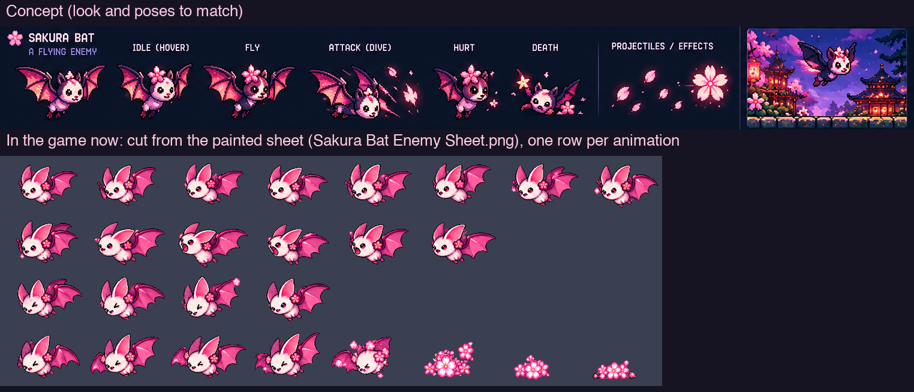

**Done:** cut from `docs/concept/Sakura Bat Enemy Sheet.png` (`Tools/sprites/characters/sakura_bat_painted.py`).

Flying attacker; hovers and swoops down to just over a standing hero's head.
**Game frame 46×32, hit area 18×14, flying 42 up.** One hit.

| Row | Frames | Speed | Loops | What the frames show |
|---|---|---|---|---|
| FLY | 8 | 16 fps | yes | One full wingbeat |
| ATTACK | 6 | 12 fps | no | The swoop: wings back (1–2), diving (3–4), pulling up (5–6) |
| HURT | 3 | 12 fps | no | Tumbling, wings crumpled |
| DEATH | 6 | 12 fps | no | Bursting into petals |

### Shadow Spirit (`shadow_spirit`)

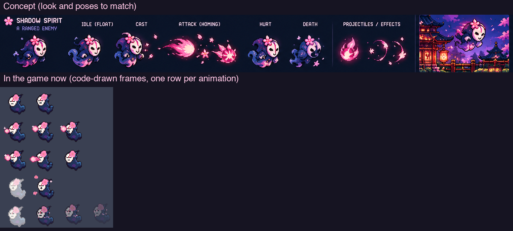

Ranged floating enemy; floats over the hero and casts homing pink spirit flames.
**Game frame 38×38, hit area 16×20, floating 36 up.** Two hits.

| Row | Frames | Speed | Loops | What the frames show |
|---|---|---|---|---|
| IDLE | 6 | 8 fps | yes | Floating, robe/smoke trailing, bobbing |
| CAST | 6 | 12 fps | no | Raising its hands, a pink orb forming |
| ATTACK | 6 | 14 fps | no | Orb at full glow (1), **casts it** (2), recoil (3–4), settle (5–6) |
| HURT | 3 | 12 fps | no | Flickering, eyes squeezed |
| DEATH | 8 | 12 fps | no | Dissolving into dark smoke and pink sparks |
| SPIRIT FLAME | 6 | 12 fps | yes | **Projectile** (game 14×12): a homing pink spirit flame with a short tail |

### Spike Kappa (`spike_kappa`)

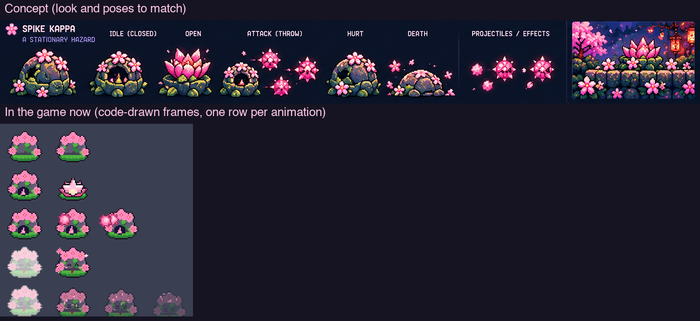

Stationary armored hazard; its shell opens into a lotus on a rhythm and throws a fan of three spike
balls that roll on. **Game frame 40×32, hit area 22×18.** Two hits.

| Row | Frames | Speed | Loops | What the frames show |
|---|---|---|---|---|
| CLOSED | 6 | 6 fps | yes | Shut in its shell, peeking, a little rock |
| OPEN | 4 | 8 fps | yes | The warning: the shell opening into a lotus, spikes showing |
| ATTACK | 6 | 14 fps | no | Rearing up (1), **throws** (2), arms out (3–4), sinking back (5–6) |
| HURT | 3 | 12 fps | no | Pulling into the shell, flinching |
| DEATH | 8 | 12 fps | no | Shell cracking, falling apart into pieces and petals |
| SPIKE BALL | 6 | 12 fps | yes | **Projectile** (game 12×12): a spiked blossom ball rolling |

## Level 3 — Moonlit Temple (night)

Night colours: these enemies sit on a dark navy and violet background, so give them a strong dark
outline and bright pink/magenta accents (see `docs/concept/Sakura World Level 3 Enemy Sprites.png`).

### Shadow Slime (`shadow_slime`)

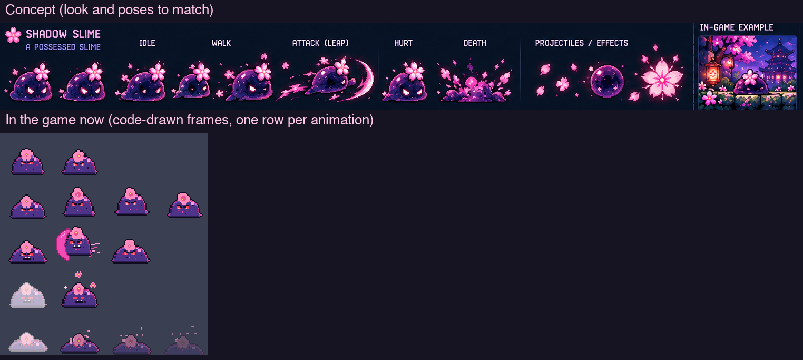

Possessed slime; lurches in quick bursts and, once close, leaps aggressively, leaving a dark-petal burst.
**Game frame 40×34, hit area 20×16.** One hit; a stomp defeats it.

| Row | Frames | Speed | Loops | What the frames show |
|---|---|---|---|---|
| IDLE | 6 | 8 fps | yes | Dark violet jelly with red eyes and a blossom, squashing once |
| WALK | 8 | 14 fps | yes | One lurch forward |
| ATTACK | 6 | 12 fps | no | The leap: squash (1–2), spring up and forward with a pink crescent (3–4), landing burst of dark petals (5), settle (6) |
| HURT | 3 | 12 fps | no | Flattened, eyes flaring |
| DEATH | 8 | 12 fps | no | Bursting into dark petals and pink sparks |

### Samurai Ronin (`samurai_ronin`)

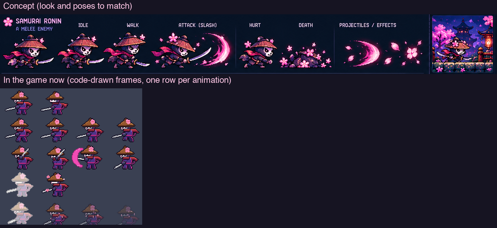

Melee swordsman; walks in, holds its stance when close, then lunges with a wide sakura slash.
A cat in a straw hat and red scarf with a katana. **Game frame 52×40, hit area 18×22.** Two hits; a stomp defeats it.

| Row | Frames | Speed | Loops | What the frames show |
|---|---|---|---|---|
| IDLE | 6 | 8 fps | yes | The stance (shown while it gets ready): katana held low, scarf stirring |
| WALK | 8 | 12 fps | yes | A careful walk, scarf trailing |
| ATTACK | 6 | 12 fps | no | Draw (1–2), **wide slash through a pink crescent** (3–4), follow-through (5), recover (6) |
| HURT | 3 | 12 fps | no | Staggering back, hat tilted |
| DEATH | 8 | 12 fps | no | Kneeling, hat falling, fading into petals |

### Oni Cat (`oni_cat`)

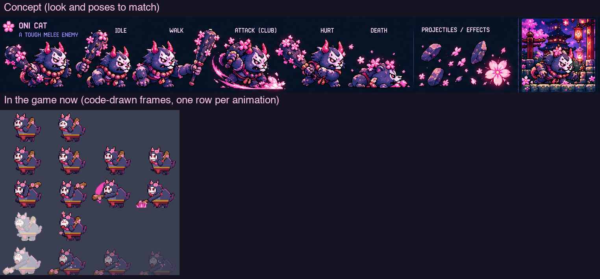

Heavy melee enemy; slow, tough (four hits, can't be stomped), its club always out in front, and it lobs
rocks that land ahead and roll on. A big dark cat with horns, a white oni mask and a club.
**Game frame 76×56, hit area 24×28.**

| Row | Frames | Speed | Loops | What the frames show |
|---|---|---|---|---|
| IDLE | 6 | 6 fps | yes | Heavy breathing, club resting on the shoulder |
| WALK | 8 | 10 fps | yes | A slow stomp, club held out in front |
| ATTACK | 6 | 12 fps | no | Its throw: reaching back (1), **lobs the rock** (2), follow-through (3–4), club back out (5–6) |
| HURT | 3 | 12 fps | no | Rocking back, mask cracked a little |
| DEATH | 8 | 12 fps | no | Toppling over, mask falling off, fading into petals |
| ONI ROCK | 6 | 12 fps | yes | **Projectile** (game 12×12): a dark rock with a few petals, tumbling |

### Tengu Crow (`tengu_crow`)

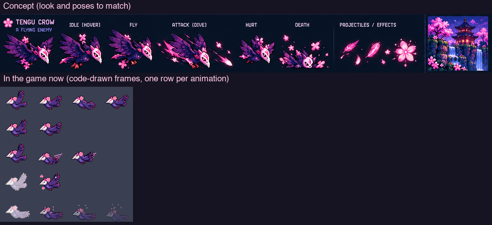

Fast aerial enemy; flies high and dives steeply all the way to the ground as it nears.
A dark crow with a white tengu mask. **Game frame 54×44, hit area 18×14, flying 52 up.** One hit.

| Row | Frames | Speed | Loops | What the frames show |
|---|---|---|---|---|
| IDLE | 6 | 8 fps | yes | Hovering, wings half open |
| FLY | 8 | 14 fps | yes | One full wingbeat; both wings visible (the far one behind) |
| ATTACK | 6 | 12 fps | no | The dive: wings folding (1–2), plunging steeply (3–5), pulling up (6) |
| HURT | 3 | 12 fps | no | Tumbling, mask askew |
| DEATH | 8 | 12 fps | no | Spinning down, bursting into feathers and petals |

### Spirit Will-o'-Wisp (`spirit_wisp`)

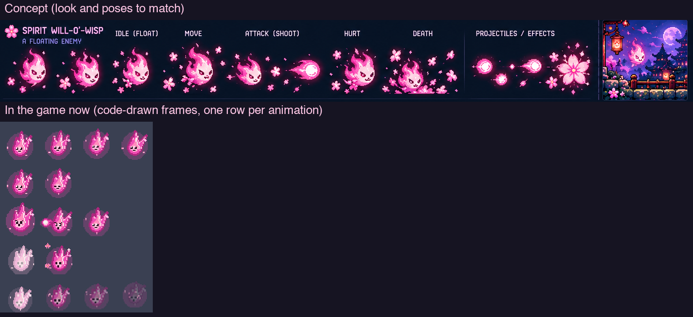

Floating ranged enemy; drifts in over the hero and shoots homing spirit orbs.
A pink flame spirit with a face. **Game frame 38×38, hit area 16×20, floating 36 up.** Two hits.

| Row | Frames | Speed | Loops | What the frames show |
|---|---|---|---|---|
| IDLE | 6 | 8 fps | yes | Flickering in place |
| FLOAT | 8 | 10 fps | yes | Bobbing once, the flame tip waving |
| ATTACK | 6 | 14 fps | no | Swelling (1), **shoots the orb** (2), shrinking back (3–4), settle (5–6) |
| HURT | 3 | 12 fps | no | Guttering, eyes squeezed |
| DEATH | 8 | 12 fps | no | Rising and fading into sparks and petals |
| WISP SHOT | 6 | 12 fps | yes | **Projectile** (game 14×12): a homing pink fireball, tail on the right |

## Before sending, check

- [ ] The background is transparent: the squares disappear on a dark background.
- [ ] One sheet per enemy, the enemy about 3× its game frame, the same size in every frame.
- [ ] **Every row has exactly the frame count in the table** — count them.
- [ ] Enemy facing right, projectiles pointing left; feet on one line, a shadow under flyers.
- [ ] Throwers release on frame 2 of ATTACK; melee strikes in frames 3–4.
- [ ] Looping rows close the loop; DEATH ends on a near-empty frame.
- [ ] Frames don't touch (~30 px apart), and effects stay inside their own frame.

## For the developer cutting the sheets

These counts are higher than today's code-drawn enemies (usually 2–4 frames per row). The game reads
frame counts and fps from `Sprites.json`, and every animation name above is one GameScene already plays,
so no Swift change is needed. Cut them with the hero/boss cutters (`Tools/sprites/sheet_hero.py`,
`sheet_boss.py`) into the existing sprite names and game frame sizes, with `faces_left=True`, and update
the frame counts in `SPEC` (`Tools/sprites/tests/test_sprites.py`) and `docs/sprite-spec.md`.
